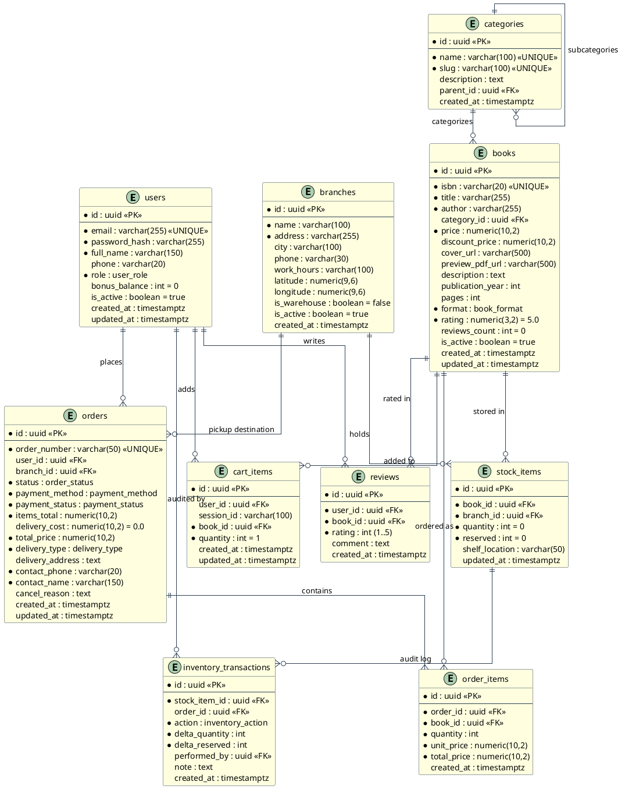
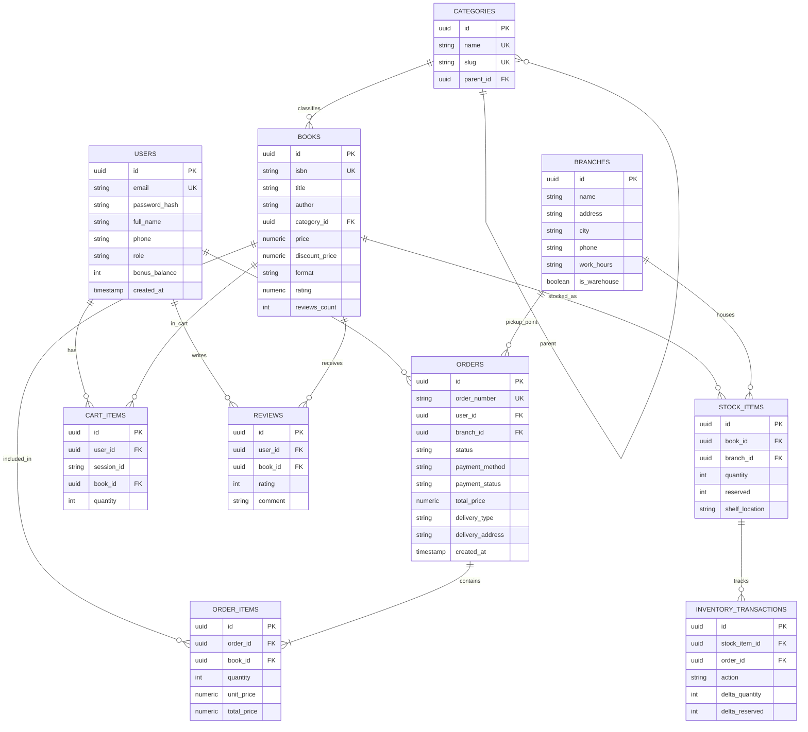

# Лабораторная работа №4

## Стили интеграции программных систем и проектирование API программного комплекса «Litera»

**Дисциплина:** Проектирование человеко-машинных интерфейсов  
**Тема проекта:** Кроссплатформенный книжный онлайн-магазин «Litera» (Web, Mobile, Server)  
**Авторы (группа 12):**  
- Зайдаль Кирилл Андреевич  
- Савицкая Анна-Мария Алексеевна  
**Преподаватель:** Давидовская М. И.  

---

## 1. Введение и цели работы

**Цели лабораторной работы:**
1. Разработать формализованную модель требований и реестр вариантов использования (**Use Cases**) на основе пользовательских историй (**User Stories**) и ролей пользователей (Акторов), сформированных в предыдущих лабораторных работах (ЛР №1–3).
2. Спроектировать физическую модель базы данных под управлением СУБД **PostgreSQL 16+**, включая логическую таблицу сущностей, ограничения целостности, индексы, хранимые процедуры/триггеры и исполняемый DDL-скрипт `Litera/database/schema.sql`.
3. Разработать спецификации диаграмм сущностей и связей (**ERD**) на языках описания диаграмм **PlantUML** и **Mermaid**.
4. Спроектировать архитектуру и маршруты **RESTful API** платформы «Litera» с детальным маппингом сущностей и сценариев использования к HTTP-глаголам, статус-кодам и ролевой модели авторизации (RBAC).
5. Разработать эталонную спецификацию **OpenAPI 3.0** (`Litera/api/openapi.yaml`), содержащую контракты запросов и ответов, схемы валидации DTO, примеры данных и руководство по запуску mock-серверов в Postman, Bruno и Stoplight Prism.
6. Спроектировать и программно реализовать сервер контекстного протокола **Model Context Protocol (MCP)** на языке Python (`Litera/mcp-server/`), обеспечивающий бесшовную интеграцию больших языковых моделей (LLM) с бизнес-логикой онлайн-магазина через инструменты (**Tools**), ресурсы (**Resources**) и промпты (**Prompts**).
7. Разработать контейнеризированную инфраструктуру проекта: многоэтапный `Dockerfile`, файл оркестрации `docker-compose.yml` и конфигурацию пайплайна непрерывной интеграции **GitHub Actions** (`.github/workflows/ci.yml`).

---

## 2. Задание 1. Проектирование модели требований и реестра вариантов использования

### 2.1. Классификация действующих лиц (Акторов системы)

Взаимодействие с системой «Litera» разделено на клиентские, корпоративные и внешние системные роли:

| Актор (Действующее лицо) | Категория | Описание роли и зона ответственности |
|---|---|---|
| **Гость (Guest)** | Пользователь (B2C) | Неавторизованный посетитель витрины. Осуществляет поиск книг, фильтрацию по жанрам и филиалам, чтение ознакомительного фрагмента, добавление товаров в локальную корзину. |
| **Зарегистрированный клиент (Customer)** | Пользователь (B2C) | Авторизованный покупатель. Управляет профилем, историей покупок, оформляет заказы (самовывоз/доставка), совершает онлайн-оплату, накапливает бонусные баллы, отменяет заказы до отгрузки. |
| **Комплектовщик / Менеджер склада (Warehouse Manager)** | Персонал (B2E) | Внутренний корпоративный пользователь. Выполняет адресную сборку оплаченных заказов с использованием терминалов сбора данных (ТСД) по штрихкодам ISBN, контролирует ячейки хранения и остатки. |
| **Контент-менеджер / Администратор (Admin)** | Персонал (B2E) | Управляет номенклатурой каталога, карточками книг, загружает ознакомительные PDF-фрагменты, настраивает филиалы сети и скидочные программы, просматривает финансовый аудит. |
| **Платежный шлюз (Payment Gateway)** | Внешняя система | Сторонняя процессинговая система банка (эквайринг, СБП, 3D-Secure 2.0). Обрабатывает холдирование и списание средств, отправляет вебхуки подтверждения оплаты. |
| **Служба курьерской доставки (Carrier Service)** | Внешняя система | Логистический партнер. Принимает скомплектованные заказы на центральном складе, передает трекинг-номера и координаты курьеров в реальном времени. |

---

### 2.2. Матрица трассировки: Актор $\rightarrow$ User Story $\rightarrow$ Use Case

Ниже представлена сквозная трассировка пользовательских историй (разработанных в ЛР №3) в функциональные варианты использования системы для всех ключевых сценариев:

| Сценарий предметной области | Актор | Идентификатор US | Пользовательская история (User Story) | Идентификатор UC | Вариант использования (Use Case) |
|---|---|---|---|---|---|
| **1. Поиск и подбор книг** | Гость / Клиент | **US-01** | Поиск и интеллектуальная фильтрация в каталоге | **UC-01** | Поиск книг с фасетной фильтрацией и проверкой наличия в филиалах |
| **2. Чтение фрагмента** | Гость / Клиент | **US-02** | Интерактивное чтение ознакомительного фрагмента | **UC-02** | Просмотр ознакомительного фрагмента произведения в защищенном ридере |
| **3. Управление корзиной** | Гость / Клиент | **US-03** | Корзина и кросс-девайсная синхронизация | **UC-03** | Управление корзиной покупок и синхронизация при авторизации |
| **4. Оформление заказа** | Клиент | **US-04** | Выбор варианта доставки и экспресс-чекаут | **UC-04** | Оформление заказа (самовывоз из филиала / курьерская доставка) |
| **5. Онлайн-оплата** | Клиент / Шлюз | **US-04** | Безопасная онлайн-оплата и фискализация чека | **UC-05** | Проведение онлайн-платежа и обработка финансовой транзакции |
| **6. Складская логистика** | Комплектовщик | **US-05** | Сборка заказа комплектовщиком по штрихкоду | **UC-06** | Комплектация заказа по штрихкоду и корректировка складских остатков |
| **7. Отмена и возврат** | Клиент / Саппорт | **US-06** | Отмена заказа покупателем с валидацией доставки | **UC-07** | Отмена заказа с расчетом финансовой компенсации |
| **8. Администрирование** | Администратор | **US-07** | Управление карточками изданий и филиалами | **UC-08** | Модерация каталога, аудит остатков и управление точками сети |

---

### 2.3. Спецификации ключевых вариантов использования (Use Case Specifications)

#### Спецификация UC-01: Поиск книг с фасетной фильтрацией
* **Действующее лицо:** Гость, Зарегистрированный клиент.
* **Предусловие:** Пользователь открыл главную страницу витрины или раздел каталога.
* **Триггер:** Ввод поисковой строки в поле поиска или переключение параметров в панели фильтрации.
* **Основной поток (Happy Path):**
  1. Пользователь вводит поисковый запрос (название, автор или ISBN) либо выбирает категорию («Программирование и IT»).
  2. Пользователь активирует чекбокс «Самовывоз сегодня в ТЦ Галерея» и ограничивает диапазон цены до 70 BYN.
  3. Клиентское приложение отправляет запрос `GET /api/v1/books?q=...&branch_id=...&max_price=...`.
  4. Сервер обращается к полнотекстовому индексу PostgreSQL и таблице `stock_items`, формируя список релевантных позиций с ненулевым доступным остатком в филиале.
  5. Витрина отображает карточки найденных книг с индикацией цен, рейтингов и бейджем «В наличии сегодня».
* **Альтернативные потоки:**
  * *A1 (Опечатка в запросе):* Поисковый сервис применяет триграммный нечеткий поиск (pg_trgm) и возвращает книги с плашкой «Возможно, вы имели в виду: ...».
  * *A2 (Книга отсутствует в выбранном филиале, но есть на центральном складе):* Система предлагает оформить доставку в выбранный магазин к следующему дню.

#### Спецификация UC-02: Чтение ознакомительного фрагмента книги
* **Действующее лицо:** Гость, Зарегистрированный клиент.
* **Предусловие:** Пользователь находится в карточке выбранного издания.
* **Триггер:** Нажатие кнопки «Читать ознакомительный фрагмент».
* **Основной поток:**
  1. Клиентское приложение вызывает конечную точку `GET /api/v1/books/{id}/preview`.
  2. Сервер валидирует наличие ознакомительной версии и возвращает защищенный URL потока страниц и количество ознакомительных страниц (до 24 стр.).
  3. Клиент открывает встроенный оверлей ридера (на мобильном клиенте — полноэкранный ридер с векторным рендерингом).
  4. Пользователь листает страницы, настраивает размер шрифта и тему оформления (светлая/сепия/темная).
  5. По достижении последней ознакомительной страницы ридер отображает экран финализации с кнопкой «Купить полную версию за N BYN» и добавляет книгу в корзину в 1 клик.
* **Альтернативный поток:**
  * *A1 (Фрагмент не загружен издательством):* Кнопка ридера деактивируется, выводится сообщение «Издатель не предоставил ознакомительную версию».

#### Спецификация UC-04: Оформление заказа (Checkout)
* **Действующее лицо:** Зарегистрированный клиент.
* **Предусловие:** В корзине покупателя находится минимум одно издание с ненулевым доступным остатком.
* **Триггер:** Нажатие кнопки «Перейти к оформлению» в корзине.
* **Основной поток:**
  1. Клиент выбирает метод получения: «Курьерская доставка» либо «Самовывоз из филиала сети».
  2. При выборе курьерской доставки клиент указывает точный адрес в г. Минске; при самовывозе — выбирает филиал («ТЦ Галерея»).
  3. Клиент вводит контактные данные (ФИО получателя, номер мобильного телефона).
  4. Система рассчитывает стоимость доставки (0 BYN для самовывоза, 5 BYN для курьерской доставки) и итоговую сумму заказа.
  5. Приложение вызывает `POST /api/v1/orders`.
  6. Сервер в единой транзакции создает запись `orders`, создает `order_items` и переводит необходимое число книг в статус `reserved` в таблице `stock_items` с таймаутом резервирования на 15 минут.
  7. Заказу присваивается уникальный номер `LIT-YYYYMMDD-XXXXX` и статус `PENDING_PAYMENT`.
* **Альтернативные потоки:**
  * *A1 (Товар раскупили в процессе оформления):* Сервер отклоняет запрос с ошибкой `400 Bad Request` и сообщением «Товар Чистый код закончился в выбранном филиале», предлагая переключиться на доставку со склада.

#### Спецификация UC-07: Отмена заказа с валидацией логистической стадии
* **Действующее лицо:** Зарегистрированный клиент, Оператор поддержки.
* **Предусловие:** Заказ ранее создан и находится в системе Litera.
* **Триггер:** Нажатие кнопки «Отменить заказ» в личном кабинете.
* **Основной поток:**
  1. Клиент указывает причину отмены (например, «Изменились планы») и подтверждает действие.
  2. Вызывается конечная точка `POST /api/v1/orders/{id}/cancel`.
  3. Сервер считывает статус заказа. Если статус равен `PENDING_PAYMENT`, `PAID` или `PROCESSING`, отмена разрешается.
  4. Сервер переводит заказ в статус `CANCELLED`, записывает причину отмены и освобождает зарезервированные экземпляры (`reserved = reserved - qty`).
  5. Если заказ был оплачен, инициируется возврат денежных средств через платежный шлюз в полном объеме (100%).
* **Альтернативный поток (Конфликт статуса доставки):**
  * *A1 (Заказ уже отгружен курьеру или вручен):* Заказ находится в статусе `SHIPPED` либо `DELIVERED`. Сервер возвращает статус `409 Conflict` с подробным описанием: «Заказ уже находится в пути или доставлен. Отмена невозможна, воспользуйтесь регламентом возврата товара».

---

## 3. Задание 2. Физическая модель базы данных (PostgreSQL)

### 3.1. Обоснование архитектуры базы данных

Для хранения и обработки данных системы «Litera» выбрана реляционная СУБД **PostgreSQL 16**.
Выбор обусловлен следующими критериями:
1. **Строгие транзакционные гарантии (ACID):** Исключают овербукинг и коллизии списания складских остатков при одновременном оформлении одного и того же бестселлера несколькими покупателями (уровень изоляции `Read Committed` с явными блокировками `SELECT ... FOR UPDATE`).
2. **Встроенный полнотекстовый поиск (FTS):** Поддержка словарей русского и английского языков (`tsvector`, `tsquery`), стемминга и GIN-индексирования исключает необходимость развертывания отдельного кластера Elasticsearch на ранних стадиях проекта.
3. **Строгая типизация с ENUM и CHECK:** Предотвращает появление недопустимых статусов заказов или отрицательных остатков на уровне ядра СУБД.
4. **Хранимые процедуры и триггеры:** Гарантируют непрерывность аудита движений товаров, автоматическое обновление меток времени `updated_at` и расчет агрегированных рейтингов.

---

### 3.2. Логическое описание сущностей реляционной модели

| Имя таблицы | Назначение сущности | Первичный ключ | Внешние ключи (FK) | Ограничения и индексы |
|---|---|---|---|---|
| `users` | Учетные записи покупателей, складского персонала и администраторов | `id (UUID)` | — | `email UNIQUE`, `role IN (user_role)`, `bonus_balance >= 0`. Индекс по email. |
| `categories` | Иерархический рубрикатор книжного каталога | `id (UUID)` | `parent_id -> categories(id)` | `slug UNIQUE`, `name UNIQUE`. Индекс по slug. |
| `books` | Каталожные карточки изданий (печатные и электронные) | `id (UUID)` | `category_id -> categories(id)` | `isbn UNIQUE`, `price >= 0`, `discount_price <= price`, `rating BETWEEN 0 AND 5`. GIN-индекс полнотекстового поиска. |
| `branches` | Физические филиалы, пункты самовывоза и логистические хабы | `id (UUID)` | — | Координаты широты/долготы, признак склада `is_warehouse`. |
| `stock_items` | Адресный учет остатков конкретной книги в разрезе каждого филиала | `id (UUID)` | `book_id -> books(id)`, `branch_id -> branches(id)` | `UNIQUE(book_id, branch_id)`, `quantity >= 0`, `reserved <= quantity`. Индекс по остаткам. |
| `orders` | Заголовки заказов покупателей | `id (UUID)` | `user_id -> users(id)`, `branch_id -> branches(id)` | `order_number UNIQUE`, статусы заказа и платежа. Индексы по user_id, status, created_at. |
| `order_items` | Состав заказа (детализированные строки позиций) | `id (UUID)` | `order_id -> orders(id)`, `book_id -> books(id)` | `quantity > 0`, `unit_price >= 0`. Индекс по order_id. |
| `cart_items` | Корзины покупателей (с поддержкой гостевых сессий и аккаунтов) | `id (UUID)` | `user_id -> users(id)`, `book_id -> books(id)` | `CHECK(user_id IS NOT NULL OR session_id IS NOT NULL)`, частичные уникальные индексы `idx_cart_user_book` и `idx_cart_session_book`. |
| `reviews` | Пользовательские отзывы и оценки изданий | `id (UUID)` | `user_id -> users(id)`, `book_id -> books(id)` | `rating BETWEEN 1 AND 5`, `UNIQUE(user_id, book_id)`. Индекс по book_id. |
| `inventory_transactions` | Журнал аудита складских движений и инвентаризаций | `id (UUID)` | `stock_item_id -> stock_items(id)`, `performed_by -> users(id)` | Фиксация дельты остатков, причины списания/оприходования. |

---

### 3.3. Диаграмма сущностей и связей (ERD на языке PlantUML)

<details open markdown="1">
<summary>Исходный код PlantUML (ERD PostgreSQL)</summary>


</details>

---

### 3.4. Диаграмма сущностей и связей (ERD на языке Mermaid)



---

### 3.5. Реализация DDL-скрипта базы данных

Полный DDL-скрипт схемы размещен в репозитории по пути `Litera/database/schema.sql` (423 строки чистого SQL).
Скрипт содержит:
- Подключение криптографических расширений `uuid-ossp` и `pgcrypto`.
- 7 перечислений (ENUM): `user_role`, `order_status`, `payment_status`, `payment_method`, `delivery_type`, `book_format`, `inventory_action`.
- 10 взаимосвязанных таблиц с проверками `CHECK` и ограничениями внешних ключей `ON DELETE CASCADE / SET NULL / RESTRICT`.
- Высокоскоростные B-Tree индексы на идентификаторы, статусы и метки времени.
- Полнотекстовый GIN-индекс с русским стеммингом для быстрого поиска по названиям и авторам:
  ```sql
  CREATE INDEX idx_books_fts ON books USING gin (
      to_tsvector('russian', coalesce(title, '') || ' ' || coalesce(author, '') || ' ' || coalesce(description, ''))
  );
  ```
- Триггеры автоматизации:
  1. `fn_update_timestamp`: актуализация `updated_at` при каждом обновлении записей.
  2. `fn_generate_order_number`: генерация номера заказа вида `LIT-YYYYMMDD-XXXXX`.
  3. `fn_recalculate_book_rating`: автоматический пересчет рейтинга `rating` и количества рецензий `reviews_count` в карточке книги при добавлении или удалении отзыва.
- Демонстрационный набор данных (Seed Data): категории, тестовые пользователи разных ролей, номенклатура из 5 книг, складские остатки по 3 филиалам Минска и демонстрационные заказы.

---

## 4. Задание 3. Проектирование маршрутов и конечных точек REST API

### 4.1. Принципы проектирования RESTful API в проекте Litera

При проектировании архитектуры REST API соблюдены фундаментальные ограничения стиля REST:
1. **Клиент-серверная архитектура (Client-Server):** Полное разделение интерфейса пользователя (React Web SPA, React Native Mobile) и серверного домена хранения данных.
2. **Отсутствие состояния (Statelessness):** Каждый запрос несет полный контекст авторизации в виде Bearer JWT-токена в заголовке `Authorization`. Сервер не хранит серверные сессии в оперативной памяти.
3. **Кэшируемость (Cacheable):** Ответы на запросы чтения каталога (`/books`, `/categories`, `/branches`) снабжаются заголовками `Cache-Control: public, max-age=300` и `ETag` для сокращения избыточного трафика.
4. **Единообразие интерфейса (Uniform Interface):**
   - Имена ресурсов выражены существительными во множественном числе (`/books`, `/orders`, `/branches`).
   - Иерархия подресурсов отражает естественную связанность (`/books/{id}/preview`, `/cart/items/{id}`).
   - Стандартные HTTP-глаголы используются строго по назначению:
     - `GET`: Безопасное получение ресурса (идемпотентно).
     - `POST`: Создание нового подчиненного ресурса или запуск действия.
     - `PUT`: Полная замена существующего ресурса (идемпотентно).
     - `PATCH`: Частичное изменение отдельных полей (например, количества в корзине или статуса заказа).
     - `DELETE`: Удаление ресурса (идемпотентно).

---

### 4.2. Сводная таблица маппинга сущностей и Use Cases к конечным точкам API

| Модуль системы | Метод | Маршрут (URI) | Use Case | Уровень доступа | Описание операции |
|---|---|---|---|---|---|
| **Auth** | `POST` | `/api/v1/auth/register` | Регистрация | Public | Создание аккаунта нового покупателя |
| **Auth** | `POST` | `/api/v1/auth/login` | Вход | Public | Аутентификация по email/паролю, выдача пары токенов (Access + Refresh) |
| **Auth** | `POST` | `/api/v1/auth/refresh` | Обновление | Public | Ротация JWT access токена по валидному refresh токену |
| **Auth** | `GET` | `/api/v1/auth/me` | Профиль | Bearer (Customer) | Получение профиля, роли и баланса бонусов текущего пользователя |
| **Catalog** | `GET` | `/api/v1/books` | **UC-01** | Public | Полнотекстовый поиск, фильтрация по жанрам, филиалам и диапазону цен |
| **Catalog** | `GET` | `/api/v1/books/{id}` | **UC-01** | Public | Детальная карточка издания с остатками по филиалам |
| **Catalog** | `GET` | `/api/v1/books/{id}/preview` | **UC-02** | Public | Метаданные и защищенный поток для веб-ридера ознакомительного фрагмента |
| **Catalog** | `POST` | `/api/v1/books` | **UC-08** | Bearer (Admin) | Добавление новой книги в ассортимент |
| **Catalog** | `PUT` | `/api/v1/books/{id}` | **UC-08** | Bearer (Admin) | Полное обновление карточки книги |
| **Catalog** | `DELETE`| `/api/v1/books/{id}` | **UC-08** | Bearer (Admin) | Мягкое или жесткое удаление книги из каталога |
| **Catalog** | `GET` | `/api/v1/categories` | **UC-01** | Public | Дерево тематических рубрик и жанров |
| **Cart** | `GET` | `/api/v1/cart` | **UC-03** | Public / Bearer | Получение состава корзины, расчет скидок и итоговой суммы |
| **Cart** | `POST` | `/api/v1/cart/items` | **UC-03** | Public / Bearer | Добавление экземпляра книги в корзину с валидацией остатков |
| **Cart** | `PATCH`| `/api/v1/cart/items/{id}` | **UC-03** | Public / Bearer | Изменение количества экземпляров позиции |
| **Cart** | `DELETE`| `/api/v1/cart/items/{id}` | **UC-03** | Public / Bearer | Удаление товарной строки из корзины |
| **Cart** | `POST` | `/api/v1/cart/sync` | **UC-03** | Bearer (Customer) | Слияние гостевой корзины (`session_id`) с корзиной аккаунта при входе |
| **Orders** | `GET` | `/api/v1/orders` | История | Bearer (Customer) | Постраничный реестр заказов авторизованного покупателя |
| **Orders** | `POST` | `/api/v1/orders` | **UC-04** | Bearer (Customer) | Оформление заказа (чекаут), резервирование книг на складе на 15 мин |
| **Orders** | `GET` | `/api/v1/orders/{id}` | Трекинг | Bearer (Customer) | Детальная информация, состав и трекинг исполнения заказа |
| **Orders** | `POST` | `/api/v1/orders/{id}/cancel` | **UC-07** | Bearer (Customer) | Отмена заказа (разрешена до стадии SHIPPED) с возвратом остатков |
| **Orders** | `POST` | `/api/v1/orders/{id}/pay` | **UC-05** | Bearer (Customer) | Формирование сессии оплаты через банковский шлюз (3DS 2.0 / СБП) |
| **Orders** | `PATCH`| `/api/v1/orders/{id}/status` | **UC-06** | Bearer (Warehouse) | Смена логистического статуса (`PACKED`, `SHIPPED`, `DELIVERED`) |
| **Warehouse** | `GET` | `/api/v1/inventory` | Склад | Bearer (Warehouse) | Мониторинг складских балансов по точкам сети и дефицитным позициям |
| **Warehouse** | `GET` | `/api/v1/inventory/{book_id}`| Наличие | Public / Bearer | Проверка наличия книги во всех филиалах сети |
| **Warehouse** | `POST` | `/api/v1/inventory/adjust` | **UC-06** | Bearer (Warehouse) | Оприходование, инвентаризация и корректировка остатков с аудит-логом |
| **Branches** | `GET` | `/api/v1/branches` | Точки | Public | Список адресов магазинов, графиков работы и координат для самовывоза |
| **Branches** | `GET` | `/api/v1/branches/{id}` | Филиал | Public | Подробная информация об отдельном пункте выдачи заказов |

---

### 4.3. Стандартизация статус-кодов и единый формат ошибок (RFC 7807)

Взаимодействие с API регламентировано унифицированными кодами ответа HTTP:
* `200 OK`: Успешное выполнение запроса на чтение или модификацию.
* `201 Created`: Успешное создание ресурса (создание пользователя, книги, оформление заказа).
* `204 No Content`: Успешная операция без тела ответа (удаление позиции).
* `400 Bad Request`: Синтаксическая ошибка параметров запроса либо нарушение валидации DTO.
* `401 Unauthorized`: Отсутствует или просрочен JWT-токен доступа.
* `403 Forbidden`: Недостаточно привилегий для доступа к эндпоинту (например, попытка покупателя вызвать складскую инвентаризацию).
* `404 Not Found`: Запрашиваемая сущность не найдена по указанному UUID/номеру.
* `409 Conflict`: Нарушение бизнес-правил жизненного цикла (например, попытка отменить заказ, который уже отгружен курьеру `SHIPPED`).
* `422 Unprocessable Entity`: Семантическая ошибка входных данных (например, отрицательное количество книг).
* `500 Internal Server Error`: Непредвиденный сбой сервера.

#### Формат ответа об ошибке (Problem Details)
Все ошибочные ответы возвращаются в стандартизированном JSON-формате:

```json
{
  "status": 409,
  "error": "ORDER_CANCELLATION_CONFLICT",
  "message": "Невозможно отменить заказ LIT-20261012-10002 в статусе 'DELIVERED'. Заказ уже вручен клиенту.",
  "timestamp": "2026-10-14T00:10:00Z",
  "details": [
    {
      "field": "status",
      "issue": "Текущий статус 'DELIVERED' не входит в перечень отменяемых (PENDING_PAYMENT, PAID, PROCESSING)"
    }
  ]
}
```

---

## 5. Задание 4. Спецификация OpenAPI 3.0 и руководство по Mock-тестированию

### 5.1. Структура спецификации OpenAPI (`Litera/api/openapi.yaml`)

Спецификация OpenAPI 3.0.3 спроектирована в формате YAML и расположена в репозитории по пути `Litera/api/openapi.yaml`.
Характеристики спецификации:
* **22 конечные точки (Endpoints)**, сгруппированные по 7 тегам предметной области (`Authentication`, `Books & Catalog`, `Categories`, `Cart`, `Orders`, `Inventory & Warehouse`, `Branches`).
* **33 схемы данных компонентов (Schemas)**:
  * Перечисления бизнес-домена (`UserRole`, `OrderStatus`, `PaymentMethod`, `PaymentStatus`, `DeliveryType`, `BookFormat`).
  * Контракты запросов (`UserRegisterRequest`, `UserLoginRequest`, `BookCreateRequest`, `CartItemRequest`, `OrderCreateRequest`, `OrderCancelRequest`, `InventoryAdjustRequest`).
  * Контракты ответов (`AuthResponse`, `TokenResponse`, `Book`, `BookDetail`, `BookListResponse`, `BookPreviewResponse`, `CartResponse`, `Order`, `OrderListResponse`, `PaymentSessionResponse`, `StockItem`, `Branch`, `ErrorResponse`).
* Схемы безопасности: `BearerAuth` (JWT в заголовке `Authorization`) и `ApiKeyAuth` (заголовок `X-API-Key`).
* Для каждого эндпоинта предоставлены реалистичные примеры полезной нагрузки (`examples`) с белорусскими ценами в BYN, минскими адресами и корректными UUID.

---

### 5.2. Инструкции по мокированию и тестированию через Postman, Bruno и SwaggerHub

#### Вариант 1: Локальный запуск Mock-сервера через Prism CLI (Рекомендуемый)
Инструмент **Stoplight Prism** поднимает полноценный HTTP mock-сервер напрямую из спецификации OpenAPI, автоматически валидируя запросы и генерируя ответы на основе `examples`:

```bash
# Установка и запуск Prism CLI
npx @stoplight/prism-cli mock Litera/api/openapi.yaml -p 8000
```
После запуска mock-сервер доступен по адресу `http://localhost:8000/api/v1`:
```bash
# Тестовый запрос поиска книг
curl -X GET "http://localhost:8000/api/v1/books?q=чистый%20код" -H "Accept: application/json"

# Тестовый запрос информации о корзине
curl -X GET "http://localhost:8000/api/v1/cart" -H "Accept: application/json"
```

#### Вариант 2: Импорт и мокирование в Postman
1. Откройте **Postman** $\rightarrow$ нажмите кнопку **Import** в левом верхнем углу.
2. Перетащите файл `Litera/api/openapi.yaml` или укажите путь к нему.
3. Выберите опцию **Import as API with a Collection**. Postman автоматически сгенерирует коллекцию из 22 запросов.
4. В контекстном меню сгенерированной коллекции выберите **Mock collection**.
5. Задайте имя мок-сервера (например, `Litera Local Mock`) и нажмите **Create Mock Server**.
6. Postman сгенерирует персональный Mock URL вида `https://<mock-id>.mock.pstmn.io/api/v1`. Все запросы к нему будут возвращать ответы, описанные в спецификации.

#### Вариант 3: Импорт в Bruno (Open-Source API Client)
1. Откройте **Bruno** $\rightarrow$ выберите пункт меню **Import Collection**.
2. Выберите тип импорта **OpenAPI 3.0** и укажите файл `Litera/api/openapi.yaml`.
3. Создайте среду окружения (Environment) `local` с переменной `baseUrl = http://localhost:8000/api/v1`.
4. Запустите mock-сервер Prism (либо Docker-контейнер) и отправляйте запросы через интерфейс Bruno.

#### Вариант 4: Визуализация и Mock в SwaggerHub / Swagger UI
1. Перейдите на портал [SwaggerHub](https://app.swaggerhub.com/) $\rightarrow$ **Create New API** $\rightarrow$ **Import and Document API** $\rightarrow$ загрузите `openapi.yaml`.
2. Включите встроенный тумблер **Auto Mocking**. SwaggerHub предоставит интерактивный публичный адрес для тестирования.
3. Либо запустите контейнер Swagger UI из `docker-compose.yml` и откройте интерактивную документацию в браузере по адресу `http://localhost:8080`.

---

## 6. Задание 5. Проектирование и программная реализация MCP-сервера

### 6.1. Архитектура Model Context Protocol (MCP) в инфраструктуре «Litera»

**Model Context Protocol (MCP)** — открытый стандарт межпрограммного взаимодействия, предложенный компанией Anthropic в конце 2024 года. Протокол стандартизирует способ, с помощью которого большие языковые модели (LLM) безопасно подключаются к внешним источникам данных и исполняемым бизнес-инструментам.

В архитектуре «Litera» MCP-сервер решает ключевую задачу: **превращает LLM в интеллектуального персонального консультанта и логистического ассистента интернет-магазина**. Пользователь в веб- или мобильном чате может написать:
> *«Посоветуй две лучшие книги по архитектуре микросервисов до 100 рублей и проверь, могу ли я забрать их сегодня в ТЦ Галерея»*.

LLM не фантазирует, а последовательно вызывает зарегистрированные MCP-инструменты:
1. `search_books(category='it-and-programming', max_price=100)`
2. `check_inventory(book_id='...', branch_id='ТЦ Галерея')`
3. Получает строгие данные и формирует аргументированный ответ, предлагая создать заказ через `create_order`.

---

### 6.2. Спецификация компонентов MCP-сервера

Сервер реализован в каталоге `Litera/mcp-server/` и поддерживает версию протокола **2024-11-05** через стандартный поток ввода/вывода (**stdio JSON-RPC 2.0**).

#### 1. Реализованные инструменты (Tools)
* `search_books`:
  * *Входные аргументы:* `query` (строка), `category` (рубрика), `max_price` (цена в BYN), `limit` (число результатов).
  * *Логика:* Выполняет параметризованный поиск по названию, автору, ISBN и аннотации с сортировкой по рейтингу.
* `check_inventory`:
  * *Входные аргументы:* `book_id` (UUID или ISBN книги), `branch_id` (опциональный фильтр по филиалу).
  * *Логика:* Возвращает общий доступный остаток и разбивку по физическим магазинам с указанием ячеек хранения (`shelf_location`).
* `create_order`:
  * *Входные аргументы:* `user_id`, `items`, `delivery_type` (`COURIER`, `PICKUP_BRANCH`, `POSTAL_SERVICE`), `delivery_address`, `branch_id`, `contact_phone`, `contact_name`.
  * *Логика:* Проверяет наличие каждого издания. Если остатков достаточно, в атомарной транзакции увеличивает счетчик `reserved`, рассчитывает стоимость доставки и создает заказ со статусом `PENDING_PAYMENT`.
* `cancel_order`:
  * *Входные аргументы:* `order_id` (UUID или номер заказа), `reason` (причина).
  * *Логика валидации:* Если заказ находится в статусе `SHIPPED` (передан курьеру) или `DELIVERED` (вручен), выбрасывается исключение `OrderCancellationError` с возвратом `isError: true` и рекомендацией перейти к регламенту возвратов. В допустимых статусах заказ переводится в `CANCELLED`, а зарезервированные книги немедленно возвращаются в свободный остаток.

#### 2. Реализованные ресурсы (Resources)
* `books://catalog`: Полный каталог активных изданий магазина в формате JSON с ценами и совокупными остатками.
* `orders://recent`: Оперативная лента последних 10 заказов для мониторинга складской активности.
* `orders://user/{id}/history` (Шаблон URI): Персональная история покупок конкретного клиента с детализацией состава каждого чека.

#### 3. Реализованные системные промпты (Prompts)
* `order_assistance`: Системный промпт консультанта книжного магазина Litera. Принимает литературные интересы клиента, подтягивает релевантные книги из хранилища и формирует структурированное руководство для LLM по общению с покупателем.
* `refund_calculation`: Промпт для службы поддержки и расчета финансовой компенсации при возврате. Автоматически рассчитывает удерживаемую стоимость доставки в зависимости от стадии заказа и регламентные сроки межбанковского перечисления.

---

### 6.3. Верификация и тестирование MCP-сервера

Тестовый набор `Litera/mcp-server/test_mcp.py` содержит **37 комплексных модульных тестов** на базе стандартной библиотеки `unittest`.

Результаты прогона тестового набора:
```
Ran 37 tests in 0.012s
OK
```
Покрытые тестовые сценарии:
* Полнотекстовый и параметризованный поиск книг по названию, автору, категории, фильтрация по максимальной цене.
* **Регистронезависимый поиск для кириллицы (Unicode Cyrillic collation)**: корректный поиск при вводе запросов в нижнем регистре («чистый», «роберт мартин», «оруэлл»).
* Проверка наличия по корректным, несуществующим и неформатированным идентификаторам (толерантность к дефисам в ISBN: `9785446109234` и `978-5-4461-0923-4`).
* Создание заказа курьером (+5 BYN), почтой (+4 BYN) и самовывозом (+0 BYN).
* Валидация ошибок: превышение доступного остатка (`InventoryError`), доставка без адреса, самовывоз без указания филиала.
* Отмена заказов на допустимых стадиях (`PROCESSING`) с **изолированным возвратом зарезервированных книг строго для целевого филиала** (исключение коллизий пересчета на мультифилиальных складах).
* Защита от отмены доставленных заказов (`DELIVERED`) с генерацией ошибки бизнес-конфликта.
* Корректность чтения всех ресурсов (`books://catalog`, `orders://recent`, динамический шаблон истории покупок `orders://user/{id}/history` с поддержкой percent-encoded URI `@` $\rightarrow$ `%40`).
* Генерация промптов `order_assistance` (с динамической фильтрацией каталога по бюджету) и `refund_calculation`.
* Полноценное рукопожатие JSON-RPC 2.0 (`initialize`, `notifications/initialized`, `ping`, `tools/list`, `tools/call`, `resources/read`, обработка неизвестных методов `-32601`, защита от `None` аргументов).

Инструкции по подключению к **Claude Desktop**, **Cursor** и интерактивному **MCP Inspector** (`npx @modelcontextprotocol/inspector python3 server.py`) задокументированы в файле `Litera/mcp-server/README.md`.

---

## 7. Задание 6. Инфраструктура проекта и непрерывная интеграция (CI)

### 7.1. Многоэтапный Dockerfile (`Litera/Dockerfile`)

Для обеспечения воспроизводимости и минимального размера контейнера реализован двухэтапный Dockerfile на базе легковесного дистрибутива `python:3.11-slim`:
* **Этап сборки (Builder):** Устанавливает сборочные утилиты и компилирует бинарные зависимости в изолированный префикс `/install`.
* **Этап исполнения (Runtime):**
  * Создает непривилегированного системного пользователя `appuser` (UID 1000) для соответствия требованиям безопасности контейнеров.
  * Копирует только собранные пакеты и исходный код приложения.
   * Настраивает системный `HEALTHCHECK`, проверяющий работоспособность среды выполнения Python и инициализацию хранилища MCP.
   * Конфигурирует окружение `PYTHONPATH=/app:/app/mcp-server`.
   * Запускает приложение от имени `appuser`.

---

### 7.2. Файл оркестрации Docker Compose (`Litera/docker-compose.yml`)

Стек `docker-compose.yml` разворачивает полноценное локальное окружение одной командой:
```bash
docker compose up -d
```
Стек объединяет 5 сервисов в общей изолированной сети `litera_network`:
1. `db`: Кластер PostgreSQL 16 Alpine с постоянным томом `litera_pgdata` и автомонтированием DDL-скрипта `schema.sql` в директорию автоинициализации `/docker-entrypoint-initdb.d/`.
2. `cache`: Сервер Redis 7 Alpine для кэширования сессий и поисковых запросов.
3. `api-mock`: Mock-сервер Stoplight Prism на порту 8000, отдающий синтетические ответы по спецификации `api/openapi.yaml`.
4. `swagger-ui`: Интерактивный веб-интерфейс Swagger UI на порту 8080 для визуального тестирования REST API.
5. `mcp-server`: Контейнер сервера Model Context Protocol, подключенный к базе данных и кэшу.

---

### 7.3. Пайплайн непрерывной интеграции GitHub Actions (`.github/workflows/ci.yml`)

Конфигурация CI-пайплайна автоматически валидирует качество кодовой базы при каждом push и pull request в ветки `main` и `develop`:
1. **validate-openapi:**
   - Устанавливает Redocly CLI и выполняет строгий линтинг файла `api/openapi.yaml` на соответствие стандартам OpenAPI 3.0.
   - Проверяет корректность синтаксиса через парсер Python PyYAML.
2. **validate-database:**
   - Поднимает изолированный сервисный контейнер PostgreSQL 16 Alpine с проверкой `pg_isready`.
   - Выполняет весь DDL-скрипт `database/schema.sql`, проверяя создание таблиц, индексов, триггеров и вставку seed-данных.
3. **test-mcp-server:**
   - Запускает матричное тестирование на 4 версиях интерпретатора: Python 3.9, 3.10, 3.11 и 3.12.
   - Проверяет чистоту кода линтерами `ruff` и `flake8`.
   - Выполняет полный расширенный набор из 37 тестов `test_mcp.py`.
4. **docker-build:**
   - Валидирует конфигурацию `docker compose config`.
   - Выполняет тестовую сборку Docker-образа приложения.

---

## 8. Заключение

В ходе выполнения лабораторной работы №4 были полностью решены все поставленные задачи:
1. **Спроектирована модель требований и реестр вариантов использования (Use Cases):** Проведена сквозная трассировка от действующих лиц (Акторов) и пользовательских историй к детальным прецедентам с описанием основных и альтернативных потоков.
2. **Спроектирована физическая модель базы данных PostgreSQL:** Разработана детальная логическая спецификация сущностей, построены диаграммы связей ERD на PlantUML и Mermaid, и написан полностью рабочий DDL-скрипт `schema.sql` с индексами, ограничениями целостности и триггерами.
3. **Спроектированы маршруты REST API:** Выполнено сопоставление сущностей и прецедентов к HTTP-методам, стандартизированы статус-коды и формат сообщений об ошибках по стандарту RFC 7807.
4. **Разработана спецификация OpenAPI 3.0:** Сформирован YAML-документ с полными контрактами DTO, примерами и инструкциями по развертыванию mock-серверов в Postman, Bruno и Prism.
5. **Создан и протестирован сервер Model Context Protocol (MCP):** Разработаны инструменты поиска, складской инвентаризации, создания и контролируемой отмены заказов, ресурсы каталога и системные промпты для LLM. Работоспособность подтверждена 37 модульными тестами.
6. **Настроена инфраструктура проекта:** Разработан многоэтапный Dockerfile, конфигурация Docker Compose для развертывания полного стека и GitHub Actions CI workflow для автоматического контроля качества.

### Вклад авторов в выполнение работы:
- **Зайдаль Кирилл Андреевич:** Проектирование физической модели базы данных PostgreSQL, написание DDL-скрипта `schema.sql` с триггерами и индексами, построение диаграмм ERD (PlantUML, Mermaid), программная реализация MCP-сервера (хранилище, инструменты, ресурсы, промпты, JSON-RPC транспорт), разработка тестового набора `test_mcp.py`, проектирование `Dockerfile` и `docker-compose.yml`, интеграционная сборка проекта, релизный деплой и публикация артефактов в репозиторий GitHub.
- **Савицкая Анна-Мария Алексеевна:** Разработка модели требований и реестра вариантов использования (трассировка Actor $\rightarrow$ US $\rightarrow$ UC), спецификация REST API маршрутов и кодов ответов, составление спецификации OpenAPI 3.0 (`openapi.yaml`), разработка руководства по mock-тестированию в Postman/Bruno, проектирование и настройка сценариев непрерывной интеграции (CI-пайплайн GitHub Actions).
