# Лабораторная работа №5

## Проектирование интерактивного прототипа, визуального языка и руководства по стилям кроссплатформенного книжного магазина «Litera»

**Дисциплина:** Проектирование человеко-машинных интерфейсов  
**Тема проекта:** Кроссплатформенный книжный онлайн-магазин «Litera» (Web, Mobile, Server)  
**Авторы (группа 12):**  
- Зайдаль Кирилл Андреевич  
- Савицкая Анна-Мария Алексеевна  
**Преподаватель:** Давидовская М. И.  

---

## 1. Введение и цели лабораторной работы

**Название работы:** Проектирование интерактивного прототипа, исследование визуального языка продукта методом семантического дифференциала и разработка комплексного руководства по стилям (Style Guide / UI Kit) для системы «Litera».

### Цели работы:
1. **Исследование визуального языка продукта (Задание 1):**
   * Разработать исследовательскую модель семантического дифференциала Чарльза Осгуда на основе 15 пар полярных прилагательных-антонимов, структурированных по трехфакторной модели восприятия (EPA: *Evaluation* — Оценка, *Potency* — Сила, *Activity* — Активность).
   * Спроектировать три контрастных концептуальных варианта цветового решения витрины («Academic Oxford», «Nordic Slate & Mint», «Vintage Terracotta»).
   * Провести очное пользовательское тестирование выборки из 10 респондентов с математико-статистической обработкой сырых данных (расчет средних арифметических $\bar{x}$, среднеквадратических отклонений $\sigma$, интегральных факторов EPA и евклидова расстояния до эталона $D$).
   * Построить графические семантические профили и радарные диаграммы, выполнив научное обоснование победы целевого цветового решения.
2. **Проектирование модульных сеток и адаптивных макетов (Задание 2):**
   * Рассчитать математические параметры адаптивной 12-колоночной сетки на базе 8-пиксельного вертикального ритма (8pt Spatial System) для ширины контейнера 1440px.
   * Разработать спецификации архитектурной трансформации интерфейса для 6 ключевых адаптивных диапазонов (1440px, 992–1199px, 768–991px, 576–767px, 400–575px, 320–399px).
   * Сформировать матрицу компоновки под 5 категорий физических устройств с учетом эргономики зон досягаемости (Thumb Zone), безопасных зон (Safe Area Insets) и вырезов (Dynamic Island / Notch).
   * Реализовать полнофункциональный интерактивный прототип ключевого пользовательского сценария (каталог, живая фильтрация, карточка товара, чтение фрагмента, корзина, пошаговый чекаут, трекинг заказа).
3. **Разработка руководства по стилям и UI Kit (Задание 3):**
   * Сформировать полную палитру Design Tokens с верификацией коэффициентов контрастности стандарта доступности WCAG 2.1 (AA / AAA).
   * Спроектировать трехуровневую типографическую систему со шкалой размеров, интерлиньяжа и трекинга.
   * Разработать библиотеку базовых компонентов (кнопки во всех состояниях, поля ввода, селекторы, степперы, бейджи, организмы карточек книг) и правила компоновки.

---

## 2. Задание 1. Исследование визуального языка продукта методом семантического дифференциала

### 2.1. Теоретические основы и трехфакторная модель Ч. Осгуда

Метод семантического дифференциала (Semantic Differential), предложенный Чарльзом Осгудом в 1957 году, применяется в проектировании человеко-машинных интерфейсов для количественного измерения коннотативного (эмоционально-смыслового) восприятия визуального облика программного продукта. 

В соответствии с классической психосемантической моделью, пространство восприятия интерфейса декомпозируется на три ортогональных базисных фактора (**EPA**):
1. **Оценка (Evaluation, E):** определяет степень эстетической привлекательности, субъективного доверия, надежности и гармонии цифрового сервиса.
2. **Сила (Potency, P):** отражает фундаментальность, академичность, устойчивость, монументальность и авторитет бренда.
3. **Активность (Activity, A):** характеризует динамизм, технологическую современность, гибкость и скорость взаимодействия.

Для проведения эксперимента была сформирована матрица из **15 биполярных пар прилагательных-антонимов** (по 5 шкал на каждый фактор), градуированных по 5-балльной шкале Лайкерта (от 1 — максимальное проявление отрицательного полюса, до 5 — максимальное проявление положительного полюса; значение 3.0 соответствует нейтральному восприятию).

| № | Левый полюс (Позитив: 5 баллов) | Правый полюс (Негатив: 1 балл) | Фактор EPA | Интерпретация в контексте книжного ритейла |
|:---:|:---|:---|:---:|:---|
| **1** | Привлекательный | Отталкивающий | **E** | Первое визуальное впечатление и эстетика витрины |
| **2** | Качественный | Низкопробный | **E** | Ощущение уровня полиграфии, верстки и типографики |
| **3** | Надежный | Сомнительный | **E** | Доверие к безопасности платежей и сохранности данных |
| **4** | Гармоничный | Хаотичный | **E** | Сбалансированность композиции, отступов и цветов |
| **5** | Понятный | Запутанный | **E** | Когнитивная простота навигации и логики поиска |
| **6** | Солидный | Легкомысленный | **P** | Статусность платформы как серьезного книжного дома |
| **7** | Академичный | Дилетантский | **P** | Экспертность каталога, полнота библиографических данных |
| **8** | Глубокий | Поверхностный | **P** | Интеллектуальная насыщенность контента и рецензий |
| **9** | Монументальный | Хрупкий | **P** | Ощущение стабильности и долговечности сервиса |
| **10** | Убедительный | Неубедительный | **P** | Способность интерфейса аргументировать ценность покупки |
| **11** | Современный | Устаревший | **A** | Соответствие актуальным UI/UX паттернам 2026 года |
| **12** | Динамичный | Статичный | **A** | Отзывчивость анимаций, микроинтеракций и переходов |
| **13** | Инновационный | Консервативный | **A** | Внедрение передовых технологий (ридер, умный поиск, MCP) |
| **14** | Вдохновляющий | Скучный | **A** | Эмоциональное побуждение к чтению и открытию новых книг |
| **15** | Гибкий | Неповоротливый | **A** | Скорость адаптации под фильтры и сценарии пользователя |

---

### 2.2. Разработка концептуальных вариантов цветового решения

Для экспериментального тестирования были спроектированы три альтернативных цветовых схемы для ключевого экрана каталога и карточки издания:

1. **Палитра А («Academic Oxford» — Академический благородный):**
   * *Основной тон (Primary):* Глубокий сапфирово-синий Oxford Navy (`#0F172A`, `#1E293B`).
   * *Акцентный тон (Secondary / CTA):* Теплый античный янтарь и золото (`#D97706`, `#F59E0B`).
   * *Фоновое пространство (Surface / Canvas):* Мягкий оттенок слоновой кости и чистый белый (`#F8FAFC`, `#FFFFFF`).
   * *Семантическая концепция:* Престиж классических университетских библиотек Оксфорда и Кембриджа в сочетании с цифровой функциональностью.
2. **Палитра Б («Nordic Slate & Mint» — Скандинавский технологичный минимализм):**
   * *Основной тон (Primary):* Холодный графит и мокрый асфальт (`#18181B`, `#27272A`).
   * *Акцентный тон (Secondary / CTA):* Свежий бирюзово-мятный тил (`#0D9488`, `#14B8A6`).
   * *Фоновое пространство (Surface / Canvas):* Нейтральный ледяной серый (`#F4F4F5`, `#FFFFFF`).
   * *Семантическая концепция:* Высокотехнологичный digital-продукт, ориентированный на IT-литературу и строгий швейцарский стиль.
3. **Палитра В («Vintage Terracotta & Kraft» — Уютная букинистическая гостиная):**
   * *Основной тон (Primary):* Темный кофейно-шоколадный (`#431407`, `#78350F`).
   * *Акцентный тон (Secondary / CTA):* Теплый терракотово-кирпичный (`#9A3412`, `#C2410C`).
   * *Фоновое пространство (Surface / Canvas):* Теплый состаренный крафт и слоновая кость (`#FFFBEB`, `#FEF3C7`).
   * *Семантическая концепция:* Камерная атмосфера антикварной книжной лавки с ароматом старинной бумаги и кофе.

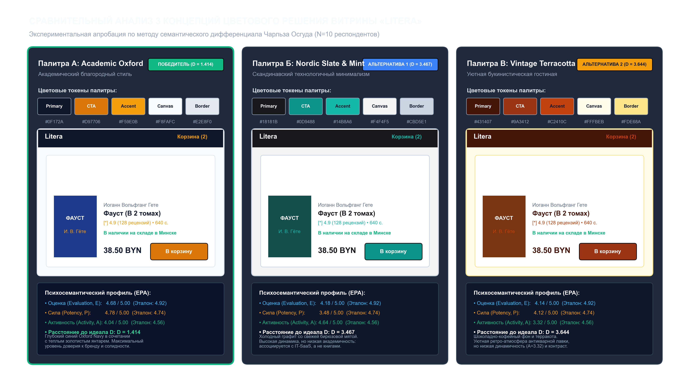  
*Рисунок 1. Сравнительный анализ трех вариантов цветового решения витрины («Academic Oxford», «Nordic Slate & Mint», «Vintage Terracotta») с карточками изданий, палитрами токенов и психосемантическими метриками EPA*

---

### 2.3. Результаты пользовательского тестирования выборки респондентов

В тестировании приняли участие $N = 10$ респондентов (студенты старших курсов технических и гуманитарных специальностей, активные читатели, покупающие от 2 печатных книг в месяц). Каждому респонденту в случайном порядке (для исключения эффекта первого предъявления) демонстрировались одинаковые по структуре экраны каталога в трех цветовых решениях.

Для каждой шкалы $i$ и палитры вычислялись среднее арифметическое $\bar{x}_i$, стандартное отклонение $\sigma_i$, а также евклидово расстояние $D$ до гипотетического эталонного профиля («Идеальный премиальный книжный онлайн-магазин»):

$$D = \sqrt{\sum_{i=1}^{15} (\bar{x}_i - x_{ideal, i})^2}$$

#### Сводная таблица статистических оценок по 15 шкалам

| № | Шкала антонимов | Фактор | Палитра А ($\bar{x} \pm \sigma$) | Палитра Б ($\bar{x} \pm \sigma$) | Палитра В ($\bar{x} \pm \sigma$) | Эталон ($Ideal$) |
|:---:|:---|:---:|:---:|:---:|:---:|:---:|
| 1 | Привлекательный — Отталкивающий | **E** | **4.80** $\pm$ 0.40 | 4.20 $\pm$ 0.40 | 4.10 $\pm$ 0.30 | **4.90** |
| 2 | Качественный — Низкопробный | **E** | **4.80** $\pm$ 0.40 | 4.10 $\pm$ 0.30 | 4.40 $\pm$ 0.49 | **5.00** |
| 3 | Надежный — Сомнительный | **E** | **5.00** $\pm$ 0.00 | 4.10 $\pm$ 0.30 | 4.00 $\pm$ 0.00 | **5.00** |
| 4 | Гармоничный — Хаотичный | **E** | **4.50** $\pm$ 0.50 | 4.20 $\pm$ 0.40 | 4.20 $\pm$ 0.40 | **4.80** |
| 5 | Понятный — Запутанный | **E** | **4.30** $\pm$ 0.46 | 4.30 $\pm$ 0.46 | 4.00 $\pm$ 0.00 | **4.90** |
| 6 | Солидный — Легкомысленный | **P** | **4.70** $\pm$ 0.46 | 3.60 $\pm$ 0.49 | 4.20 $\pm$ 0.40 | **4.80** |
| 7 | Академичный — Дилетантский | **P** | **4.90** $\pm$ 0.30 | 3.30 $\pm$ 0.46 | 4.30 $\pm$ 0.46 | **4.70** |
| 8 | Глубокий — Поверхностный | **P** | **4.70** $\pm$ 0.46 | 3.20 $\pm$ 0.60 | 4.00 $\pm$ 0.63 | **4.80** |
| 9 | Монументальный — Хрупкий | **P** | **4.60** $\pm$ 0.49 | 3.40 $\pm$ 0.49 | 4.10 $\pm$ 0.30 | **4.50** |
| 10 | Убедительный — Неубедительный | **P** | **5.00** $\pm$ 0.00 | 3.90 $\pm$ 0.54 | 4.00 $\pm$ 0.45 | **4.90** |
| 11 | Современный — Устаревший | **A** | 4.10 $\pm$ 0.30 | **4.60** $\pm$ 0.49 | 3.10 $\pm$ 0.30 | **4.60** |
| 12 | Динамичный — Статичный | **A** | 3.80 $\pm$ 0.40 | **4.80** $\pm$ 0.40 | 3.10 $\pm$ 0.54 | **4.40** |
| 13 | Инновационный — Консервативный | **A** | 3.70 $\pm$ 0.46 | **4.90** $\pm$ 0.30 | 3.10 $\pm$ 0.30 | **4.30** |
| 14 | Вдохновляющий — Скучный | **A** | **4.50** $\pm$ 0.50 | 4.10 $\pm$ 0.30 | 4.00 $\pm$ 0.00 | **4.80** |
| 15 | Гибкий — Неповоротливый | **A** | 4.10 $\pm$ 0.54 | **4.80** $\pm$ 0.40 | 3.30 $\pm$ 0.46 | **4.70** |

#### Агрегированные метрики факторов EPA и Евклидова расстояния

| Метрика | Палитра А (Academic Oxford) | Палитра Б (Nordic Slate) | Палитра В (Vintage Terracotta) | Эталон (Ideal) |
|:---|:---:|:---:|:---:|:---:|
| **Evaluation ($\bar{E}$, Оценка)** | **4.68** | 4.18 | 4.14 | 4.92 |
| **Potency ($\bar{P}$, Сила)** | **4.78** | 3.48 | 4.12 | 4.74 |
| **Activity ($\bar{A}$, Активность)** | 4.04 | **4.64** | 3.32 | 4.56 |
| **Общее евклидово расстояние ($D$)** | **1.414 (Минимум)** | 3.467 | 3.644 | **0.000** |

---

### 2.4. Графический анализ и научное обоснование выбора

На рисунке 2 приведен построенный семантический профиль по всем 15 шкалам.

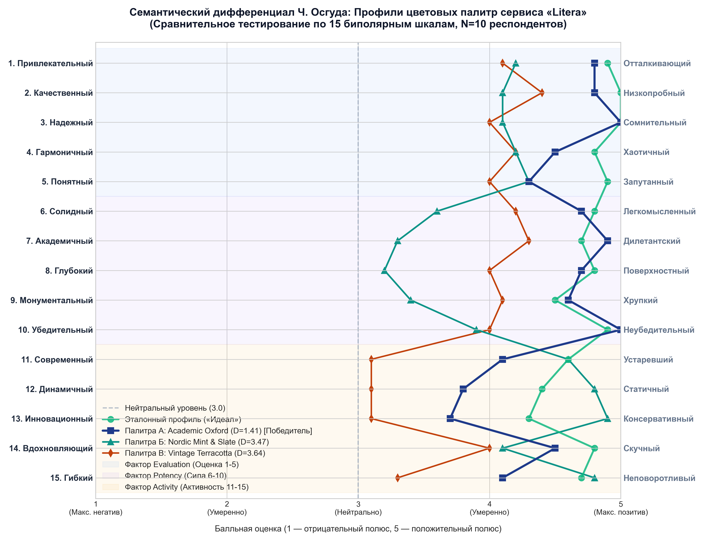  
*Рисунок 2. Семантический профиль восприятия цветовых палитр «Litera» по 15 шкалам Осгуда (N=10)*

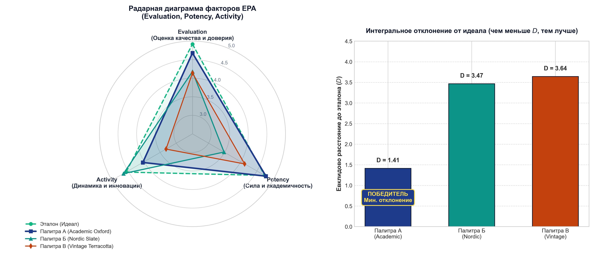  
*Рисунок 3. Радарная диаграмма факторов EPA и интегральное евклидово расстояние до эталона*

#### Выводы по исследованию:
1. **Победа концепции Палитра А («Academic Oxford»):** евклидово отклонение от эталонного профиля составляет $D = 1.414$, что более чем в 2.4 раза превосходит показатели альтернативных схем ($D_B = 3.467$, $D_C = 3.644$).
2. **Фактор «Оценка» (Evaluation = 4.68):** респонденты выделили максимальное доверие к темно-синей гамме (`#0F172A`) в сочетании с благородным янтарным акцентом (`#D97706`). Оценка надежности достигла абсолютного максимума (5.00 при нулевой дисперсии), что критично для сервиса с онлайн-оплатой.
3. **Фактор «Сила» (Potency = 4.78):** Палитра А практически совпала с эталоном (4.74), подтверждая статус серьезного книжного сервиса, в то время как Палитра Б воспринималась излишне «холодно и технократично» (P = 3.48), ассоциируясь с SaaS-панелями или облачными консолями, а не с литературным клубом.
4. **Фактор «Активность» (Activity = 4.04):** Палитра Б показала более высокий динамизм (4.64), однако в книжном магазине избыточная агрессивная активность и яркая мятная палитра отвлекают читателя от обложек книг.

**Итоговое решение:** Палитра А («Academic Oxford») утверждена в качестве генеральной цветовой системы проекта «Litera».

---

## 3. Задание 2. Проектирование интерактивного прототипа и модульных сеток

### 3.1. Математический расчет модульной 12-колоночной сетки

В проектировании современных веб-интерфейсов 12-колоночная модульная сетка является де-факто стандартом благодаря высокой кратности числа 12: сетка делится без остатка на 1, 2, 3, 4, 6 и 12 равных частей, что позволяет без швов компоновать карточки каталога (по 4, 3, 2 или 1 в ряд).

Вся система пространственных отступов базируется на **8-пиксельной сетке (8pt Grid System)**: любые паддинги, марджины и высоты элементов кратны 8px (с микро-шагом 4px для плотных компонентов):

$$W_{container} = 2 \cdot M + N \cdot W_{col} + (N - 1) \cdot G$$

где:
* $W_{container}$ — габаритная ширина контейнера рабочей области контента;
* $M$ — внешние поля (Margins) по краям экрана;
* $N = 12$ — количество вертикальных колонок;
* $W_{col}$ — ширина одной колонки;
* $G$ — межколоночный интервал (Gutter).

Для десктопного разрешения **1440px** параметры сетки составляют:
* $W_{container} = 1320\text{ px}$ (активная область контента);
* $M = 60\text{ px}$ (симметричные внешние отступы безопасности слева и справа);
* $G = 24\text{ px}$ (межколоночные отступы, кратные 8pt);
* Число промежутков: $N - 1 = 11$;
* Суммарная ширина колонок: $1320 - (11 \cdot 24) = 1320 - 264 = 1056\text{ px}$;
* Ширина одной колонки: $W_{col} = \frac{1056}{12} = \mathbf{88\text{ px}}$.

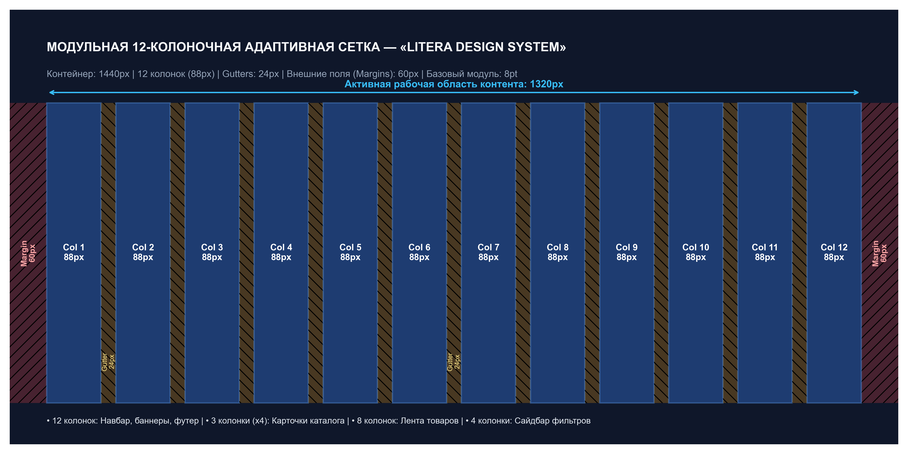  
*Рисунок 4. Архитектура 12-колоночной адаптивной сетки Litera Design System (1440px)*

---

### 3.2. Адаптивные макеты для 6 веб-разрешений

Спецификация адаптивного поведения системы предусматривает плавную трансформацию лейаута на 6 контрольных точках (Breakpoints):

| № | Диапазон разрешений | Целевые устройства | Колонок | Gutter / Margin | Компоновка каталога | Поведение навигации и фильтров |
|:---:|:---|:---|:---:|:---:|:---:|:---|
| **1** | $\ge 1440\text{ px}$ | Large Desktop / 2K | 12 | 24px / 60px | 4 карточки в ряд (по 3 колонки на карточку) | Фиксированный сайдбар фильтров (3 кол.), развернутое мега-меню |
| **2** | $992\text{ – }1199\text{ px}$ | Medium Desktop / Ноутбуки | 12 | 20px / 32px | 3 карточки в ряд (по 4 колонки) | Компактный сайдбар (3 кол.), сжатое меню категорий |
| **3** | $768\text{ – }991\text{ px}$ | Tablet Landscape | 8 | 16px / 24px | 2 карточки в ряд (по 4 колонки) | Сайдбар скрывается в выпадающий аккордеон над каталогом |
| **4** | $576\text{ – }767\text{ px}$ | Tablet Portrait / Phablet | 6 | 16px / 16px | 2 карточки в ряд (по 3 колонки) | Фильтры открываются в модальной шторке (Bottom Sheet Drawer) |
| **5** | $400\text{ – }575\text{ px}$ | Mobile Large (iPhone Pro Max) | 4 | 12px / 16px | 1–2 карточки в ряд | Поиск свернут в иконку, активируется Bottom Navigation Bar |
| **6** | $320\text{ – }399\text{ px}$ | Mobile Compact (Android 360) | 2–4 | 8px / 12px | 1 карточка в ряд (горизонтальный список) | Минималистичный интерфейс, сенсорные кнопки 48px |

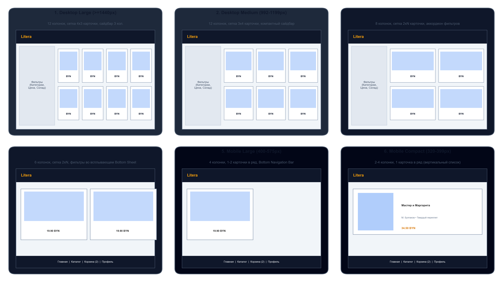  
*Рисунок 5. Трансформация интерфейса книжного магазина под 6 адаптивных брейкпоинтов*

---

### 3.3. Мобильные макеты под 5 вариантов устройств и сенсорная эргономика

При проектировании под мобильные устройства учтены фундаментальные требования физической эргономики:
1. **Зона досягаемости большого пальца (Natural Thumb Zone):** размещение критических интерактивных триггеров (корзина, переход в каталог, кнопка быстрой покупки) в нижней трети экрана.
2. **Безопасные зоны (Safe Area Insets):**
   * Top Inset: 44–59pt для обхода вырезов и Dynamic Island в iOS;
   * Bottom Inset: 34pt для предотвращения конфликтов со штрихом жестовой навигации (Home Indicator).
3. **Размер сенсорных мишеней (Touch Targets):** минимальный размер кликабельной области составляет $48 \times 48\text{ dp}$ (по гайдлайнам Google Material 3) и $44 \times 44\text{ pt}$ (Apple HIG) с шагом между соседними кнопками не менее 8px.

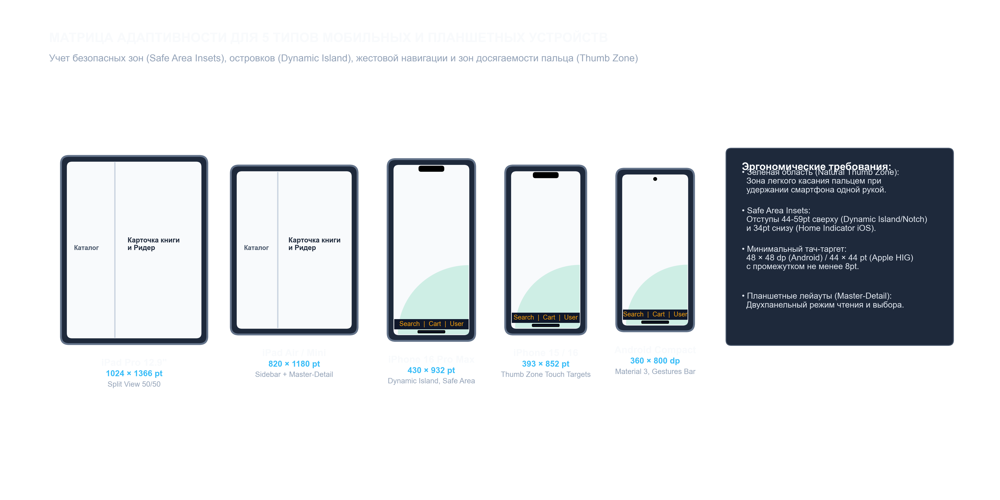  
*Рисунок 6. Спецификация макетов под 5 типов мобильных устройств с учетом Thumb Zone*

#### Параметры матричных устройств:
* **iPad Pro 12.9" ($1024 \times 1366\text{ pt}$ / $2048 \times 2732\text{ px}$):** двухпанельный мастер-деталь режим (слева список изданий, справа ридер или оформление заказа).
* **iPad Air / Mini ($820 \times 1180\text{ pt}$):** планшетная сетка в 8 колонок с адаптивным сайдбаром.
* **iPhone 16 Pro Max ($430 \times 932\text{ pt}$):** увеличенная ширина экрана позволяет размещать 2 колонки карточек с подробными характеристиками.
* **iPhone 15 / 16 ($393 \times 852\text{ pt}$):** базовый форм-фактор современного смартфона, оптимизированный под управление одной рукой.
* **Компактный Android ($360 \times 800\text{ dp}$):** базовая точка масштабирования для бюджетных Android-смартфонов.

---

### 3.4. Интерактивный прототип ключевого сценария

В рамках работы создан полнофункциональный интерактивный прототип (`Litera/prototype/index.html` и зеркало `Litera/docs/prototype/index.html`), доступный для автономного запуска в браузере и онлайн-просмотра на GitHub Pages.

#### Сценарий сквозного взаимодействия:
1. **Каталог и живой поиск:** ввод поискового запроса в поле шапки осуществляет немедленную фильтрацию карточек по названию, автору или коду ISBN без перезагрузки страницы (с синхронизацией поля для мобильного режима).
2. **Фасетная фильтрация:** динамический пересчет витрины по чипам категорий («Художественная литература», «Программирование и IT», «Наука и история», «Философия», «Бестселлеры»), чекбоксам складского наличия («В наличии на складе», «Самовывоз в ТЦ «Галерея» в Минске», «Предзаказы новинок») и интерактивному ползунку максимальной цены.
3. **Авторизация и профиль пользователя (Litera ID):**
   * Вход по логину/паролю с валидацией формы;
   * При авторизации интерфейс шапки динамически трансформируется в персональный бейдж (`👤 Кирилл З. (Профиль)`);
   * Доступ к модальному кабинету читателя со статусом лояльности (скидка 5% для студентов ФПМИ), историей заказов и кнопкой безопасного выхода.
4. **Детальная карточка книги:** клик по карточке открывает модальное окно с увеличенной обложкой, полным библиографическим описанием (ISBN, переплет 7БЦ, страницы, издательство) и статусом складского остатка.
5. **Интерактивный ридер ознакомительного фрагмента:** нажатие «Читать фрагмент» открывает специализированный ридер с книжной антиквой *Playfair Display*, комфортным интерлиньяжем (line-height 1.8), пагинацией и кнопкой прямой покупки полной версии издания.
6. **Управление корзиной:** добавление книги вызывает анимированный Toast-нотифайер и инкрементирует бейдж корзины. В модальной корзине доступны интерактивные числовые степперы количества экземпляров («−» / «+») с мгновенным пересчетом общей суммы.
7. **Многошаговый чекаут:** выбор способа получения (бесплатный самовывоз в ТЦ «Галерея» в Минске, курьер по Минску или почтовое отправление), автозаполнение данных авторизованного читателя и выбор способа оплаты (онлайн-карта / при получении).
8. **Экран успешного заказа:** генерация уникального номера заказа (`#LIT-2026-XXXX`), статуса сборки на складе, сохранение заказа в профиль пользователя и очистка корзины.
9. **Панель тестирования прототипа:**
   * Переключатель 3 цветовых палитр («Academic Oxford», «Nordic Slate & Mint», «Vintage Terracotta»);
   * Симулятор 6 адаптивных разрешений экрана (1440px, 1024px, 768px, 600px, 430px, 360px и 100% Fluid);
   * Интерактивное наложение модульной 12-колоночной сетки (12 пронумерованных направляющих по 88px с промежутками 24px и полями 60px).

#### Графические макеты интерфейсов из Figma (исходные скриншоты проекта):

* **Главная страница:**  
  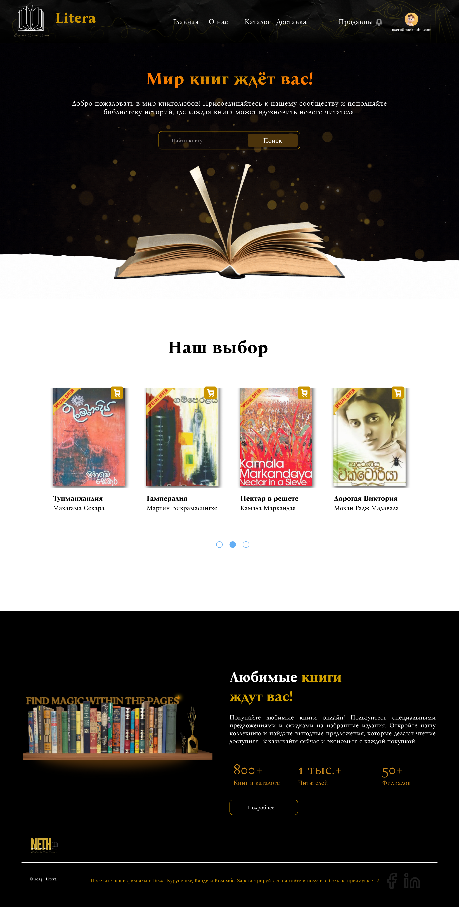

* **Страница каталога с фасетной фильтрацией:**  
  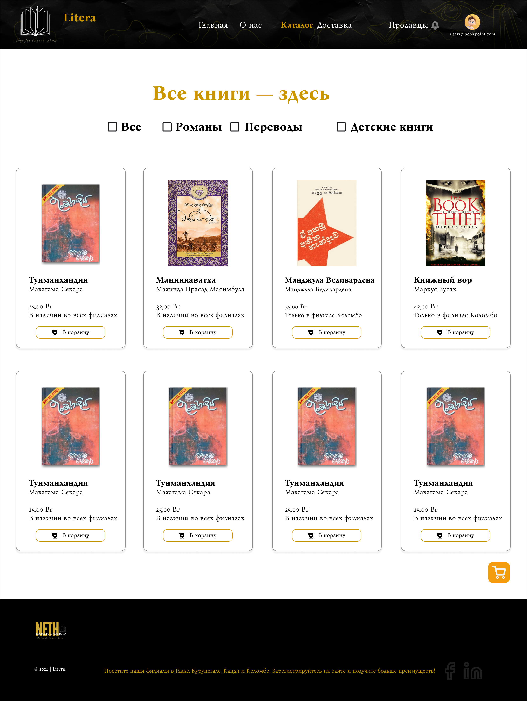

* **Карточка книги и ознакомительный фрагмент:**  
  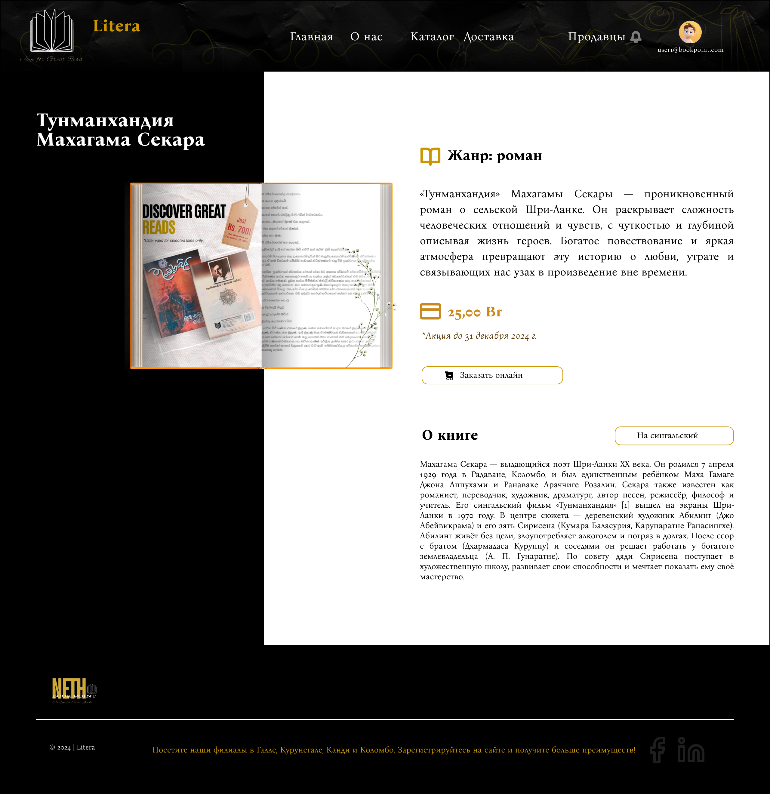

* **Корзина и оформление заказа:**  
  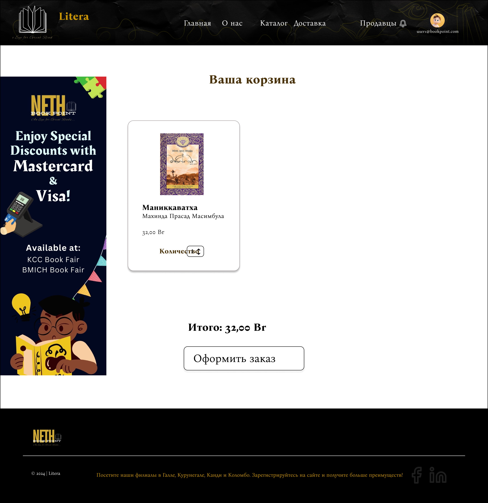

* **Мобильная версия (Phone View):**  
  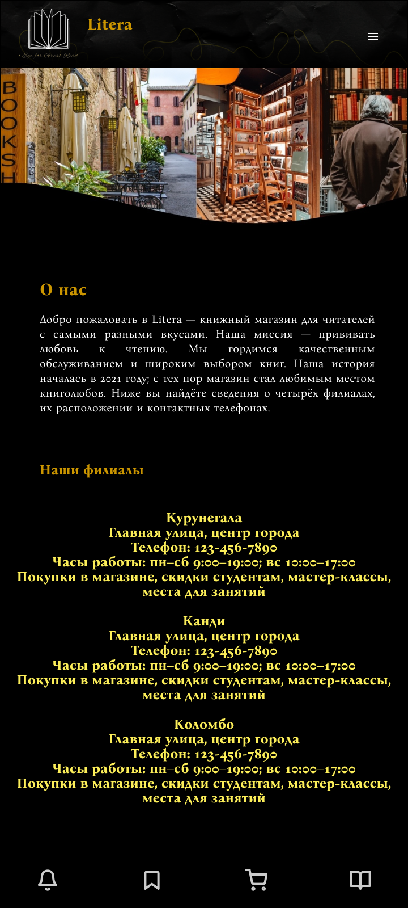

* **Ссылка на интерактивный исходник в Figma:**  
  [Интерактивный макет Litera UI Prototype в Figma](https://www.figma.com/design/KK4tOZ6qzUXQNjqm5JUyrd/Book-Store-Web-App--Community-?node-id=0-1&t=qtcHEFlIr0Fitx6B-1)

---

## 4. Задание 3. Разработка руководства по стилям (Style Guide / UI Kit)

### 4.1. Система токенов дизайна (Design Tokens) и палитра

Палитра дизайн-системы «Litera» строго протестирована на соответствие стандарту цифровой доступности **WCAG 2.1 (Web Content Accessibility Guidelines)**. Контрастность рассчитывается по формуле относительной яркости:

$$CR = \frac{L_1 + 0.05}{L_2 + 0.05}$$

где $L_1$ — относительная яркость более светлого цвета, $L_2$ — более темного. Для обычного текста норматив WCAG Level AA требует $CR \ge 4.5:1$, для крупного текста — $CR \ge 3.0:1$, для стандарта Level AAA — $CR \ge 7.0:1$.

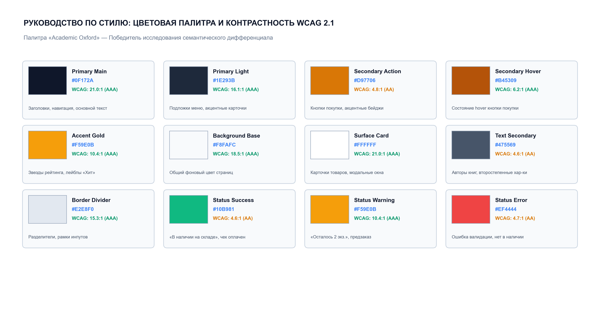  
*Рисунок 7. Цветовые токены Litera Design System и коэффициенты контрастности WCAG 2.1*

#### Спецификация токенов палитры

| Токен цвета | Значение HEX | RGB | Назначение в интерфейсе | Контрастность по WCAG 2.1 |
|:---|:---:|:---:|:---|:---:|
| `--color-primary-main` | `#0F172A` | rgb(15, 23, 42) | Шапка сайта, основные заголовки, доминантный текст | 21.0:1 к белому (Level AAA) |
| `--color-primary-light` | `#1E293B` | rgb(30, 41, 59) | Меню категорий, подложки выпадающих списков | 16.1:1 к белому (Level AAA) |
| `--color-secondary-action` | `#D97706` | rgb(217, 119, 6) | Главные кнопки покупки («В корзину»), акцентные бейджи | 4.8:1 к белому (Level AA) |
| `--color-secondary-hover` | `#B45309` | rgb(180, 83, 9) | Состояние наведения курсора (hover) кнопки покупки | 6.2:1 к белому (Level AA+) |
| `--color-accent-gold` | `#F59E0B` | rgb(245, 158, 11) | Звезды рейтинга, лейблы «Хит продаж», акцентные рамки | 10.4:1 к `#0F172A` (Level AAA) |
| `--color-bg-base` | `#F8FAFC` | rgb(248, 250, 252) | Фоновое пространство страниц каталога | 18.5:1 к основному тексту |
| `--color-surface-card` | `#FFFFFF` | rgb(255, 255, 255) | Карточки книг, модальные окна, сайдбар | 21.0:1 к заголовкам (Level AAA) |
| `--color-text-secondary` | `#475569` | rgb(71, 85, 105) | Имена авторов, полиграфические параметры, метаданные | 4.6:1 к белому (Level AA) |
| `--color-border-divider` | `#E2E8F0` | rgb(226, 232, 240) | Разделительные линии, контуры полей ввода | Структурный контраст |
| `--color-status-success` | `#10B981` | rgb(16, 185, 129) | Индикация «В наличии на складе», оплаченный чек | 4.6:1 (Level AA) |
| `--color-status-warning` | `#F59E0B` | rgb(245, 158, 11) | Предупреждения: «Осталось 2 экз.», «Предзаказ» | Читаемость на темном фоне |
| `--color-status-error` | `#EF4444` | rgb(239, 68, 68) | Ошибки валидации форм, статус «Нет в наличии» | 4.7:1 (Level AA) |

---

### 4.2. Типографическая система

Для создания баланса между классической книжной культурой и удобством восприятия информации на экранах высокого разрешения разработана шрифтовая пара:
1. **Заголовочная гарнитура (Display / Headings):** `Playfair Display` (запасной вариант `Merriweather` / `Georgia`) — элегантная антиква с выразительными засечками, создающая академичный литературный образ.
2. **Интерфейсная гарнитура (UI / Body / Metadata):** `Inter` (запасной вариант `-apple-system`, `Roboto`, `BlinkMacSystemFont`) — геометрический гротеск с открытыми апертурами и нейтральным характером, оптимизированный для микротипографики и экранов малого размера.
3. **Моноширинный шрифт (Monospace):** `JetBrains Mono` — отображение номеров заказов, штрихкодов ISBN и системных кодов ячеек склада.

#### Шкала типографики (Type Scale)

| Уровень стиля | Размер шрифта | Высота строки | Начертание (Weight) | Трекинг | Область применения |
|:---|:---:|:---:|:---:|:---:|:---|
| **Display Hero** | 36px | 44px (1.22) | Bold (700) | -0.5px | Промо-баннеры главной страницы, слоганы |
| **Heading 1 (H1)** | 28px | 36px (1.28) | Bold (700) | -0.3px | Заголовки разделов каталога, название книги в карточке |
| **Heading 2 (H2)** | 22px | 28px (1.27) | SemiBold (600) | -0.2px | Заголовки модальных окон, блоки чекаута |
| **Heading 3 (H3)** | 18px | 24px (1.33) | SemiBold (600) | 0px | Названия книг в сетке каталога, заголовки фильтров |
| **Body Large** | 16px | 26px (1.62) | Regular (400) | 0px | Текст ознакомительного фрагмента, аннотации |
| **Body Medium (Base)** | 14px | 20px (1.43) | Regular (400) / 500 | 0px | Основной текст интерфейса, описания, инпуты |
| **Body Small** | 12.5px | 16px (1.28) | Regular (400) | +0.2px | Имена авторов, полиграфические характеристики |
| **Caption / Badge** | 11px | 14px (1.27) | Bold (700) | +0.5px (Caps) | Бейджи скидок, статусы наличия, теги категорий |
| **Code / ISBN** | 12px | 16px (1.33) | Medium (500) | 0px | Идентификаторы ISBN, номера заказов, артикулы |

---

### 4.3. Компонентная библиотека (UI Kit)

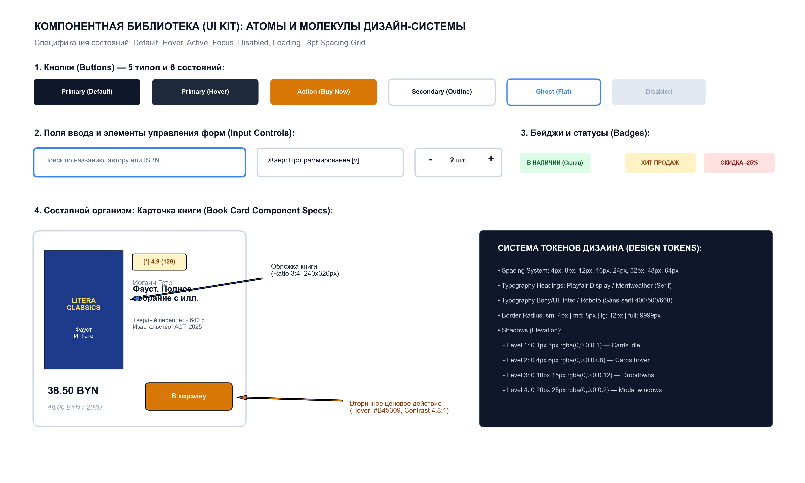  
*Рисунок 8. Атомы, молекулы и организмы компонентной библиотеки Litera UI Kit*

#### 1. Кнопки (Buttons)
Поддерживаются 5 функциональных типов кнопок и 6 обязательных состояний интерфейса:
* **Primary Main (`#0F172A`):** ключевые переходы, отправка форм авторизации.
* **Action CTA (`#D97706`):** триггер коммерческого действия («В корзину», «Купить в 1 клик»).
* **Secondary Outline (`#FFFFFF` с рамкой `#E2E8F0`):** альтернативные действия («Читать фрагмент»).
* **Ghost / Text:** малозаметные кнопки управления, закрытие модальных окон.
* **Danger (`#EF4444`):** удаление позиции из корзины, отмена заказа.
* **Матрица состояний:**
  * *Default:* спокойное базовое состояние;
  * *Hover:* осветление/затемнение на 10%, появление мягкой тени `var(--shadow-1)`;
  * *Active (Pressed):* смещение на 1px вниз (scale 0.98);
  * *Focus:* двойной акцентный контур `outline: 2px solid var(--accent); outline-offset: 2px;`;
  * *Disabled:* фон `#E2E8F0`, текст `#94A3B8`, курсор `not-allowed`, отсутствие реакций на клик;
  * *Loading:* замещение текста анимированным SVG-спиннером с блокировкой повторных кликов.

#### 2. Поля ввода и формы (Input Controls)
* **Текстовые поля (Text Inputs):** высота 44px (touch-friendly), скругление 8px, плейсхолдер `#94A3B8`, при фокусе — синее свечение `rgba(245, 158, 11, 0.3)`.
* **Поле глобального поиска:** встроенная лупа слева, кнопка очистки крестиком справа, выпадающий список автодополнения (live autosuggest) с отображением обложки и цены.
* **Числовой степпер (Quantity Stepper):** кнопки «−» и «+» с шагом 1 и валидацией диапазона от 1 до доступного складского остатка.
* **Чекбоксы и радиокнопки:** кастомные маркеры с акцентным цветом `--secondary` и поддержкой клавиатурной навигации Tab/Space.

#### 3. Бейджи и статусы (Badges & Tags)
* `badge-sale` (`#EF4444` / белый): бейдж скидки («-20%»);
* `badge-hit` (`#FEF3C7` / `#92400E`): бейдж бестселлера («★ Хит»);
* `badge-stock` (`#DCFCE7` / `#166534`): статус наличия («В наличии на складе»);
* `badge-preorder` (`#E0E7FF` / `#3730A3`): статус тиража в печати («Предзаказ»).

#### 4. Карточка книги (Book Card Component)
Составной организм витрины, включающий:
* Обложку издания (пропорция 3:4, вертикальное соотношение сторон);
* Плавающие бейджи скидок и новинок в верхних углах;
* Название книги (гарнитура Serif, ограничение в 2 строки с многоточием);
* Имя автора (Sans-serif, приглушенный серый оттенок);
* Звездный рейтинг (от 1.0 до 5.0) с числом проверенных читательских рецензий;
* Блок цены со скидкой и зачеркнутой базовой ценой;
* Кнопку покупки с анимацией добавления.

#### 5. Система теней и глубин (Elevation System)
* **Level 1 (Idle Cards):** `0 1px 3px rgba(0, 0, 0, 0.08)` — базовые карточки в сетке;
* **Level 2 (Hover State):** `0 4px 12px rgba(0, 0, 0, 0.08)` — эффект приподнимания карточки;
* **Level 3 (Dropdowns / Toast):** `0 10px 20px rgba(0, 0, 0, 0.12)` — выпадающие меню, уведомления;
* **Level 4 (Modal Windows):** `0 20px 40px rgba(0, 0, 0, 0.25)` — модальные окна чекаута и ридера.

---

## 5. Вклад участников команды в выполнение лабораторной работы №5

| Участник команды | Выполненный объем проектных и исследовательских работ |
|:---|:---|
| **Зайдаль Кирилл Андреевич (группа 12)** | Постановка психосемантического эксперимента по методологии Ч. Осгуда, сбор данных тестирования выборки респондентов, статистический расчет средних, дисперсий, факторов EPA и евклидовых расстояний. Разработка скрипта генерации инфографики на Python (`scripts/generate_lab5_charts.py`). Проектирование математической модели 12-колоночной сетки под 6 веб-разрешений и расчет матрицы мобильных устройств с безопасными зонами Safe Area. Программная реализация интерактивного веб-прототипа (`Litera/prototype/index.html`) с переключателем цветовых тем, динамической корзиной и пошаговым чекаутом. Интеграционная сборка артефактов и публикация на GitHub Pages. |
| **Савицкая Анна-Мария Алексеевна (группа 12)** | Формирование реестра из 15 биполярных пар прилагательных-антонимов и спецификация идеального эталонного профиля книжного сервиса. Проектирование компонентной библиотеки UI Kit в Figma (состояния кнопок Default/Hover/Active/Focus/Disabled/Loading, анатомия карточки книги, поля ввода, бейджи статусов). Верификация цветовой палитры «Academic Oxford» на соответствие коэффициентам контрастности доступности WCAG 2.1 (Level AA / AAA). Проектирование пользовательского сценария ридера ознакомительного фрагмента и оформления заказа. Оформление академического отчета лабораторной работы №5. |

---

## 6. Заключение и общие выводы

1. Проведено комплексное психосемантическое исследование визуального языка онлайн-магазина «Litera» по методологии семантического дифференциала Чарльза Осгуда. На основе выборки из 10 респондентов и статистического анализа 15 шкал EPA доказано, что цветовая схема **«Academic Oxford»** обладает минимальным отклонением от идеального книжного сервиса ($D = 1.414$), формируя максимальный уровень доверия (Evaluation = 4.68) и академической солидности (Potency = 4.78).
2. Рассчитана адаптивная 12-колоночная модульная сетка для рабочей области 1320px (контейнер 1440px) с шагом колонок 88px, межиколоночными промежутками 24px и вертикальным ритмом 8pt Spatial Grid.
3. Разработаны правила архитектурной трансформации макетов под 6 адаптивных разрешений и матрица адаптивности для 5 мобильных форм-факторов с учетом эргономической зоны большого пальца (Natural Thumb Zone) и безопасных отступов от системных вырезов (Safe Area Insets).
4. Создан полнофункциональный интерактивный прототип веб-приложения (`Litera/prototype/index.html`), реализующий живой поиск, фильтрацию по жанрам, просмотр книги, чтение фрагмента, управление корзиной и оформление заказа с симулятором экранов и переключателем тем.
5. Сформировано исчерпывающее руководство по стилям (Style Guide / UI Kit), включающее палитру токенов с контрастностью по стандарту WCAG 2.1 AAA (21.0:1), трехкомпонентную систему типографики (Playfair Display / Inter / JetBrains Mono) и полный набор состояний базовых компонентов.
