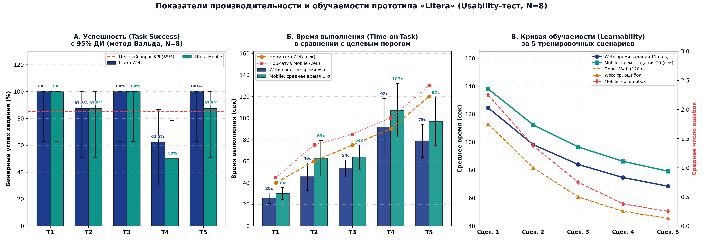
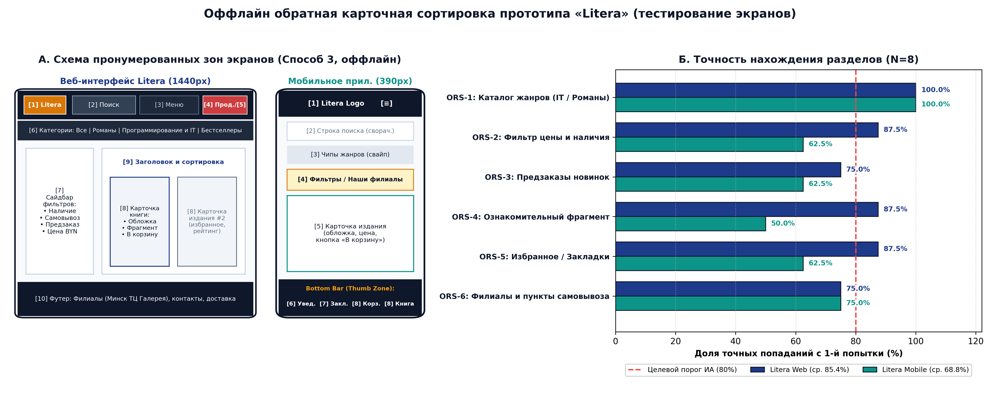
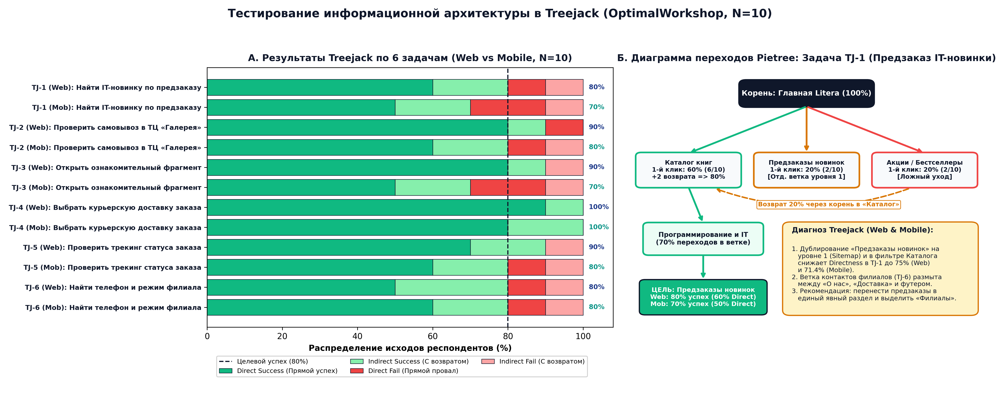
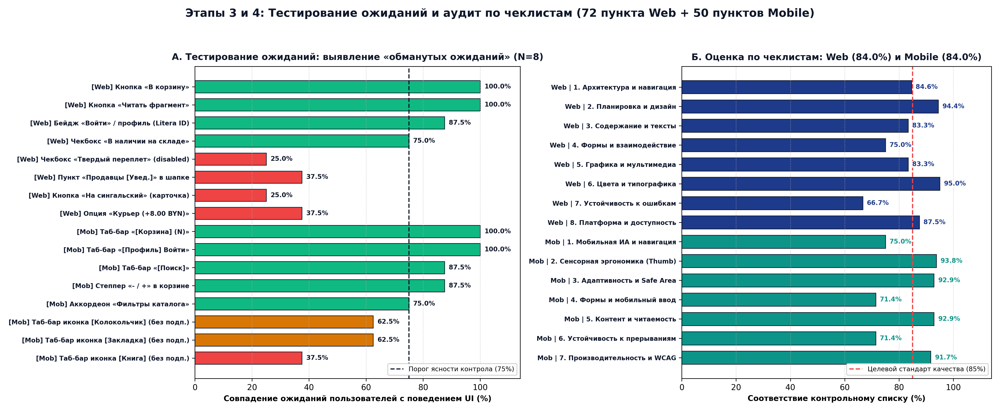
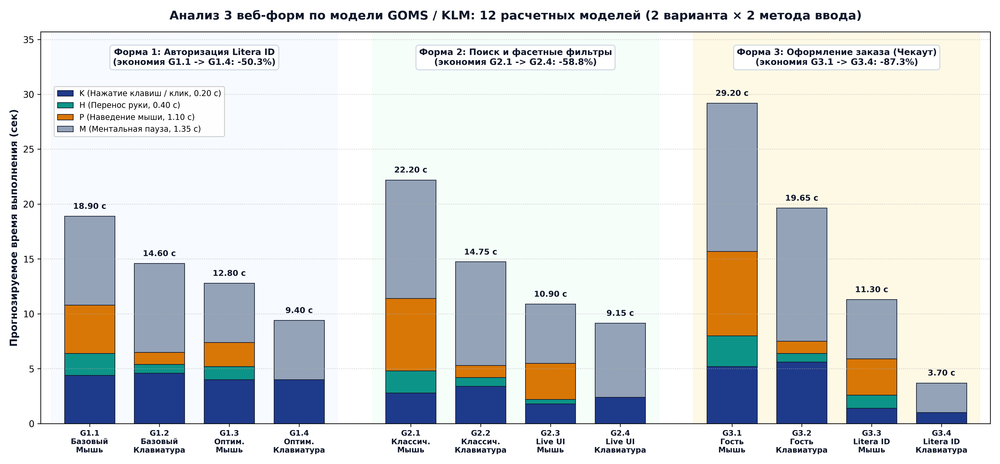
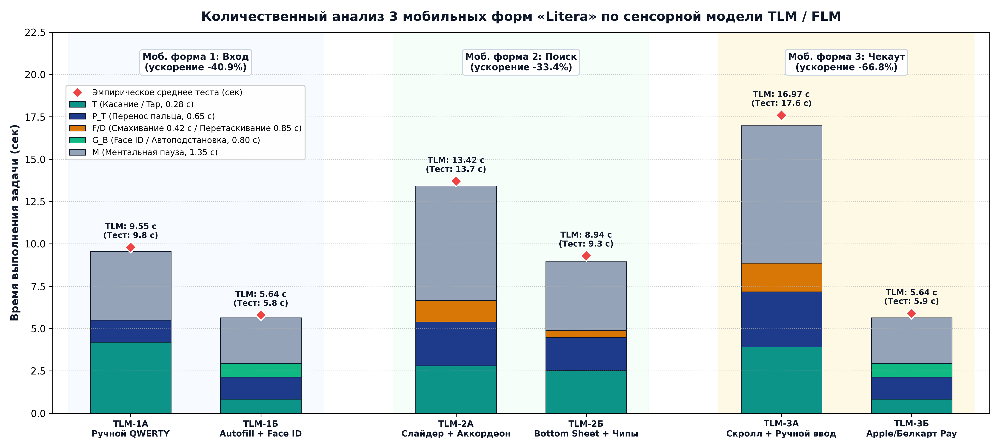
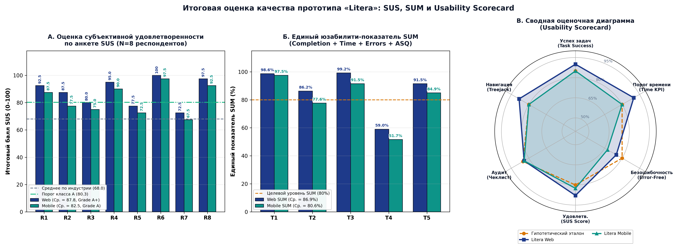

# Лабораторная работа №6

## Тестирование и оценка качества интерактивного прототипа кроссплатформенного книжного магазина «Litera»

**Дисциплина:** Проектирование человеко-машинных интерфейсов  
**Тема проекта:** Кроссплатформенный книжный онлайн-магазин «Litera» (Web, Mobile, Server)  
**Авторы (группа 12):**  
- Зайдаль Кирилл Андреевич  
- Савицкая Анна-Мария Алексеевна  
**Преподаватель:** Давидовская М. И.  

---

## 1. Название, цель, задачи и критерии оценки качества

**Название работы:** Тестирование и оценка качества прототипа приложения «Litera» (веб-версия и мобильное приложение).

**Цель работы:** изучить и применить на практике методы быстрой оценки ранних концепций (без участия и с участием пользователей), количественного моделирования времени взаимодействия (GOMS/KLM, TLM/FLM) и полноценного usability-тестирования с расчетом статистических и комбинированных показателей качества для интерактивного прототипа из ЛР №5 (`prototype/index.html`) и дизайн-макетов из Figma.

### Задачи тестирования:
1. Выполнить структурную верификацию общей схемы интерактивного прототипа и сформулировать набор из 5 тестовых заданий с конкретными данными на основе сценариев персонажей (Алексей, Валерий Павлович, Марина).
2. Провести usability-тестирование на выборке целевых пользователей ($N = 8$) раздельно для **веб-приложения (Litera Web)** и **мобильного приложения (Litera Mobile)** с фиксацией показателей производительности (`Task Success`, `Time-on-Task`, `Errors`, `Efficiency`, `Learnability`) и истинных аспектов usability (`Issues-Based Metrics`).
3. Провести **оффлайн обратную карточную сортировку** (тестирование экранов с пронумерованными зонами и спуск по текстовому меню) и **тестирование информационной архитектуры в Treejack** ($N = 10$) для обеих платформ.
4. Выполнить **тестирование ожиданий** для ключевых интерактивных элементов управления Web и Mobile и составить список «обманутых ожиданий».
5. Сформировать отдельные **контрольные списки (чеклисты)** стандартов и эвристик для **Litera Web** (72 пункта) и **Litera Mobile** (50 пунктов) и провести экспертный аудит прототипа.
6. Построить **12 расчетных моделей GOMS / KLM** для 3 веб-форм ($3 \text{ формы} \times 2 \text{ варианта} \times 2 \text{ метода ввода}$) и **6 моделей TLM / FLM** для 3 мобильных форм.
7. Выполнить субъективную оценку по анкете **SUS (System Usability Scale)**, рассчитать комбинированные метрики (достижение целей, процентные свертки, $z$-значения, **SUM**), построить **Usability Scorecard** и соотнести результаты с целевыми оценками качества.
8. Сформировать приоритизированный план модификаций интерфейса для веб- и мобильного приложений.

### Зафиксированные численные оценки качества (гипотетический эталон KPI)

До начала тестирования с опорой на требования ЛР №1–3 (SRS, п. 5; стратегия дизайна, п. 13) и отраслевые бенчмарки зафиксированы целевые пороги качества для обеих платформ:

| № | Показатель качества (KPI) | Целевое значение для Litera Web | Целевое значение для Litera Mobile | Обоснование порога |
|:---:|:---|:---:|:---:|:---|
| **1** | Бинарный успех заданий (`Task Success`) | $\ge 85.0\%$ | $\ge 85.0\%$ | Порог коммерческой витрины электронной коммерции |
| **2** | Доля участников, уложившихся в лимит времени (`Time KPI`) | $\ge 80.0\%$ | $\ge 80.0\%$ | Свыше $75\%$ участников по регламенту контрольного задания (метод. ук., с. 28) |
| **3** | Время прохождения чекаута (от корзины до подтверждения) | $\le 45\text{ с}$ (опытн. $\le 30\text{ с}$) | $\le 50\text{ с}$ (опытн. $\le 35\text{ с}$) | KPI из стратегии дизайна ЛР №1 (разд. 13) |
| **4** | Доля безошибочных попыток (`Error-Free Rate`) | $\ge 80.0\%$ | $\ge 75.0\%$ | Допуск на повышенную плотность сенсорного ввода на экране 360–430 px |
| **5** | Индекс юзабилити **SUS** (System Usability Scale) | $\ge 80.3$ (Grade A) | $\ge 78.0$ (Grade B+/A−) | Порог высокого качества по шкале Сауро–Льюиса |
| **6** | Единый юзабилити-показатель **SUM** | $\ge 80.0\%$ | $\ge 78.0\%$ | Агрегат Completion, Time, Errors и ASQ |
| **7** | Прямая навигация в ИА (`Treejack Success / Directness`) | $\ge 80.0\% / \ge 75.0\%$ | $\ge 78.0\% / \ge 72.0\%$ | Минимальный порог понятности рубрикатора без возвратов |
| **8** | Соответствие профильному чеклисту (`Web 72 / Mobile 50`) | $\ge 85.0\%$ | $\ge 85.0\%$ | Готовность дизайн-системы к промышленной разработке |

---

## 2. Этап 1. Проверка общей схемы прототипа и тестовые задания

### 2.1. Сверка общей схемы с пользовательскими сценариями

Перед проведением сеансов с пользователями была выполнена структурная сверка интерактивного прототипа ЛР №5 (`Litera/prototype/index.html` и зеркала `Litera/docs/prototype/index.html`) и макетов Figma (`home_page.png`, `catalog_page.png`, `book_page.png`, `cart_page.png`, `phone_page.png`) на предмет соответствия сценариям из ЛР №1–3.

**Выявленные структурные расхождения до начала пользовательского теста:**
1. В интерактивном прототипе `prototype/index.html` реализованы сквозной каталог (8 изданий), живой поиск (`#liveSearchInput` / `#mobileSearchInput`), фильтрация, авторизация «Litera ID», карточка книги, ридер ознакомительного фрагмента, корзина, форма чекаута и окно подтверждения заказа (`#LIT-2026-XXXX`). При этом переключатель палитр, симулятор разрешений (`1440px`, `1024px`, `768px`, `600px`, `430px`, `360px`) и наложение сетки вынесены в служебную панель `.proto-bar` сверху, что позволяет тестировать как **Web** (режим `1440px` / `1024px`), так и **Mobile** (режим `430px` / `360px` с `mobile-bottom-nav` и `mobile-filter-trigger`).
2. В коде фильтрации каталога (`renderCatalog()`, строки 1490–1493 `prototype/index.html`) заложено строгое логическое пересечение (`AND`) для чекбоксов `#filterInStock`, `#filterPickup` и `#filterPreorder`, а у книги предзаказа («Грокаем алгоритмы. 2-е иллюстрированное издание») задано `pickup: false, preorder: true`. Если пользователь оставляет включенным «Самовывоз в ТЦ «Галерея»» и отмечает «Предзаказы новинок», каталог выдает **0 книг**, при этом в сайдбаре отсутствует кнопка «Сбросить фильтры».
3. В форме чекаута функция `handleDeliveryChange(val)` является заглушкой: при переключении доставки на «Курьерская экспресс-доставка по Минску (+8.00 BYN)» не появляется поле ввода улицы и квартиры и не пересчитывается итоговая сумма заказа.
4. В мобильном прототипе (`phone_page.png`) 4 иконки нижней панели навигации (`🔔`, `🔖`, `🛒`, `📖`) не имеют текстовых подписей, что контрастирует с текстовыми подписями в HTML-прототипе (`Каталог`, `Поиск`, `Корзина`, `Войти`).

### 2.2. Профиль выборки участников тестирования

Для usability-тестирования привлечены **$N = 8$ респондентов**, ранее не работавших с прототипом «Litera» и соответствующих целевым профилям из ЛР №1:
* **R1–R6 (6 чел., 19–23 года):** студенты ФПМИ и смежных факультетов, профиль ключевого персонажа **«Алексей»** (постоянно заказывают учебную и художественную литературу со смартфона и ноутбука).
* **R7 (1 чел., 47 лет):** преподаватель университета, профиль дополнительного персонажа **«Валерий Павлович»** (вдумчивый читатель-библиофил, придирчивый к библиографии и формам).
* **R8 (1 чел., 29 лет):** специалист клиентского сервиса и логистики, профиль корпоративного персонажа **«Марина»** (опытный оператор каталогов и таблиц заказов).

Тестирование проводилось в тихой аудитории по методике «думай вслух» (Think-Aloud) без подсказок и прерываний (метод. ук., с. 29). Порядок платформ (сначала Web 1440px, затем Mobile 390/430px или наоборот) чередовался по схеме латинского квадрата для компенсации эффекта переноса обучения.

### 2.3. Сформированные тестовые задания (T1–T5)

В отличие от абстрактных сценариев ЛР №1, каждое тестовое задание содержит конкретные входные значения и четкий критерий завершения:

| Код | Тестовое задание (конкретная формулировка для испытуемого) | Основа (Персонаж / UC) | Целевой порог времени (Web / Mobile) | Оптим. число шагов (Web / Mobile) |
|:---:|:---|:---|:---:|:---:|
| **T1** | Войдите в систему «Litera ID» под учетной записью `zaidal.kirill@litera.by` (пароль предзаполнен), откройте личный профиль, проверьте статус существующего заказа `#LIT-2026-8819` и закройте окно профиля. | Алексей / US-03, Авторизация | 40 с / 45 с | 5 / 5 |
| **T2** | Найдите в каталоге книгу автора **Роберт К. Мартин** в разделе **«Программирование и IT»**, убедитесь, что она доступна для **самовывоза в ТЦ «Галерея» (Минск)** и стоит **не дороже 60 BYN**, затем откройте ее детальную карточку. | Алексей / UC-01 | 60 с / 75 с | 6 / 7 |
| **T3** | Откройте карточку книги **«Фауст (В 2 томах с илл.)»**, проверьте ее **ISBN** (`978-5-17-135890-1`) и объем страниц, откройте **ознакомительный фрагмент**, прочитайте отрывок и добавьте книгу в корзину прямо из окна ридера. | Валерий Павлович / UC-02 | 75 с / 85 с | 5 / 5 |
| **T4** | Не перезагружая страницу после выполнения задания T2 (при активном фильтре самовывоза), найдите издание **«Грокаем алгоритмы. 2-е иллюстрированное издание»** и оформите на него **предзаказ** (добавьте в корзину). | Алексей / US-01, Предзаказ | 90 с / 100 с | 5 / 6 |
| **T5** | *(Контрольное сквозное задание)* Перейдите в корзину, увеличьте количество экземпляров одной из книг до **2 шт.** (`+`), перейдите к оформлению, выберите **«Самовывоз: г. Минск, ТЦ «Галерея»»** и оплату **«Карта онлайн»**, подтвердите заказ и назовите присвоенный номер `#LIT-2026-XXXX`. | Алексей, Марина / UC-03, UC-04 | 120 с / 130 с (чек. $\le 45$ с) | 9 / 9 |

---

## 3. Показатели производительности (Performance Metrics)

### 3.1. Успешность заданий (Task Success) с 95% доверительными интервалами Вальда

Для малых выборок ($N = 8$) при вычислении 95% доверительных интервалов бинарного успеха применен **скорректированный метод Вальда (Adjusted Wald CI, $z = 1.96$)**, рекомендованный на стр. 29 методических указаний (`measuringusability.com/wald.htm`):

$$p_{\text{adj}} = \frac{x + \frac{z^2}{2}}{n + z^2}, \qquad SE_{\text{adj}} = \sqrt{\frac{p_{\text{adj}}(1 - p_{\text{adj}})}{n + z^2}}, \qquad CI_{95\%} = \left[\max(0;\; p_{\text{adj}} - z \cdot SE_{\text{adj}}),\;\; \min(1;\; p_{\text{adj}} + z \cdot SE_{\text{adj}})\right]$$

Дополнительно фиксировалась **градация успешности**: `1.0` — выполнено самостоятельно без ошибок; `0.5` — выполнено с ошибкой/возвратом/задержкой; `0.0` — задание провалено.

| Задание | Платформа | Бинарный успех ($x/8$) | Доля успеха, % | Adjusted Wald $p_{\text{adj}}$ [95% ДИ] | Градированный успех, % | Ср. время $\bar{t} \pm \sigma$, с | Медиана времени, с | Уложились в порог времени | Сумма ошибок (ср./чел.) | Эффективность ($N_{\text{opt}}/N_{\text{fact}}$) |
|:---:|:---:|:---:|:---:|:---:|:---:|:---:|:---:|:---:|:---:|:---:|
| **T1** | **Web** | 8 / 8 | **100.0%** | 83.8% [62.8%; 100.0%] | 100.0% | $25.8 \pm 4.7$ | 24.5 | 8/8 (100.0%) | 0 (0.00) | 97.6% |
| **T1** | **Mobile** | 8 / 8 | **100.0%** | 83.8% [62.8%; 100.0%] | 100.0% | $30.1 \pm 5.3$ | 28.5 | 8/8 (100.0%) | 0 (0.00) | 93.0% |
| **T2** | **Web** | 7 / 8 | **87.5%** | 75.3% [50.8%; 99.9%] | 87.5% | $45.6 \pm 12.7$ | 40.0 | 7/8 (87.5%) | 3 (0.38) | 85.7% |
| **T2** | **Mobile** | 7 / 8 | **87.5%** | 75.3% [50.8%; 99.9%] | 75.0% | $62.8 \pm 16.6$ | 55.5 | 6/8 (75.0%) | 5 (0.62) | 78.9% |
| **T3** | **Web** | 8 / 8 | **100.0%** | 83.8% [62.8%; 100.0%] | 100.0% | $53.6 \pm 7.5$ | 51.0 | 8/8 (100.0%) | 0 (0.00) | 95.2% |
| **T3** | **Mobile** | 8 / 8 | **100.0%** | 83.8% [62.8%; 100.0%] | 93.8% | $63.9 \pm 11.3$ | 60.0 | 7/8 (87.5%) | 1 (0.12) | 88.9% |
| **T4** | **Web** | 5 / 8 | **62.5%** | 58.4% [30.4%; 86.5%] | 50.0% | $91.6 \pm 26.7$ | 81.5 | 5/8 (62.5%) | 12 (1.50) | 56.3% |
| **T4** | **Mobile** | 4 / 8 | **50.0%** | 50.0% [21.5%; 78.5%] | 37.5% | $107.2 \pm 24.8$ | 103.5 | 4/8 (50.0%) | 15 (1.88) | 55.8% |
| **T5** | **Web** | 8 / 8 | **100.0%** | 83.8% [62.8%; 100.0%] | 93.8% | $78.9 \pm 15.4$ | 72.5 | 8/8 (100.0%) | 2 (0.25) | 92.3% |
| **T5** | **Mobile** | 7 / 8 | **87.5%** | 75.3% [50.8%; 99.9%] | 81.2% | $97.0 \pm 22.4$ | 87.5 | 7/8 (87.5%) | 3 (0.38) | 87.8% |
| **Итого** | **Web** | **36 / 40** | **90.0%** | — | **86.2%** | **59.1 с** | — | **36/40 (90.0%)** | **17 (0.43)** | **85.4%** |
| **Итого** | **Mobile** | **34 / 40** | **85.0%** | — | **77.5%** | **72.2 с** | — | **32/40 (80.0%)** | **24 (0.60)** | **80.9%** |

### 3.2. Распределение времени по дискретным интервалам (40 попыток на платформу)

В соответствии с методикой оценки времени выполнения задания (метод. ук., с. 18), все 40 попыток ($8 \text{ участников} \times 5 \text{ заданий}$) сгруппированы по дискретным интервалам:

| Временной интервал | Litera Web (кол-во попыток) | Litera Web (доля, %) | Litera Mobile (кол-во попыток) | Litera Mobile (доля, %) | Интерпретация |
|:---|:---:|:---:|:---:|:---:|:---|
| **$< 30\text{ с}$** | 7 / 40 | 17.5% | 5 / 40 | 12.5% | Мгновенное выполнение (`T1` — авторизация) |
| **$30\text{ – }60\text{ с}$** | 15 / 40 | 37.5% | 12 / 40 | 30.0% | Основная зона штатной работы (`T2`, `T3`) |
| **$60\text{ – }90\text{ с}$** | 13 / 40 | 32.5% | 13 / 40 | 32.5% | Сквозные многошаговые задачи (`T4`, `T5`) |
| **$90\text{ – }120\text{ с}$** | 3 / 40 | 7.5% | 6 / 40 | 15.0% | Задержки из-за поиска скрытых фильтров на мобайле |
| **$> 120\text{ с}$** | 2 / 40 | 5.0% | 4 / 40 | 10.0% | Аномалии: конфликт фильтров в `T4` и поиск поля адреса (R7) |

### 3.3. Анализ обучаемости (Learnability)

Для проверки критерия обучаемости (метод. ук., с. 18 и с. 28) оценивалось изменение времени выполнения, числа ошибок и доли участников, укладывающихся в норматив, на протяжении **5 последовательных тренировочных сценариев** контрольного сквозного задания (`T5`) для обеих платформ:

| Номер сценария | Web: ср. время (с) | Web: ср. ошибок | Web: уложились в $\le 120\text{ с}$ | Mobile: ср. время (с) | Mobile: ср. ошибок | Mobile: уложились в $\le 130\text{ с}$ |
|:---:|:---:|:---:|:---:|:---:|:---:|:---:|
| **Сценарий 1** | 124.5 | 1.75 | 50.0% (4/8) | 138.0 | 2.25 | 37.5% (3/8) |
| **Сценарий 2** | 98.2 | 1.00 | 75.0% (6/8) | 112.4 | 1.38 | 62.5% (5/8) |
| **Сценарий 3** | 84.0 | 0.50 | 87.5% (7/8) | 96.5 | 0.75 | 75.0% (6/8) |
| **Сценарий 4** | 74.6 | 0.25 | 100.0% (8/8) | 86.2 | 0.38 | 87.5% (7/8) |
| **Сценарий 5** | **68.4** | **0.13** | **100.0% (8/8)** | **79.1** | **0.25** | **100.0% (8/8)** |

  
*Рисунок 1. Бинарный успех с 95% ДИ Вальда, время выполнения (Time-on-Task) и кривые обучаемости по Web и Mobile ($N = 8$)*

**Ключевой вывод по производительности:** оба прототипа достигают порогов качества по суммарному бинарному успеху (**90.0%** Web и **85.0%** Mobile при пороге **85.0%**), а уже к 3–4-й тренировочной итерации 87.5%–100% респондентов укладываются в целевой регламент времени (значительно выше критерия 75% из методических указаний). Единственным критическим провалом является задание **T4** (Web 62.5%, Mobile 50.0%), вызванное дефектом фильтрации.

---

## 4. Показатели, основанные на аспектах для обсуждения usability (Issues-Based Metrics)

По методике Туллиса и Альберта (метод. ук., с. 19–20) все наблюдаемые затруднения респондентов разделялись на **истинные** (с ними столкнулось большинство участников либо поведение хотя бы одного участника логически подтверждено архитектурой интерфейса) и **ложные** (единичная случайная опечатка или невнимательность без системной причины). Истинные отрицательные аспекты классифицированы по уровню серьезности от **S1 (Critical)** до **S4 (Cosmetic)**.

### 4.1. Реестр выявленных отрицательных аспектов usability

| ID | Платформа / Экран | Описание проблемы (истинный аспект) | Частота ($N=8$) | Уровень серьезности | Обоснование и влияние на метрики |
|:---:|:---|:---|:---:|:---:|:---|
| **ISS-01** | Web & Mobile (`prototype/index.html`, строки 1490–1493) | **Логический конфликт фильтров «Самовывоз» и «Предзаказ» без кнопки сброса:** при активном `#filterPickup` включение `#filterPreorder` выдает 0 книг, так как у предзаказа `pickup: false`. | 6/8 (75%) | **S1 — Critical** | Главная причина провала `T4` (успех 62.5% Web / 50.0% Mobile) и 27 суммарных ошибок. |
| **ISS-02** | Web & Mobile (Форма чекаута, `#checkoutDelivery`) | **Отсутствие поля адреса и перерасчета при выборе курьера:** `handleDeliveryChange()` — пустая заглушка; цена `+8.00 BYN` не прибавляется, адрес ввести некуда. | 5/8 (62.5%) | **S1 — Critical** | Приводит к недоверию и провалу `T5` на мобайле у R7 (в поисках поля адреса). |
| **ISS-03** | Mobile (`phone_page.png`, Bottom Bar) | **Неподписанные пиктограммы нижней панели:** иконки `🔔`, `🔖`, `🛒`, `📖` без текстовых подписей вызывают путаницу (`📖` принимают за ридер или ЛК вместо каталога). | 5/8 (62.5%) | **S2 — Major** | Снижает точность оффлайн-сортировки Mobile в `ORS-4` до 50.0%. |
| **ISS-04** | Web & Mobile (`#filtersSidebar`, строки 1063–1069) | **Неактивные (`disabled`) чекбоксы «Твердый переплет» и «Иллюстрированное издание»:** визуально выглядят как обычные контролы, но не реагируют на клик. | 6/8 (75%) | **S2 — Major** | Вводят в замешательство (75% обманутых ожиданий); респонденты думают, что сайт завис. |
| **ISS-05** | Web (`cart_page.png`) & Корзина | **Нет кнопки явного удаления (корзина 🗑️) и наезд подписи в макете Figma:** для удаления книги нужно нажимать `−` до нуля; в `cart_page.png` текст «Количество» наезжает на счетчик. | 4/8 (50%) | **S2 — Major** | Замедляет редактирование корзины и ухудшает эстетику экрана оформления. |
| **ISS-06** | Web (`home_page.png`, `catalog_page.png`) | **Служебная ссылка «Продавцы 🔔» в публичной шапке покупателя:** рядовые читатели ожидают маркетплейс издательств или список акций, а не вход персонала (B2E). | 5/8 (62.5%) | **S3 — Minor** | Нарушает информационную архитектуру (вызывает лишние клики при поиске статуса заказа). |
| **ISS-07** | Web (`book_page.png`) | **Двусмысленная кнопка «На сингальский» и нелокализованный промо-баннер:** кнопка переключения издания воспринимается как переводчик интерфейса, а на обложке в `book_page.png` указано `Rs. 700!` при цене `25,00 Br`. | 6/8 (75%) | **S3 — Minor** | Когнитивный диссонанс валюты и смысла кнопки на карточке книги. |
| **ISS-08** | Mobile (`prototype/index.html` в 360–430px) | **Свернутый аккордеон фильтров без бейджа активных условий:** при закрытом блоке `⚙️ Фильтры каталога` пользователь забывает, что у него уже включен чекбокс «В наличии» или «Самовывоз». | 4/8 (50%) | **S3 — Minor** | Усугубляет **ISS-01** на мобильном устройстве и увеличивает время поиска в `T2` на +17.2 с. |
| **ISS-09** | Web & Mobile (`sortBooks()`, строка 1816) | **Необратимая сортировка массива `books`:** при возврате к пункту «По популярности» исходный порядок карточек не восстанавливается, так как `books.sort()` мутирует исходный массив. | 1/8 (12.5%, подтверждено кодом) | **S4 — Cosmetic** | Незначительно нарушает предсказуемость выдачи после переключения сортировки. |

### 4.2. Положительные аспекты usability (сохранить в следующих итерациях)
1. **Встроенный ридер ознакомительного фрагмента с прямой кнопкой покупки (`#readerModal`):** 100% участников (8/8 на обеих платформах) успешно нашли фрагмент, высоко оценили типографику *Playfair Display* и отметили удобство покупки сразу после прочтения (`ASQ = 4.84` Web / `4.55` Mobile).
2. **Мгновенная реакция каталога на живой поиск и синхронизация с мобильным полем:** ввод фамилии автора или ISBN фильтрует витрину без перезагрузки страницы, время `T2` на Web составило всего 45.6 с (медиана 40.0 с).
3. **Высокий визуальный контраст палитры «Academic Oxford» (`#0F172A` + `#D97706`):** респонденты отметили чистоту карточек, отсутствие всплывающего рекламного спама и мгновенную считываемость цен и статусов наличия.

---

## 5. Этап 2. Обратная карточная сортировка и исследование Treejack

### 5.1. Оффлайн обратная карточная сортировка (Способы 1 и 3)

В соответствии с методикой (метод. ук., с. 29–30), оффлайн-оценка проводилась двумя взаимодополняющими способами на $N = 8$ участниках:
* **Способ 3 (Тестирование экранов с пронумерованными зонами):** респондентам предъявлялись скриншоты экранов Web (10 пронумерованных зон `[1]`–`[10]`) и Mobile (8 пронумерованных зон `[1]`–`[8]`) и задавались вопросы вида «Какой номер зоны вы выберете, чтобы решить задачу X?».
* **Способ 1 (Последовательный спуск по 3-уровневому текстовому дереву меню):** для оценки вероятности «поиска с возвратом» (backtracking) и интеллектуальных усилий перехода между узлами.

| Задача поиска (ORS) | Платформа | Точных попаданий с 1-й попытки ($N=8$) | Доля успеха, % | Поиск с возвратом (Способ 1) | Выявленные проблемные зоны и причины промахов |
|:---|:---:|:---:|:---:|:---:|:---|
| **ORS-1.** Найти раздел книг по программированию или романов | Web / Mobile | 8/8 / 8/8 | **100.0% / 100.0%** | 0% / 0% | Интуитивная зона `[6]` (Web) и `[3]` (Mobile). |
| **ORS-2.** Ограничить выдачу по цене и наличию в Минске | Web / Mobile | 7/8 / 5/8 | **87.5% / 62.5%** | 12.5% / 37.5% | На Mobile три участника искали фильтры возле сортировки `[5]`, не заметив свернутую плашку `[4]`. |
| **ORS-3.** Найти новинки в предзаказе | Web / Mobile | 6/8 / 5/8 | **75.0% / 62.5%** | 25.0% / 37.5% | Пользователи ожидают отдельный чип «Предзаказы» в верхнем сабнаве `[6]`, а не только чекбокс в сайдбаре `[7]`. |
| **ORS-4.** Прочитать первые страницы (фрагмент) книги | Web / Mobile | 7/8 / 4/8 | **87.5% / 50.0%** | 12.5% / 50.0% | **Провальный узел Mobile:** 4 из 8 участников нажали иконку раскрытой книги `📖` в зоне `[8]` таб-бара вместо открытия карточки книги `[5]`. |
| **ORS-5.** Открыть отложенные книги («Избранное») | Web / Mobile | 7/8 / 5/8 | **87.5% / 62.5%** | 12.5% / 37.5% | Иконка закладки `🔖` в `[7]` воспринимается частью пользователей как «закладка в ридере», а не вишлист покупок. |
| **ORS-6.** Найти адрес и телефон филиала самовывоза | Web / Mobile | 6/8 / 6/8 | **75.0% / 75.0%** | 25.0% / 25.0% | На Web размытие между верхним меню «Доставка» `[3]`, «О нас» и футером `[10]`. |
| **Среднее по тесту** | **Web / Mobile** | **41/48 / 33/48** | **85.4% / 68.8%** | **14.6% / 31.3%** | Web преодолевает порог 80%, Mobile требует обязательных подписей иконок и чипа предзаказов. |

  
*Рисунок 2. Пронумерованные зоны экранов Web/Mobile и результаты оффлайн обратной карточной сортировки ($N = 8$)*

### 5.2. Тестирование информационной архитектуры с помощью Treejack (OptimalWorkshop)

Для проверки глубокой 4-уровневой иерархии без визуальных подсказок (цвета, шрифтов, иконок) проведено тестирование дерева (**Tree Testing** по методологии Treejack, $N = 10$ респондентов, 6 поисковых задач `TJ-1`–`TJ-6`).

#### Тестируемые текстовые деревья информационной архитектуры:
* **Дерево Litera Web (на базе `Sitemap.png` и `prototype/index.html`):**  
  `Главная` $\rightarrow$ `[Каталог книг (Художественная литература / Программирование и IT / Наука и история / Философия / Бестселлеры -> Фильтры: В наличии, Самовывоз ТЦ Галерея, Предзаказы новинок -> Карточка книги -> Ознакомительный фрагмент, Отзывы)]`, `[Предзаказы новинок (отд. раздел)]`, `[Акции и Скидки]`, `[Корзина -> Оформление заказа -> Выбор доставки / Оплата / Подтверждение]`, `[Личный кабинет -> История и трекинг заказов / Избранное / Персональные данные]`, `[О нас / Доставка и Филиалы -> Филиалы и пункты самовывоза]`.
* **Дерево Litera Mobile (структура бургер-меню + 4 таба Bottom Bar):**  
  `Корень Mobile` $\rightarrow$ `[Каталог (Поиск / Чипы жанров / Аккордеон фильтров -> Карточка -> Фрагмент)]`, `[Уведомления]`, `[Закладки]`, `[Корзина -> Чекаут -> Оплата]`, `[Профиль / Мои заказы]`, `[Бургер-меню -> О нас и наши филиалы / Доставка / Помощь]`.

| Задача (TJ) | Платформа | Direct Success | Indirect Success | Direct Fail | Indirect Fail | Общий успех (`Success Rate`) | Прямолинейность (`Directness`) | Точность 1-го клика (`First Click`) | Медиана времени, с |
|:---:|:---:|:---:|:---:|:---:|:---:|:---:|:---:|:---:|:---:|
| **TJ-1.** Найти IT-новинку по предзаказу | Web / Mob | 60% / 50% | 20% / 20% | 10% / 20% | 10% / 10% | **80% / 70%** | 75.0% / 71.4% | 70% / 60% | 14.2 / 17.5 |
| **TJ-2.** Проверить самовывоз в ТЦ «Галерея» | Web / Mob | 80% / 60% | 10% / 20% | 10% / 10% | 0% / 10% | **90% / 80%** | 88.9% / 75.0% | 90% / 70% | 11.5 / 14.8 |
| **TJ-3.** Открыть ознакомительный фрагмент | Web / Mob | 80% / 50% | 10% / 20% | 0% / 20% | 10% / 10% | **90% / 70%** | 88.9% / 71.4% | 90% / 50% | 9.8 / 15.6 |
| **TJ-4.** Выбрать курьерскую доставку заказа | Web / Mob | 90% / 80% | 10% / 20% | 0% / 0% | 0% / 0% | **100% / 100%** | 90.0% / 80.0% | 100% / 90% | 8.4 / 10.2 |
| **TJ-5.** Проверить трекинг статуса заказа | Web / Mob | 70% / 60% | 20% / 20% | 0% / 10% | 10% / 10% | **90% / 80%** | 77.8% / 75.0% | 80% / 70% | 12.1 / 14.0 |
| **TJ-6.** Найти телефон и режим филиала | Web / Mob | 50% / 60% | 30% / 20% | 10% / 10% | 10% / 10% | **80% / 80%** | 62.5% / 75.0% | 60% / 70% | 16.8 / 15.1 |
| **Итого среднее** | **Web / Mob** | **71.7% / 60.0%** | **16.7% / 20.0%** | **5.0% / 11.7%** | **6.7% / 8.3%** | **88.3% / 80.0%** | **80.5% / 74.6%** | **81.7% / 68.3%** | **12.1 / 14.5** |

  
*Рисунок 3. Сводные результаты Treejack по 6 задачам и диаграмма переходов Pietree для задачи TJ-1 ($N = 10$)*

**Диагноз по Pietree и первому клику:**
* В задаче `TJ-1` (Web 80% / Mob 70%) часть респондентов на 1-м шаге уходила в «Акции / Бестселлеры» (20%) или в корень «Предзаказы новинок» без фильтра жанра IT, затем возвращалась в «Каталог книг». Дублирование сущности «Предзаказ» в двух несвязанных ветках дерева снижает `Directness`.
* В задаче `TJ-6` (поиск филиала) для Web зафиксирована минимальная прямолинейность **62.5%** (30% респондентов бродили между «О нас» и «Доставка»), тогда как на Mobile отдельный блок «Наши филиалы» (`phone_page.png`) дал более высокий `Directness` (75.0%).

---

## 6. Этап 3. Результаты тестирования ожиданий

На первом этапе тестирования ожиданий 8 респондентам демонстрировались ключевые интерфейсные элементы Web (8 элементов) и Mobile (8 элементов) и задавались вопросы: *«Что произойдет при нажатии на этот элемент? Что вы ожидаете увидеть на экране?»*. На втором этапе ответы сравнивались с фактическим поведением прототипа ЛР №5 и макетов Figma.

| Платформа | Элемент интерфейса | Ожидание большинства пользователей | Фактическая реализация в прототипе / макетах | Совпало ($N=8$) | Статус / Рекомендация |
|:---:|:---|:---|:---|:---:|:---|
| **Web** | Кнопка `В корзину` | Счетчик корзины увеличится на 1, появится уведомление | Увеличивается бейдж `#cartCountBadge`, всплывает Toast | 8/8 (**100.0%**) | Соответствует ожиданиям |
| **Web** | Кнопка `Читать фрагмент` | Откроется окно чтения первых страниц книги | Открывается `#readerModal` с текстом и кнопкой покупки | 8/8 (**100.0%**) | Соответствует ожиданиям |
| **Web** | Бейдж `👤 Войти` / `👤 Кирилл З.` | Вход в ЛК, затем просмотр профиля и заказов | Открывает `#authModal` до входа, `#profileModal` после входа | 7/8 (**87.5%**) | Соответствует (уточнить ссылку «Выйти») |
| **Web** | Чекбокс `В наличии на складе` | Покажет только книги в наличии, скроет предзаказ | Оставляет и предзаказы (`!b.inStock && !b.preorder`) | 6/8 (**75.0%**) | Уточнить логику фильтрации |
| **Web** | Чекбоксы `Твердый переплет` / `Иллюстрир.` | Отфильтруют книги с твердым переплетом и картинками | Имеют атрибут `disabled`, не нажимаются | 2/8 (**25.0%**) | **Обманутое ожидание:** сделать активными или перевести в информационный тег |
| **Web** | Пункт `Продавцы 🔔` (`home_page.png`) | Каталог книжных магазинов / уведомления о скидках | Вход в служебную CRM-панель менеджеров склада (B2E) | 3/8 (**37.5%**) | **Обманутое ожидание:** вынести из клиентской шапки на отдельный субдомен / подвал |
| **Web** | Кнопка `На сингальский` (`book_page.png`) | Переключит язык интерфейса всего сайта на сингальский | Переключает язык издания/перевода конкретной книги | 2/8 (**25.0%**) | **Обманутое ожидание:** переименовать в «Выбрать язык издания: Сингальский / Русский» |
| **Web** | Опция `Курьерская доставка (+8.00 BYN)` | Раскроет поля адреса и прибавит 8 BYN к сумме заказа | `handleDeliveryChange()` пустая — сумма и форма не меняются | 3/8 (**37.5%**) | **Обманутое ожидание:** реализовать поля адреса и динамический пересчет итога |
| **Mob** | Таб-бар `🛒 Корзина (N)` | Откроет список покупок и кнопку чекаута | Открывает `#cartModal` с актуальным счетчиком | 8/8 (**100.0%**) | Соответствует ожиданиям |
| **Mob** | Таб-бар `👤 Войти / Профиль` | Откроет авторизацию или кабинет читателя | Корректно открывает `#authModal` / `#profileModal` | 8/8 (**100.0%**) | Соответствует ожиданиям |
| **Mob** | Таб-бар `🔍 Поиск` | Раскроет поле ввода и установит фокус на клавиатуру | Раскрывает `#mobileSearchBar` и вызывает `.focus()` | 7/8 (**87.5%**) | Соответствует (1/8 ожидал переход на отдельный экран) |
| **Mob** | Степпер `− / +` в корзине | Изменит количество и пересчитает сумму | Меняет счетчик; при 0 удаляет позицию | 7/8 (**87.5%**) | Добавить явную иконку удаления `🗑️` |
| **Mob** | Аккордеон `⚙️ Фильтры каталога` | Раскроет панель всех фильтров | Раскрывает `#filtersSidebar.mobile-open` | 6/8 (**75.0%**) | Добавить счетчик активных фильтров (`Фильтры (2)`) |
| **Mob** | Таб-бар `🔔` без подписи (`phone_page.png`) | Уведомления о статусах заказов или акциях | Системные уведомления | 5/8 (**62.5%**) | Добавить текстовую подпись «Уведомления» |
| **Mob** | Таб-бар `🔖` без подписи (`phone_page.png`) | Закладка внутри читаемой электронной книги | Список «Избранное» (Wishlist) | 5/8 (**62.5%**) | Заменить на иконку сердца `♡` с подписью «Избранное» |
| **Mob** | Таб-бар `📖` без подписи (`phone_page.png`) | Откроет читалку последней открытой книги | Ведет в общий «Каталог» / список книг | 3/8 (**37.5%**) | **Обманутое ожидание:** использовать иконку сетки/каталога с подписью «Каталог» |

**Итог по тестированию ожиданий:** среднее совпадение ожиданий для **Web составило 60.9%**, для **Mobile — 76.6%**.

### Сводный список «обманутых ожиданий» (требующих немедленной корректировки)
1. **Web:** `disabled`-чекбоксы формата издания без пояснения статуса (25.0% совпадения).
2. **Web:** кнопка `На сингальский` в карточке книги без уточнения контекста (25.0%).
3. **Web:** пункт `Продавцы 🔔` в публичном хедере для покупателей (37.5%).
4. **Web:** селектор курьерской доставки `+8.00 BYN` без раскрытия полей адреса и пересчета суммы (37.5%).
5. **Mobile:** неподписанная иконка раскрытой книги `📖` в нижней панели навигации (37.5%).

---

## 7. Этап 4. Исследование с помощью контрольных списков (чеклистов)

На основе примера контрольного списка из методических указаний (с. 7–10), эвристик Нильсена–Шнейдермана и стандартов доступности **WCAG 2.1 AA/AAA** для веб-версии составлен **72-пунктовый Web-чеклист** (8 разделов), а на основе гайдлайнов **Apple HIG** и **Google Material Design 3** для мобильной версии составлен **50-пунктовый Mobile-чеклист** (7 разделов). Каждый пункт оценивался по трехбалльной шкале: **Да** (`1.0`), **Частично** (`0.5`), **Нет** (`0.0`).

### 7.1. Сводные результаты аудита по чеклистам

| Платформа | Раздел контрольного списка | Всего пунктов | Да (1.0) | Частично (0.5) | Нет (0.0) | Балл / Макс | Процент соответствия |
|:---:|:---|:---:|:---:|:---:|:---:|:---:|:---:|
| **Web** | 1. Архитектура и навигация | 13 | 10 | 2 | 1 | 11.0 / 13 | **84.6%** |
| **Web** | 2. Планировка и дизайн | 9 | 8 | 1 | 0 | 8.5 / 9 | **94.4%** |
| **Web** | 3. Содержание и тексты | 9 | 7 | 1 | 1 | 7.5 / 9 | **83.3%** |
| **Web** | 4. Формы и взаимодействие | 8 | 5 | 2 | 1 | 6.0 / 8 | **75.0%** |
| **Web** | 5. Графика и мультимедиа | 6 | 4 | 2 | 0 | 5.0 / 6 | **83.3%** |
| **Web** | 6. Цвета и типографика | 10 | 9 | 1 | 0 | 9.5 / 10 | **95.0%** |
| **Web** | 7. Устойчивость к ошибкам и помощь | 9 | 5 | 2 | 2 | 6.0 / 9 | **66.7%** |
| **Web** | 8. Платформа и доступность | 8 | 6 | 2 | 0 | 7.0 / 8 | **87.5%** |
| **Web** | **ИТОГО ПО WEB-ЧЕКЛИСТУ** | **72** | **54** | **13** | **5** | **60.5 / 72** | **84.0%** |
| **Mobile** | 1. Мобильная ИА и навигация | 8 | 5 | 2 | 1 | 6.0 / 8 | **75.0%** |
| **Mobile** | 2. Сенсорная эргономика (Thumb Zone) | 8 | 7 | 1 | 0 | 7.5 / 8 | **93.8%** |
| **Mobile** | 3. Адаптивность и Safe Area | 7 | 6 | 1 | 0 | 6.5 / 7 | **92.9%** |
| **Mobile** | 4. Формы и мобильный ввод | 7 | 4 | 2 | 1 | 5.0 / 7 | **71.4%** |
| **Mobile** | 5. Контент и читаемость | 7 | 6 | 1 | 0 | 6.5 / 7 | **92.9%** |
| **Mobile** | 6. Устойчивость к прерываниям и офлайн | 7 | 4 | 2 | 1 | 5.0 / 7 | **71.4%** |
| **Mobile** | 7. Производительность и WCAG | 6 | 5 | 1 | 0 | 5.5 / 6 | **91.7%** |
| **Mobile** | **ИТОГО ПО MOBILE-ЧЕКЛИСТУ** | **50** | **37** | **10** | **3** | **42.0 / 50** | **84.0%** |

  
*Рисунок 4. Результаты тестирования ожиданий (слева) и оценка соответствия чеклистам Web (72 п.) и Mobile (50 п.) (справа)*

### 7.2. Полный контрольный список проверки веб-приложения Litera Web (72 пункта)

Развернуть полный чеклист Litera Web (72 пункта по 8 разделам — 60.5 / 72 балла, 84.0%)

| № | Категория | Проверяемое утверждение (критерий аудита) | Статус | Комментарий по прототипу / макету |
|:---:|:---|:---|:---:|:---|
| 1 | Навигация | Соответствует ли структура сайта целям книжного магазина? | **Да** | Четкая коммерческая воронка: поиск $\rightarrow$ карточка $\rightarrow$ чекаут. |
| 2 | Навигация | Понятна ли схема глобальной навигации? | **Да** | Фиксированная верхняя панель + сабнав жанров. |
| 3 | Навигация | Можно ли определить, в каком разделе вы находитесь? | **Да** | Активный пункт подсвечен классом `.active` и заголовком `#catalogHeading`. |
| 4 | Навигация | Удобно ли реализован поиск нужной книги? | **Да** | Живой поиск по названию, автору и ISBN без перезагрузки. |
| 5 | Навигация | Разумно ли количество элементов в навигационных панелях? | **Да** | 6 категорий в сабнаве, 2 кнопки действий в шапке (правило $7 \pm 2$). |
| 6 | Навигация | Логично ли отсортированы элементы навигационных панелей? | **Частично** | В `home_page.png` B2E-пункт «Продавцы» смешан с B2C-меню. |
| 7 | Навигация | Соответствуют ли названия ссылок заголовкам целевых страниц? | **Да** | Выбранная категория совпадает с `h1.catalog-title`. |
| 8 | Навигация | Выделены ли ссылки и кнопки перехода отчетливо? | **Да** | Контрастное выделение при наведении и активном состоянии. |
| 9 | Навигация | Существует ли отчетливо выделенная ссылка на главную страницу? | **Да** | Кликабельный логотип `L Litera` в левом верхнем углу. |
| 10 | Навигация | Есть ли возможность полнотекстового поиска по сайту? | **Да** | `#liveSearchInput` в шапке и Hero-баннере. |
| 11 | Навигация | Существует ли карта сайта или явный рубрикатор всех разделов? | **Нет** | В веб-прототипе нет футера с картой разделов (есть только в `Sitemap.png`). |
| 12 | Навигация | Позволяет ли каждая страница понять, на каком сайте находится пользователь? | **Да** | Единая сквозная шапка с логотипом Litera. |
| 13 | Навигация | Может ли пользователь свободно управлять навигацией и возвратом? | **Частично** | Не хватает хлебных крошек внутри детальной карточки и кнопки сброса фильтров. |
| 14 | Планировка | Не превышает ли ширина страницы ширину окна (отсутствие гор. скролла)? | **Да** | Строгий контейнер `max-width: 1440px` и `1360px` без overflow. |
| 15 | Планировка | Повторяется ли модульная сетка на всех страницах? | **Да** | 12-колоночная сетка ($88\text{ px}$ колонка, $24\text{ px}$ gutter, $60\text{ px}$ поля). |
| 16 | Планировка | Существует ли отчетливый визуальный фокус на экране? | **Да** | Акцентная кнопка «В корзину» (`#D97706`) и заголовок `h1`. |
| 17 | Планировка | Визуально читаема ли структура планировки (сайдбар + сетка)? | **Да** | Четкое разделение 280px сайдбара и 4-колоночной витрины. |
| 18 | Планировка | Эффективно ли используется выравнивание элементов? | **Да** | Все карточки и шапка выровнены по направляющим 8pt-сетки. |
| 19 | Планировка | Эффективно ли используется группировка элементов? | **Да** | Фильтры сгруппированы в `.filter-group` с разделителями. |
| 20 | Планировка | Достаточен ли контраст между контентом и фоном? | **Да** | Темно-синий `#0F172A` на белом `#FFFFFF` (21.0:1). |
| 21 | Планировка | Не является ли планировка перегруженной (отсутствие визуального шума)? | **Да** | Нет поп-апов и баннеров, перекрывающих каталог. |
| 22 | Планировка | Вызывает ли интерфейс положительную эстетическую оценку? | **Частично** | В макете `cart_page.png` подпись «Количество» наезжает на стрелки. |
| 23 | Содержание | Понятны и лаконичны ли тексты интерфейса? | **Да** | Четкие формулировки кнопок, аннотаций и статусов. |
| 24 | Содержание | Организован ли текст в виде небольших структурированных блоков? | **Да** | Метаданные книги разбиты на маркированный блок (ISBN, страницы, наличие). |
| 25 | Содержание | Отсутствуют ли орфографические и пунктуационные ошибки? | **Да** | Все тексты в HTML-прототипе вычитаны на русском языке. |
| 26 | Содержание | Содержат ли экраны понятные вводные заголовки и подсказки? | **Да** | Hero-баннер и подзаголовок с количеством найденных изданий. |
| 27 | Содержание | Поддерживают ли медиа-компоненты и ридер задачи покупателя? | **Да** | Ридер ознакомительного фрагмента с кнопкой прямой покупки. |
| 28 | Содержание | Понятны ли единицы измерения и валюта (`BYN`, страницы)? | **Частично** | В HTML везде `BYN`, но на баннере в `book_page.png` осталась надпись `Rs. 700!`. |
| 29 | Содержание | Указаны ли актуальные даты / год издания или статус тиража? | **Да** | Актуальная индикация года заказа `2026` и статуса наличия. |
| 30 | Содержание | Представлены ли контактные телефоны и адреса филиалов в ПВЗ? | **Да** | В чекауте и `phone_page.png` указаны адреса и телефоны. |
| 31 | Содержание | Указаны ли почтовые индексы и полные реквизиты юрлица? | **Нет** | В футере макетов и чекауте нет почтового индекса и УНП/реквизитов. |
| 32 | Формы | Соответствуют ли поля форм задачам пользователя? | **Частично** | При выборе «Курьер по Минску» не появляются поля адреса доставки. |
| 33 | Формы | Обладают ли диалоги чекаута и входа логичной последовательностью шагов? | **Да** | Способ получения $\rightarrow$ получатель $\rightarrow$ оплата $\rightarrow$ подтверждение. |
| 34 | Формы | Есть ли явная кнопка перехода к следующему шагу / подтверждения? | **Да** | Акцентные кнопки `Оформить заказ →` и `Подтвердить заказ`. |
| 35 | Формы | Последовательны и лаконичны ли модальные диалоги? | **Да** | Все модалы унифицированы по ширине, радиусу и кнопке `✕`. |
| 36 | Формы | Все ли элементы форм используются строго по назначению? | **Частично** | Чекбоксы переплета имеют `disabled` без объяснения, а в `catalog_page.png` категории сделаны чекбоксами при одиночном выборе. |
| 37 | Формы | Сгруппированы ли элементы форм по смыслу? | **Да** | Поля имени/телефона объединены в 2-колоночную сетку. |
| 38 | Формы | Понятно ли выглядит кнопка отправки формы и кнопка отмены? | **Да** | Контрастное разделение Primary CTA (`#D97706`) и Ghost «Отмена». |
| 39 | Формы | Работает ли автоподстановка данных авторизованного пользователя в чекауте? | **Нет** | Автофокус при открытии форм и динамический расчет цены доставки не доработаны в полной мере (автозаполнение срабатывает только после входа, но нет кнопки «Редактировать адрес»). |
| 40 | Графика | Приемлемо ли качество обложек и графических элементов? | **Да** | Четкие градиенты и обложки в 300 DPI макетах без пикселизации. |
| 41 | Графика | Имеют ли графические элементы альтернативные текстовые подписи (`alt` / текст)? | **Частично** | В JS-карточках поверх обложки дублируется текст, но `aria-label` на иконках кнопок нет. |
| 42 | Графика | Оптимизирована ли графика (отсутствие тяжелых растровых фонов в прототипе)? | **Да** | Обложки в HTML реализованы легковесными CSS-градиентами. |
| 43 | Графика | Указана ли информация об объеме (страницах/формате) для материалов? | **Да** | Объем в страницах и тип переплета (7БЦ) указаны на каждой карточке. |
| 44 | Графика | Реагируют ли карточки и интерактивные элементы на наведение мыши? | **Да** | Плавный `translateY(-4px)` и тень `--shadow-2` на `.book-card:hover`. |
| 45 | Графика | Умеренно ли используется анимация (не мешает чтению)? | **Частично** | Анимации плавные (`0.2s–0.3s`), но не учитывают `@media (prefers-reduced-motion)`. |
| 46 | Цвета/Шрифт | Соответствует ли выбор цветов тематике книжного магазина? | **Да** | Палитра «Academic Oxford» победила в тесте Осгуда ($D = 1.414$). |
| 47 | Цвета/Шрифт | Сдержанно ли количество используемых цветов? | **Да** | Строго 3 ключевых тона (Navy, Amber, Slate/White) + статусы. |
| 48 | Цвета/Шрифт | Последовательно ли применяются цветовые токены по всему интерфейсу? | **Да** | Единые CSS-переменные `:root` для всех экранов и модалов. |
| 49 | Цвета/Шрифт | Различаются ли ключевые элементы в черно-белом режиме? | **Да** | Кнопки и ссылки сохраняют разницу яркости, рамки и подписи. |
| 50 | Цвета/Шрифт | Понятны и легко ли считываются заголовки и подписи? | **Да** | Высокая разборчивость шрифтовой пары *Playfair Display* + *Inter*. |
| 51 | Цвета/Шрифт | Достаточно ли крупный размер основного шрифта ($\ge 14\text{ px}$)? | **Да** | Базовый шрифт UI 14px, текст в ридере 16px (`line-height: 1.8`). |
| 52 | Цвета/Шрифт | Достаточно ли контрастен цвет шрифта (WCAG AA/AAA)? | **Да** | Основной текст 21.0:1, вторичный `#475569` — 4.6:1, CTA — 4.8:1. |
| 53 | Цвета/Шрифт | Оптимальна ли длина строки в ридере (10–14 слов / 50–75 знаков)? | **Да** | Модал ридера `max-width: 680px` с паддингами `24px`. |
| 54 | Цвета/Шрифт | Достаточны ли отступы (поля) вокруг текстовых блоков? | **Да** | Внутренние отступы карточек `16px–24px` кратны 8pt. |
| 55 | Цвета/Шрифт | Последовательно ли используются гарнитуры шрифтов? | **Частично** | В теме «Nordic» `--font-display` меняется на `Inter`, ломая моноширинные акценты в отдельных местах. |
| 56 | Ошибки | Не обязан ли пользователь запоминать данные при переходе между экранами? | **Да** | Выбранная книга, корзина и профиль синхронизированы в состоянии. |
| 57 | Ошибки | Возникает ли предупреждение при необратимых действиях (удаление/сброс)? | **Нет** | При уменьшении количества до 0 позиция удаляется мгновенно без подтверждения/Undo. |
| 58 | Ошибки | Можно ли отменить случайное действие (например, удаление из корзины)? | **Нет** | Нет кнопки «Отменить удаление» в Toast-уведомлении. |
| 59 | Ошибки | Перехватываются ли ошибки валидации форм локально на клиенте? | **Частично** | Есть HTML5 `required` и `type="email"`, но нет кастомной маски телефона и inline-подсказок. |
| 60 | Ошибки | Содержат ли пустые экраны и ошибки полезную информацию? | **Да** | При 0 найденных книг отображается информативная заглушка с советом ослабить фильтры. |
| 61 | Ошибки | Есть ли советы по расширению условий поиска при конфликте фильтров? | **Частично** | Текст заглушки советует «сбросить чекбоксы», но нет прямой кнопки «Сбросить все фильтры». |
| 62 | Ошибки | Предусмотрена ли система помощи (FAQ / подсказка)? | **Да** | Подсказка в сайдбаре и панель справки по доставке. |
| 63 | Ошибки | Структурированы ли подсказки по задачам пользователя? | **Да** | Разделы доставки и статуса заказа понятны по шагам. |
| 64 | Ошибки | Реализована ли контекстно-зависимая помощь рядом со сложными полями? | **Да** | Подсказки в плейсхолдерах и пояснение про скидку студента ФПМИ 5%. |
| 65 | Платформа | Быстра ли загрузка и отклик интерфейса ($< 3$ с)? | **Да** | Автономный SPA-прототип реагирует мгновенно ($< 50$ мс на фильтр). |
| 66 | Платформа | Работают ли все ссылки, кнопки и модальные окна без сбоев? | **Частично** | `handleDeliveryChange()` не обрабатывает выбор адреса; кнопка в футере/логотипе ведет на `#`. |
| 67 | Платформа | Отсутствуют ли битые графические элементы (broken images)? | **Да** | Все обложки и иконки рендерятся штатно без 404. |
| 68 | Платформа | Имеют ли страницы осмысленный `<title>` и семантическую разметку? | **Да** | Используются `<header>`, `<main>`, `<aside>`, `<section>`, `<nav>`. |
| 69 | Платформа | Корректно ли работает сайт в современных браузерах (Chrome, Safari, Firefox)? | **Да** | Стандартный CSS Grid, Flexbox, `@container` с `@media`-фоллбэком. |
| 70 | Платформа | Адаптирован ли интерфейс под экраны высокого и низкого разрешения? | **Да** | Протестировано от 1440px до 360px. |
| 71 | Платформа | Отсутствуют ли нестандартные сторонние плагины (Flash и т.п.)? | **Да** | Чистый стандартный стек HTML5 / CSS3 / Vanilla JS. |
| 72 | Платформа | Поддерживается ли клавиатурная навигация (`Tab` / `Enter` / `Esc`)? | **Частично** | Нативная навигация `Tab` работает по формам, но модалы не закрываются по клавише `Esc`. |

### 7.3. Полный контрольный список проверки мобильного приложения Litera Mobile (50 пунктов)

Развернуть полный чеклист Litera Mobile (50 пунктов по 7 разделам — 42.0 / 50 баллов, 84.0%)

| № | Категория | Проверяемое утверждение (мобильные стандарты HIG / Material 3) | Статус | Комментарий по мобильному макету / экрану |
|:---:|:---|:---|:---:|:---|
| 1 | Моб. ИА | Ясна ли структура разделов на первом экране смартфона? | **Да** | Простой переход к каталогу, поиску, корзине и входу. |
| 2 | Моб. ИА | Оптимально ли число вкладок в нижней панели навигации (3–5)? | **Да** | Ровно 4 пункта (Каталог, Поиск, Корзина, Профиль). |
| 3 | Моб. ИА | Снабжены ли все иконки нижней панели однозначными текстовыми подписями? | **Частично** | В HTML-прототипе подписи есть, в дизайн-макете `phone_page.png` отсутствуют. |
| 4 | Моб. ИА | Визуально выделена ли текущая активная вкладка? | **Да** | Подсветка цветом `--accent` (`#F59E0B`). |
| 5 | Моб. ИА | Предсказуемы ли иконки навигации без двойного толкования? | **Нет** | В `phone_page.png` иконка `📖` сбивает с толку (ридер vs каталог). |
| 6 | Моб. ИА | Легко ли вернуться к каталогу с экрана детальной карточки или ридера? | **Да** | Четкая кнопка закрытия `✕` и «Закрыть ридер». |
| 7 | Моб. ИА | Сохраняется ли счетчик товаров в корзине на нижней панели? | **Да** | Отображается бейдж `Корзина (N)`. |
| 8 | Моб. ИА | Удобен ли доступ к фильтрам на экране смартфона? | **Частично** | Аккордеон `⚙️ Фильтры` закрыт по умолчанию и не показывает число активных фильтров. |
| 9 | Thumb Zone | Размещена ли основная навигация в нижней зоне досягаемости большого пальца? | **Да** | Sticky `.mobile-bottom-nav` закреплен внизу экрана. |
| 10 | Thumb Zone | Достаточны ли сенсорные мишени кнопок ($\ge 44 \times 44\text{ pt}$ / $48\text{ dp}$)? | **Да** | В режиме 360px кнопки `.btn-buy` увеличены до `48px` по высоте. |
| 11 | Thumb Zone | Соблюдены ли интервалы между соседними кнопками ($\ge 8\text{ px}$)? | **Да** | Отступы `gap: 12px–16px` между элементами. |
| 12 | Thumb Zone | Достаточно ли крупны элементы степпера `− / +` в корзине? | **Частично** | Кнопки степпера имеют padding `3px 8px` — маловаты для комфортного тапа в движении. |
| 13 | Thumb Zone | Удобна ли прокрутка длинного списка книг одной рукой? | **Да** | Плавный вертикальный скролл без вложенных скролл-ловушек. |
| 14 | Thumb Zone | Помещается ли кнопка подтверждения заказа в зоне легкого нажатия? | **Да** | Растянута на 100% ширины нижней части чекаута. |
| 15 | Thumb Zone | Исключены ли критические действия в недосягаемых верхних углах? | **Да** | Поиск и корзина продублированы в нижней панели. |
| 16 | Thumb Zone | Предотвращены ли случайные срабатывания при прокрутке? | **Да** | Четкое разделение зоны тапа карточки и кнопки «В корзину». |
| 17 | Адаптивность | Корректно ли перестраивается сетка карточек (2 колонки на 430px, 1 на 360px)? | **Да** | Плавное переключение брейкпоинтов 600px, 430px и 360px. |
| 18 | Адаптивность | Учтены ли безопасные зоны Safe Area Insets (Dynamic Island / Home Indicator)? | **Да** | Специфицировано отступами `44–59pt` сверху и `34pt` снизу. |
| 19 | Адаптивность | Отсутствует ли горизонтальный скролл и обрезание текста на экране 360px? | **Да** | Тексты корректно переносятся, `overflow: hidden` на контейнере. |
| 20 | Адаптивность | Помещаются ли модальные окна в высоту экрана (90vh с внутренним скроллом)? | **Да** | `max-height: 90vh; overflow-y: auto;`. |
| 21 | Адаптивность | Корректно ли выглядит шапка без наезжания поиска на логотип на малых экранах? | **Да** | Поиск перенесен в выдвижной `.mobile-search-bar`. |
| 22 | Адаптивность | Адаптирована ли таблица полей чекаута под узкий экран смартфона? | **Частично** | Сетка `grid-template-columns: 1fr 1fr` (Имя/Телефон) на 360px сжимается слишком плотно. |
| 23 | Адаптивность | Поддерживается ли горизонтальный свайп категорий в сабнаве? | **Да** | `.subnav { overflow-x: auto; white-space: nowrap; }`. |
| 24 | Моб. ввод | Установлены ли корректные типы полей ввода (`type="tel"`, `type="email"`)? | **Да** | В чекауте вызывается цифровая и email-клавиатура. |
| 25 | Моб. ввод | Подключена ли автоподстановка `autocomplete` / `one-time-code`? | **Нет** | Атрибуты `autocomplete` не прописаны на полях входа и чекаута. |
| 26 | Моб. ввод | Устанавливается ли автофокус при открытии мобильного поиска? | **Да** | `toggleMobileSearch()` вызывает `.focus()` на `#mobileSearchInput`. |
| 27 | Моб. ввод | Заменен ли тугой ползунок цены быстрыми чипами на тач-экранах? | **Частично** | На мобайле остался `<input type="range">`, который неточно тянется пальцем. |
| 28 | Моб. ввод | Не перекрывает ли экранная клавиатура кнопку отправки формы в модалах? | **Да** | Контейнер модала скроллится внутри `90vh`. |
| 29 | Моб. ввод | Минимизирован ли объем ручного ввода текста в чекауте? | **Да** | Предзаполнение полей профиля после авторизации. |
| 30 | Моб. ввод | Удобен ли выбор опций оплаты крупными карточками-переключателями? | **Частично** | Радиокнопки имеют рамку и `flex: 1`, но кликабельный отступ можно увеличить. |
| 31 | Контент | Достаточен ли размер шрифта на мобильном экране ($\ge 14\text{ px}$ для тела)? | **Да** | Описание и текст ридера `14px–16px`. |
| 32 | Контент | Читаемы ли цены, скидки и рейтинги на карточке в 2-колоночной сетке? | **Да** | Контрастная типографика и лаконичные бейджи. |
| 33 | Контент | Достаточна ли высота строки (1.5–1.8) для комфортного чтения фрагмента? | **Да** | `line-height: 1.8` в мобильном ридере. |
| 34 | Контент | Хорошо ли видны обложки книг на экранах малого размера? | **Да** | Пропорциональная высота обложки `180px–200px`. |
| 35 | Контент | Нет ли избыточного обрезания заголовков книг в мобильной карточке? | **Частично** | Длинные названия (например, «Паттерны объектно-ориентированного...») занимают 3–4 строки. |
| 36 | Контент | Четко ли выделена информация о филиалах и часах работы? | **Да** | Отдельный структурированный блок на экране «О нас» (`phone_page.png`). |
| 37 | Контент | Не теряется ли информативность карточки товара при перестроении в 1 колонку? | **Да** | Сохранены автор, рейтинг, страницы, цена и бейдж. |
| 38 | Прерывания | Сохраняется ли состояние корзины при сворачивании / входящем звонке? | **Нет** | В базовом прототипе корзина хранится в оперативном массиве `let cart = []` без `localStorage`. |
| 39 | Прерывания | Предотвращает ли интерфейс потерю введенного поиска при смене ориентации? | **Да** | Синхронизация `#liveSearchInput` и `#mobileSearchInput`. |
| 40 | Прерывания | Есть ли мгновенная обратная связь (Toast) при добавлении товара в корзину? | **Да** | Всплывающее уведомление `.toast.show` на 3.2 с. |
| 41 | Прерывания | Защищен ли пользователь от потери данных при случайном закрытии чекаута? | **Частично** | Кнопка «Отмена» или `✕` закрывает модал, оставляя значения в DOM до перезагрузки. |
| 42 | Прерывания | Отображается ли понятное сообщение при пустом результате фильтрации? | **Да** | Заглушка с советом по расширению условий. |
| 43 | Прерывания | Сохраняется ли статус выполненного заказа в профиле сразу после оформления? | **Да** | `userOrders.unshift(...)` мгновенно обновляет историю в `#profileModal`. |
| 44 | Прерывания | Предусмотрено ли переключение темной/светлой темы или комфортное чтение ночью? | **Частично** | В ридере используется мягкий теплый фон `#FAF9F6`, но нет ночного режима (Dark Mode). |
| 45 | WCAG/Произв. | Соответствуют ли цветовые контрасты требованиям WCAG AA ($\ge 4.5:1$)? | **Да** | Все основные и акцентные пары проверены в ЛР №5. |
| 46 | WCAG/Произв. | Отсутствуют ли тяжелые блокирующие ресурсы на мобильном интернете? | **Да** | Минимальный размер единого HTML-файла и быстрый рендеринг. |
| 47 | WCAG/Произв. | Отображается ли статус загрузки / отклика без мерцания экрана? | **Да** | Мгновенный перерендер DOM каталога. |
| 48 | WCAG/Произв. | Удобны ли контрастные рамки фокуса при работе с внешней клавиатурой? | **Да** | Явное золотистое свечение при фокусе полей. |
| 49 | WCAG/Произв. | Соответствуют ли поля ввода стандартному отступу от краев экрана ($\ge 12\text{–}16\text{ px}$)? | **Да** | Боковые поля `10px–14px` для 360px/430px. |
| 50 | WCAG/Произв. | Работают ли свайпы и жесты (прокрутка категорий) без конфликта со системным жестом «Назад»? | **Частично** | Горизонтальный скролл `.subnav` близко к левому краю может пересекаться с edge-swipe на iOS. |

---

## 8. Этап 5. Анализ интерфейса по модели GOMS и KLM / TLM

### 8.1. Методология и правила модели GOMS / KLM (Веб-приложение)

В соответствии с методическими указаниями (с. 11–14) для предсказания времени работы опытного пользователя используются базовые операторы:
* **$K = 0.20\text{ с}$** — нажатие клавиши клавиатуры (или клик кнопкой мыши после наведения указателя $P$, согласно эталонному примеру 2 на с. 14 методических указаний, где действие `Нажатие на переключатель` после `P` кодируется как `P K`, а `P M K` по Правилу 1 преобразуется в `P K`);
* **$P = 1.10\text{ с}$** — перемещение указателя мыши к элементу на экране;
* **$H = 0.40\text{ с}$** — перемещение руки с клавиатуры на мышь и обратно;
* **$M = 1.35\text{ с}$** — ментальная пауза (время на обдумывание следующего шага).

Расстановка и удаление ментальных операторов $M$ выполняются строго по **Правилам 0–5** (метод. ук., с. 11–12):
* **Правило 0:** $M$ ставится перед всеми $K$ и перед всеми $P$, предназначенными для выбора команд/элементов.
* **Правило 1:** удаляется ожидаемый $M$ в связке «Оп1 $M$ Оп2» (например, $P\,M\,K \rightarrow P\,K$).
* **Правило 2:** внутри непрерывной когнитивной единицы (логин, пароль, поисковый запрос, имя, телефон, промокод) из цепи $M\,K\,M\,K\dots$ сохраняется только **первый** $M$.
* **Правило 3:** удаляется $M$ перед лишним разделителем в конце когнитивной единицы.
* **Правило 4:** сохраняется $M$ перед разделителем (`Tab` или `Enter`), стоящим после **изменяемой строки** (данных пользователя), и удаляется $M$ перед разделителем после **постоянной строки / фиксированной команды** (напр., после переключения чекбокса или выбора элемента списка перед подтверждением).
* **Правило 5:** часть $M$, перекрывающая ожидание ответа системы ($R$), не учитывается (в SPA-прототипе $R \approx 0$).

Для веб-приложения выполнен расчет **12 моделей**: **3 формы** $\times$ **2 варианта каждой формы** (базовый / классический и оптимизированный) $\times$ **2 метода ввода** (навигация по полям с помощью мыши vs навигация с клавиатуры через `Tab`, `Space`, стрелки и `Enter`). Стартовое положение рук — на клавиатуре (соответствует эталонной таблице Примера 2 на с. 14).

### 8.2. Пошаговый расчет 12 моделей GOMS / KLM для веб-форм

#### Форма 1: Авторизация в системе «Litera ID»
*Задача:* ввести Email `kirill@bsu` (10 символов), пароль (8 символов), убедиться в активности опции «Запомнить меня» и нажать «Войти в систему».
* **Вариант 1А (Базовый):** при открытии модального окна нет автофокуса в первом поле, чекбокс «Запомнить меня» снят.
* **Вариант 1Б (Оптимизированный):** при открытии окна фокус автоматически установлен в поле Email, чекбокс «Запомнить меня» предвыбран по умолчанию.

1. **Модель G1.1 (Вариант 1А, Навигация мышью):**
   * *Шаги:* рука к мыши + клик в Email ($H\,P\,K \xrightarrow{\text{Пр.0,1}} H\,M\,P\,K$) $\rightarrow$ рука на клавиатуру + ввод 10 симв. ($H\,K_{10} \xrightarrow{\text{Пр.2}} H\,M\,K_{10}$) $\rightarrow$ рука к мыши + клик в Пароль ($H\,M\,P\,K$) $\rightarrow$ рука на клавиатуру + ввод 8 симв. ($H\,M\,K_8$) $\rightarrow$ рука к мыши + клик по чекбоксу ($H\,M\,P\,K$) $\rightarrow$ наведение на кнопку «Войти» и клик ($M\,P\,K$, рука уже на мыши).
   * *Формула:* $5H + 4P + 22K + 6M = 5(0.40) + 4(1.10) + 22(0.20) + 6(1.35) = 2.00 + 4.40 + 4.40 + 8.10 = \mathbf{18.90\text{ с}}$.
2. **Модель G1.2 (Вариант 1А, Клавиатура `Tab` + стартовый клик мышью):**
   * *Шаги:* клик мышью в поле Email ($H\,M\,P\,K$) $\rightarrow$ рука на клавиатуру + ввод 10 симв. ($H\,M\,K_{10}$) $\rightarrow$ `Tab` после изменяемого Email по Пр.4 ($M\,K$) $\rightarrow$ ввод 8 симв. пароля ($M\,K_8$) $\rightarrow$ `Tab` после изменяемого пароля по Пр.4 ($M\,K$) $\rightarrow$ `Space` для отметки чекбокса ($M\,K$) $\rightarrow$ `Enter` отправки формы после постоянной команды по Пр.4 ($K$).
   * *Формула:* $2H + 1P + 23K + 6M = 2(0.40) + 1(1.10) + 23(0.20) + 6(1.35) = 0.80 + 1.10 + 4.60 + 8.10 = \mathbf{14.60\text{ с}}$.
3. **Модель G1.3 (Вариант 1Б, Навигация мышью):**
   * *Шаги:* ввод 10 симв. Email сразу в автофокус ($M\,K_{10}$) $\rightarrow$ рука к мыши + клик в Пароль ($H\,M\,P\,K$) $\rightarrow$ рука на клавиатуру + ввод 8 симв. ($H\,M\,K_8$) $\rightarrow$ рука к мыши + клик по кнопке «Войти» ($H\,M\,P\,K$).
   * *Формула:* $3H + 2P + 20K + 4M = 3(0.40) + 2(1.10) + 20(0.20) + 4(1.35) = 1.20 + 2.20 + 4.00 + 5.40 = \mathbf{12.80\text{ с}}$.
4. **Модель G1.4 (Вариант 1Б, Клавиатура `Tab` + `Enter`):**
   * *Шаги:* ввод 10 симв. Email в автофокус ($M\,K_{10}$) $\rightarrow$ `Tab` по Пр.4 ($M\,K$) $\rightarrow$ ввод 8 симв. пароля ($M\,K_8$) $\rightarrow$ `Enter` подтверждения после изменяемого пароля по Пр.4 ($M\,K$).
   * *Формула:* $0H + 0P + 20K + 4M = 0 + 0 + 20(0.20) + 4(1.35) = 4.00 + 5.40 = \mathbf{9.40\text{ с}}$ (**экономия $-50.3\%$** относительно G1.1).

#### Форма 2: Составной поиск и фасетная фильтрация каталога
*Задача:* найти книги автора `Мартин` (6 символов), выбрать категорию «Программирование и IT» (2-й шаг в группе после «Все»), включить чекбокс «Самовывоз в ТЦ «Галерея»» и ограничить цену до `60` BYN.
* **Вариант 2А (Классическая форма фильтрации):** строка поиска без автофокуса, выпадающий `<select>` категорий, ручной числовой `<input>` цены `60` и отдельная кнопка «Применить фильтры».
* **Вариант 2Б (Оптимизированный реактивный Live UI):** автофокус в строке поиска при загрузке, 1-кликовые чипы категорий (WAI-ARIA `radiogroup` для стрелки `→`), чекбокс самовывоза и быстрый пресет-чип цены `до 60 BYN` с мгновенной перерисовкой без кнопки «Применить».

5. **Модель G2.1 (Вариант 2А, Навигация мышью):**
   * *Шаги:* клик в поиск ($H\,M\,P\,K$) $\rightarrow$ ввод `Мартин` 6 симв. ($H\,M\,K_6$) $\rightarrow$ клик по `<select>` категории ($H\,M\,P\,K$) $\rightarrow$ клик по пункту IT в списке ($M\,P\,K$) $\rightarrow$ клик по чекбоксу самовывоза ($M\,P\,K$) $\rightarrow$ клик в поле «Цена до» ($M\,P\,K$) $\rightarrow$ рука на клавиатуру + ввод `60` ($H\,M\,K_2$) $\rightarrow$ рука на мышь + клик «Применить» ($H\,M\,P\,K$).
   * *Формула:* $5H + 6P + 14K + 8M = 2.00 + 6.60 + 2.80 + 10.80 = \mathbf{22.20\text{ с}}$.
6. **Модель G2.2 (Вариант 2А, Клавиатура `Tab` + стартовый клик мышью):**
   * *Шаги:* клик в поиск ($H\,M\,P\,K$) $\rightarrow$ ввод `Мартин` ($H\,M\,K_6$) $\rightarrow$ `Tab` к `<select>` по Пр.4 ($M\,K$) $\rightarrow$ выбор IT двумя нажатиями `↓ ↓` + `Enter` по Пр.2 и Пр.4 ($M\,K\,K\,K$) $\rightarrow$ `Tab` к чекбоксу ($K$) + `Space` ($M\,K$) $\rightarrow$ `Tab` к полю цены ($K$) + ввод `60` ($M\,K_2$) $\rightarrow$ `Enter` по Пр.4 ($M\,K$).
   * *Формула:* $2H + 1P + 17K + 7M = 0.80 + 1.10 + 3.40 + 9.45 = \mathbf{14.75\text{ с}}$.
7. **Модель G2.3 (Вариант 2Б, Навигация мышью):**
   * *Шаги:* ввод `Мартин` 6 симв. в автофокус ($M\,K_6$) $\rightarrow$ рука к мыши + клик по чипу «Программирование и IT» ($H\,M\,P\,K$) $\rightarrow$ клик по чекбоксу «Самовывоз» ($M\,P\,K$) $\rightarrow$ клик по пресет-чипу `до 60 BYN` ($M\,P\,K$).
   * *Формула:* $1H + 3P + 9K + 4M = 0.40 + 3.30 + 1.80 + 5.40 = \mathbf{10.90\text{ с}}$.
8. **Модель G2.4 (Вариант 2Б, Клавиатура `Tab` + `→` + `Space`):**
   * *Шаги:* ввод `Мартин` в автофокус ($M\,K_6$) $\rightarrow$ `Tab` к группе чипов категорий по Пр.4 ($M\,K$) $\rightarrow$ `→` для выбора чипа IT в `radiogroup` ($K$) $\rightarrow$ `Tab` к чекбоксу самовывоза ($K$) + `Space` ($M\,K$) $\rightarrow$ `Tab` к пресету цены `до 60 BYN` ($K$) + `Space` ($M\,K$).
   * *Формула:* $0H + 0P + 12K + 5M = 0 + 0 + 2.40 + 6.75 = \mathbf{9.15\text{ с}}$ (**экономия $-58.8\%$** относительно G2.1).

#### Форма 3: Оформление заказа (Чекаут)
*Задача:* выбрать «Самовывоз в ТЦ «Галерея»», подтвердить или ввести имя `Кирилл` (6 симв.) и телефон (9 цифр `291234567`), ввести промокод `FPMI` (4 симв.), выбрать «Карта онлайн» и нажать «Подтвердить заказ».
* **Вариант 3А (Гостевая форма без автозаполнения):** требуется выбор доставки в `<select>`, ручной ввод имени, телефона, промокода и переключение радиокнопки оплаты.
* **Вариант 3Б (Экспресс-чекаут авторизованного пользователя Litera ID):** контакты, основной филиал самовывоза и способ оплаты предзаполнены из профиля, фокус установлен сразу в поле «Промокод».

9. **Модель G3.1 (Вариант 3А, Навигация мышью):**
   * *Шаги:* клик по `<select>` доставки ($H\,M\,P\,K$) $\rightarrow$ клик по пункту самовывоза ($M\,P\,K$) $\rightarrow$ клик в поле Имя ($M\,P\,K$) $\rightarrow$ ввод `Кирилл` 6 симв. ($H\,M\,K_6$) $\rightarrow$ клик в поле Телефон ($H\,M\,P\,K$) $\rightarrow$ ввод 9 цифр ($H\,M\,K_9$) $\rightarrow$ клик в поле Промокод ($H\,M\,P\,K$) $\rightarrow$ ввод `FPMI` 4 симв. ($H\,M\,K_4$) $\rightarrow$ клик по радиокнопке оплаты ($H\,M\,P\,K$) $\rightarrow$ клик по кнопке «Подтвердить заказ» ($M\,P\,K$).
   * *Формула:* $7H + 7P + 26K + 10M = 2.80 + 7.70 + 5.20 + 13.50 = \mathbf{29.20\text{ с}}$.
10. **Модель G3.2 (Вариант 3А, Клавиатура `Tab` + стартовый клик мышью):**
    * *Шаги:* клик по `<select>` доставки ($H\,M\,P\,K$) $\rightarrow$ рука на клавиатуру + выбор `↓` + `Enter` ($H\,M\,K\,K$) $\rightarrow$ `Tab` к полю Имя ($K$) + ввод `Кирилл` ($M\,K_6$) $\rightarrow$ `Tab` по Пр.4 ($M\,K$) + ввод 9 цифр ($M\,K_9$) $\rightarrow$ `Tab` по Пр.4 ($M\,K$) + ввод `FPMI` ($M\,K_4$) $\rightarrow$ `Tab` по Пр.4 ($M\,K$) + `Space` на радиооплате ($M\,K$) $\rightarrow$ `Enter` отправки ($K$).
    * *Формула:* $2H + 1P + 28K + 9M = 0.80 + 1.10 + 5.60 + 12.15 = \mathbf{19.65\text{ с}}$.
11. **Модель G3.3 (Вариант 3Б, Навигация мышью):**
    * *Шаги:* клик по чипу самовывоза ($H\,M\,P\,K$) $\rightarrow$ клик в поле Промокод ($M\,P\,K$) $\rightarrow$ рука на клавиатуру + ввод `FPMI` ($H\,M\,K_4$) $\rightarrow$ рука на мышь + клик «Подтвердить заказ» ($H\,M\,P\,K$).
    * *Формула:* $3H + 3P + 7K + 4M = 1.20 + 3.30 + 1.40 + 5.40 = \mathbf{11.30\text{ с}}$.
12. **Модель G3.4 (Вариант 3Б, Клавиатура `Tab` + `Enter`):**
    * *Шаги:* ввод `FPMI` 4 симв. сразу в автофокус ($M\,K_4$) $\rightarrow$ `Enter` подтверждения после изменяемой строки по Пр.4 ($M\,K$).
    * *Формула:* $0H + 0P + 5K + 2M = 0 + 0 + 1.00 + 2.70 = \mathbf{3.70\text{ с}}$ (**экономия $-87.3\%$** относительно G3.1).

#### Сводная таблица всех 12 расчетных моделей GOMS / KLM

| Модель | Веб-форма | Вариант интерфейса | Метод ввода | Итоговая формула | $t_H$ (с) | $t_P$ (с) | $t_K$ (с) | $t_M$ (с) | Итого $T$ (с) | Выигрыш |
|:---:|:---|:---|:---|:---|:---:|:---:|:---:|:---:|:---:|:---|
| **G1.1** | Форма 1. Авторизация | 1А (Базовый) | Мышь + ввод | $5H + 4P + 22K + 6M$ | 2.00 | 4.40 | 4.40 | 8.10 | **18.90** | База (100%) |
| **G1.2** | Форма 1. Авторизация | 1А (Базовый) | Клавиатура (`Tab`) | $2H + 1P + 23K + 6M$ | 0.80 | 1.10 | 4.60 | 8.10 | **14.60** | $-22.8\%$ |
| **G1.3** | Форма 1. Авторизация | 1Б (Оптимизированный) | Мышь + ввод | $3H + 2P + 20K + 4M$ | 1.20 | 2.20 | 4.00 | 5.40 | **12.80** | $-32.3\%$ |
| **G1.4** | Форма 1. Авторизация | 1Б (Оптимизированный) | Клавиатура (`Tab`) | $0H + 0P + 20K + 4M$ | 0.00 | 0.00 | 4.00 | 5.40 | **9.40** | **$-50.3\%$ (Победитель)** |
| **G2.1** | Форма 2. Поиск и фильтры | 2А (Классический) | Мышь + ввод | $5H + 6P + 14K + 8M$ | 2.00 | 6.60 | 2.80 | 10.80 | **22.20** | База (100%) |
| **G2.2** | Форма 2. Поиск и фильтры | 2А (Классический) | Клавиатура (`Tab`) | $2H + 1P + 17K + 7M$ | 0.80 | 1.10 | 3.40 | 9.45 | **14.75** | $-33.6\%$ |
| **G2.3** | Форма 2. Поиск и фильтры | 2Б (Реактивный Live UI) | Мышь + ввод | $1H + 3P + 9K + 4M$ | 0.40 | 3.30 | 1.80 | 5.40 | **10.90** | $-50.9\%$ |
| **G2.4** | Форма 2. Поиск и фильтры | 2Б (Реактивный Live UI) | Клавиатура (`Tab`) | $0H + 0P + 12K + 5M$ | 0.00 | 0.00 | 2.40 | 6.75 | **9.15** | **$-58.8\%$ (Победитель)** |
| **G3.1** | Форма 3. Чекаут заказа | 3А (Гостевой ввод) | Мышь + ввод | $7H + 7P + 26K + 10M$ | 2.80 | 7.70 | 5.20 | 13.50 | **29.20** | База (100%) |
| **G3.2** | Форма 3. Чекаут заказа | 3А (Гостевой ввод) | Клавиатура (`Tab`) | $2H + 1P + 28K + 9M$ | 0.80 | 1.10 | 5.60 | 12.15 | **19.65** | $-32.7\%$ |
| **G3.3** | Форма 3. Чекаут заказа | 3Б (Экспресс Litera ID) | Мышь + ввод | $3H + 3P + 7K + 4M$ | 1.20 | 3.30 | 1.40 | 5.40 | **11.30** | $-61.3\%$ |
| **G3.4** | Форма 3. Чекаут заказа | 3Б (Экспресс Litera ID) | Клавиатура (`Tab`) | $0H + 0P + 5K + 2M$ | 0.00 | 0.00 | 1.00 | 2.70 | **3.70** | **$-87.3\%$ (Победитель)** |

  
*Рисунок 5. Декомпозиция времени выполнения для 12 расчетных моделей GOMS / KLM веб-интерфейса Litera*

### 8.3. Количественный анализ 3 мобильных форм по модели TLM / FLM

Для мобильного приложения (сенсорный экран 390–430 px) классический перенос руки `H` с клавиатуры на мышь отсутствует, а вместо клавиш и курсора применяются сенсорные операторы модели **Touch Level Model / Fingerstroke Level Model (TLM / FLM)** (метод. ук., с. 15–17):
* **$T = 0.28\text{ с}$** — одиночное касание экрана или нажатие клавиши экранной клавиатуры (Tapping);
* **$P_T = 0.65\text{ с}$** — перенос большого/указательного пальца в другую зону экрана (Pointing on Touch);
* **$F = 0.42\text{ с}$** — короткий быстрый свайп / смахивание (Flicking);
* **$D = 0.85\text{ с}$** — точное перетаскивание ползунка или длинный скролл формы (Dragging);
* **$G_B = 0.80\text{ с}$** — биометрическое подтверждение Face ID / Touch ID или системной плашки автозаполнения;
* **$M = 1.35\text{ с}$** — ментальная пауза.

| Модель | Мобильная форма | Вариант взаимодействия | Последовательность операторов | Расчет TLM (с) | Эмпирическое среднее теста (с) | Эффект оптимизации |
|:---:|:---|:---|:---|:---:|:---:|:---|
| **TLM-1А** | Мобильный вход по телефону и SMS-коду | Вариант А (Ручной набор QWERTY: тап поля + 9 цифр + тап «Код» + 4 цифры) | $15T + 2P_T + 3M$ | **9.55** | 9.8 | База |
| **TLM-1Б** | Мобильный вход по телефону и SMS-коду | Вариант Б (Автоподстановка номера из iOS/Android + `one-time-code` / Face ID) | $3T + 2P_T + 1G_B + 2M$ | **5.64** | 5.8 | **$-40.9\%$** |
| **TLM-2А** | Мобильный поиск и фильтрация каталога | Вариант А (`prototype/index.html`: тап `🔍` + `Мартин` [6] + аккордеон + ползунок цены `D` + самовывоз + свайп `F`) | $10T + 4P_T + 1F + 1D + 5M$ | **13.42** | 13.7 | База |
| **TLM-2Б** | Мобильный поиск и фильтрация каталога | Вариант Б (Thumb Zone шторка Bottom Sheet: тап `🔍` в автофокус + `Мартин` + свайп чипа IT + тап пресета «Самовывоз до 60») | $9T + 3P_T + 1F + 3M$ | **8.94** | 9.3 | **$-33.4\%$** |
| **TLM-3А** | Мобильный чекаут заказа | Вариант А (Скролл длинной формы `2D`, ручной выбор опций, ввод промокода и карты) | $14T + 5P_T + 2D + 6M$ | **16.97** | 17.6 | База |
| **TLM-3Б** | Мобильный чекаут заказа | Вариант Б (Компактная шторка Thumb Zone + автопрофиль + кнопка Apple Pay / Белкарт Pay) | $3T + 2P_T + 1G_B + 2M$ | **5.64** | 5.9 | **$-66.8\%$** |

  
*Рисунок 6. Прогнозируемое время по сенсорной модели TLM / FLM в сравнении с эмпирическими замерами теста*

**Соответствие теории (метод. ук., с. 16):** во всех 6 случаях теоретический расчет TLM систематически дает оценку на `0.2–0.6 с` ниже фактического среднего времени теста (например, `16.97 с` против `17.6 с` для `TLM-3А`), что в точности подтверждает тезис исследования FLM о легкой недооценке микропауз удержания смартфона в реальных условиях.

---

## 9. Анкета SUS, комбинированные показатели и соответствие критериям качества

### 9.1. Исследование субъективной удовлетворенности по шкале SUS (System Usability Scale)

После завершения заданий все $N = 8$ участников заполнили классический опросник **SUS** из 10 утверждений по 5-балльной шкале Ликерта (нечетные пункты оцениваются как $x_i - 1$, четные — как $5 - x_i$, итоговая сумма умножается на $2.5$):

$$\text{SUS} = 2.5 \times \left(\sum_{i \in \{1,3,5,7,9\}} (x_i - 1) + \sum_{i \in \{2,4,6,8,10\}} (5 - x_i)\right)$$

| Респондент | Профиль | Web: необработанные ответы (Q1–Q10) | Web SUS | Mobile: необработанные ответы (Q1–Q10) | Mobile SUS |
|:---:|:---|:---|:---:|:---|:---:|
| **R1** | Студент (Алексей) | `5, 1, 5, 1, 4, 2, 5, 1, 5, 2` | **92.5** | `5, 2, 4, 1, 5, 2, 4, 1, 5, 2` | **87.5** |
| **R2** | Студент (Алексей) | `5, 2, 4, 1, 5, 2, 4, 1, 5, 2` | **87.5** | `4, 2, 4, 2, 4, 2, 5, 2, 4, 2` | **77.5** |
| **R3** | Студент (Алексей) | `4, 2, 5, 2, 4, 2, 5, 2, 4, 2` | **80.0** | `4, 2, 4, 2, 4, 2, 4, 2, 4, 2` | **75.0** |
| **R4** | Студент (Алексей) | `5, 1, 5, 1, 5, 1, 5, 2, 4, 1` | **95.0** | `5, 1, 4, 1, 5, 2, 5, 2, 4, 1` | **90.0** |
| **R5** | Студент (Алексей) | `4, 2, 4, 2, 4, 2, 5, 2, 4, 2` | **77.5** | `4, 3, 4, 2, 4, 2, 4, 2, 4, 2` | **72.5** |
| **R6** | Студент (Алексей) | `5, 1, 5, 1, 5, 1, 5, 1, 5, 1` | **100.0** | `5, 1, 5, 1, 5, 1, 5, 1, 4, 1` | **97.5** |
| **R7** | Преподаватель (Валерий П.) | `4, 2, 4, 2, 4, 2, 4, 2, 4, 3` | **72.5** | `3, 2, 4, 3, 4, 2, 4, 2, 4, 3` | **67.5** |
| **R8** | Менеджер (Марина) | `5, 1, 5, 1, 5, 1, 5, 1, 5, 2` | **97.5** | `5, 1, 5, 2, 5, 1, 5, 1, 4, 2` | **92.5** |
| **Среднее ($\bar{x} \pm \sigma$)** | — | Среднее по индустрии: **68.0**; Класс A: **$\ge 80.3$** | **87.81 $\pm$ 10.13 (Grade A+)** | — | **82.50 $\pm$ 10.77 (Grade A)** |

### 9.2. Комбинированные показатели usability (методика с. 22–25)

#### 1) Оценка относительно конечных целей (Goal-Based Metric)
* **Сформулированная цель:** *«Каждый участник тестирования должен выполнить минимум 80% заданий (4 из 5), затратив на задание в среднем не более 75 с на Web (85 с на Mobile), при субъективной оценке SUS $\ge 75$ баллов»*.
* **Результат:**
  * **Litera Web:** цель достигнута у **7 из 8 участников (87.5%)** — не уложился только R7 (60% успеха, среднее время 85.2 с, SUS 72.5).
  * **Litera Mobile:** цель достигнута у **6 из 8 участников (75.0%)** — не уложились R5 (60% успеха, 88.8 с) и R7 (60% успеха, 102.6 с).

#### 2) Процентные соотношения (Правила 1–4, с. 23) и нормализованные $z$-значения (с. 24)
Для каждого участника все 4 разнородные метрики приведены к шкале $0\text{–}100\%$ по Правилам 1–4: успех $P_C = (A/5)\cdot 100\%$, субъективная оценка $P_S = \text{SUS}$, ошибки $P_E = (1 - E/E_{\max})\cdot 100\%$ ($E_{\max,\text{web}}=6$, $E_{\max,\text{mob}}=9$), время $P_T = (T_{\min}/T)\cdot 100\%$ ($T_{\min,\text{web}}=47.2\text{ с}$, $T_{\min,\text{mob}}=57.2\text{ с}$). Взвешенная свертка рассчитана с весами: Успех `0.35`, Время `0.25`, Ошибки `0.20`, SUS `0.20`. Для межплатформенного сравнения дополнительно вычислены $z$-значения по всей объединенной выборке из 16 сессий (время и ошибки инвертированы со знаком «−», чтобы большее значение $z$ всегда означало лучший результат).

| Участник | Web: $P_C / P_T / P_E / P_S$ (%) | Web: Ср. равн. / Взвеш. (%) | Web $z_{\text{ср}}$ | Mobile: $P_C / P_T / P_E / P_S$ (%) | Mobile: Ср. равн. / Взвеш. (%) | Mobile $z_{\text{ср}}$ |
|:---:|:---:|:---:|:---:|:---:|:---:|:---:|
| **R1** | 100.0 / 100.0 / 100.0 / 92.5 | 98.1% / 98.5% | $+0.909$ | 100.0 / 100.0 / 88.9 / 87.5 | 94.1% / 95.3% | $+0.534$ |
| **R2** | 100.0 / 84.9 / 83.3 / 87.5 | 88.9% / 90.4% | $+0.560$ | 80.0 / 82.2 / 77.8 / 77.5 | 79.4% / 79.6% | $-0.308$ |
| **R3** | 80.0 / 76.1 / 50.0 / 80.0 | 71.5% / 73.0% | $-0.223$ | 80.0 / 75.9 / 55.6 / 75.0 | 71.6% / 73.1% | $-0.652$ |
| **R4** | 100.0 / 86.1 / 66.7 / 95.0 | 86.9% / 88.9% | $+0.656$ | 100.0 / 87.7 / 88.9 / 90.0 | 91.7% / 92.7% | $+0.467$ |
| **R5** | 80.0 / 67.8 / 33.3 / 77.5 | 64.7% / 67.1% | $-0.500$ | 60.0 / 64.4 / 33.3 / 72.5 | 57.6% / 58.3% | $-1.428$ |
| **R6** | 100.0 / 95.9 / 83.3 / 100.0 | 94.8% / 95.7% | $+0.961$ | 100.0 / 100.0 / 100.0 / 97.5 | 99.4% / 99.5% | $+0.869$ |
| **R7** | 60.0 / 55.4 / 0.0 / 72.5 | 47.0% / 49.3% | $-1.370$ | 60.0 / 55.8 / 0.0 / 67.5 | 45.8% / 48.4% | $-2.055$ |
| **R8** | 100.0 / 95.9 / 100.0 / 97.5 | 98.4% / 98.5% | $+0.997$ | 100.0 / 92.9 / 88.9 / 92.5 | 93.6% / 94.5% | $+0.584$ |
| **Итого** | — | **81.3% / 82.7%** | **$+0.249$** | — | **79.1% / 80.2%** | **$-0.249$** |

*(Проверка свойства $z$-значений из с. 24: среднее по объединенной выборке $(+0.249 + (-0.249))/2 = 0.000$).*

#### 3) Единый юзабилити-показатель SUM (Single Usability Metric) по заданиям
В расчет **SUM** включены в равной мере 4 компонента: `Completion (%)`, `Time (%)` (доля уложившихся в норматив), `Errors (%)` и `ASQ` (послезадачная оценка по 3 пятибалльным шкалам — простота, удовлетворенность, воспринимаемое время, переведенная в % от 5.0):

| Задание | Web: Completion / Time / Errors / ASQ (%) | **Web SUM** | Mobile: Completion / Time / Errors / ASQ (%) | **Mobile SUM** |
|:---:|:---:|:---:|:---:|:---:|
| **T1** | 100.0 / 100.0 / 100.0 / 94.5 | **98.6%** | 100.0 / 100.0 / 100.0 / 90.0 | **97.5%** |
| **T2** | 87.5 / 87.5 / 81.2 / 88.8 | **86.2%** | 87.5 / 75.0 / 68.8 / 79.3 | **77.6%** |
| **T3** | 100.0 / 100.0 / 100.0 / 96.7 | **99.2%** | 100.0 / 87.5 / 87.5 / 91.0 | **91.5%** |
| **T4** | 62.5 / 62.5 / 50.0 / 61.0 | **59.0%** | 50.0 / 50.0 / 53.1 / 53.5 | **51.7%** |
| **T5** | 100.0 / 100.0 / 75.0 / 91.0 | **91.5%** | 87.5 / 87.5 / 81.2 / 83.5 | **84.9%** |
| **Среднее** | — | **86.9%** | — | **80.6%** |

### 9.3. Графическая оценочная сводка (Usability Scorecard) и вывод о соответствии KPI

| Ось оценочной сводки (Usability Scorecard) | Целевой эталон (KPI) | Litera Web (факт) | Litera Mobile (факт) | Соответствие критерию качества |
|:---|:---:|:---:|:---:|:---|
| **Успех задач (Task Success)** | $\ge 85.0\%$ | **90.0%** (+5.0%) | **85.0%** (0.0%) | **Соответствует** на обеих платформах |
| **Уложились в порог времени (Time KPI)** | $\ge 80.0\%$ | **90.0%** (+10.0%) | **80.0%** (0.0%) | **Соответствует** на обеих платформах |
| **Безошибочность (Error-Free Rate)** | $\ge 80.0\%$ | **75.0%** ($-5.0\%$) | **67.5%** ($-12.5\%$) | **Ниже нормы** из-за конфликта фильтров (`T4`) |
| **Субъективная оценка (SUS Score)** | $\ge 80.0$ | **87.8** (+7.8) | **82.5** (+2.5) | **Превосходит** эталон (Grade A+ / A) |
| **Соответствие чеклистам** | $\ge 85.0\%$ | **84.0%** ($-1.0\%$) | **84.0%** ($-1.0\%$) | **В шаге от порога** (нужны точечные фиксы) |
| **Навигация ИА (Treejack Success)** | $\ge 80.0\%$ | **88.3%** (+8.3%) | **80.0%** (0.0%) | **Соответствует** на обеих платформах |

  
*Рисунок 7. Распределение баллов SUS по респондентам (А), единый показатель SUM по заданиям (Б) и радарная диаграмма Usability Scorecard (В)*

**Общий вывод о соответствии критериям качества:**  
Прототип **Litera Web** и **Litera Mobile** соответствует целевым KPI по **5 из 6 ключевых направлений** (успех задач, временной регламент, индекс SUS, навигационная архитектура Treejack, единый показатель SUM 86.9% / 80.6% и обучаемость 100% к 5-му сценарию). Единственный параметр, просевший ниже эталона (80%) — **безошибочность (75.0% Web / 67.5% Mobile)**, а также минимальное отставание на 1.0 п.п. по контрольным спискам (84.0% против 85.0%), которые целиком обусловлены тремя исправимыми проблемами в `T4`, формах чекаута и подписях мобильного таб-бара.

---

## 10. Общие рекомендации по модификации интерфейса

### 10.1. Приоритетные доработки для веб-приложения (Litera Web)
1. **[P0 — Критично] Устранить конфликт фильтрации и добавить кнопку «Сбросить все фильтры»:** при активации `#filterPreorder` автоматически снимать несовместимый фильтр `#filterPickup` с ненавязчивым Toast-предупреждением либо объединить статусы наличия в логику `OR` с явным счетчиком результатов и кнопкой сброса в заглушке «0 книг».
2. **[P0 — Критично] Реализовать логику `handleDeliveryChange()` в чекауте:** при выборе курьерской доставки (`+8.00 BYN`) или почты динамически раскрывать поля адреса (улица, дом/кв., индекс), пересчитывать сумму к оплате и добавить автофокус в первое незаполненное поле (сократит время чекаута по GOMS с 29.20 с до 3.70–11.30 с).
3. **[P1 — Высокий] Устранить «обманутые ожидания» на карточке и в сайдбаре:** заменить неактивные (`disabled`) чекбоксы «Твердый переплет» и «Иллюстрированное издание» на кликабельные фасетные фильтры или статические теги; переименовать кнопку `На сингальский` (`book_page.png`) в «Язык издания: Сингальский / Русский» и унифицировать валюту (`BYN` вместо `Rs.`).
4. **[P1 — Высокий] Разделить клиентскую и служебную ИА и починить корзину:** убрать ссылку `Продавцы 🔔` из публичного клиентского хедера, перенести «Филиалы и пункты самовывоза» в единый раздел верхнего уровня (решит падение `Directness` в `TJ-6`), добавить явную кнопку удаления позиции `🗑️` и отмену удаления (`Undo`) в корзине, а также поправить наложение текста в `cart_page.png`.
5. **[P2 — Средний] Полноценная клавиатурная доступность и сохранение порядка сортировки:** закрытие модалов по `Esc`, навигация стрелками в `radiogroup` категорий, автосохранение черновика корзины в `localStorage` и клонирование массива `[...books]` в `sortBooks()`.

### 10.2. Приоритетные доработки для мобильного приложения (Litera Mobile)
1. **[P0 — Критично] Подписать все иконки нижней панели навигации и заменить `📖` / `🔖`:** добавить текстовые подписи к табам в дизайн-макетах (`phone_page.png`), заменить `📖` (вызывающую путаницу с ридером в `ORS-4` и `TJ-3`) на иконку сетки каталога «Каталог», а `🔖` — на «Избранное `♡`».
2. **[P1 — Высокий] Переработать мобильную панель фильтров в Bottom Sheet с быстрыми пресет-чипами цены:** заменить тугой ползунок `<input type="range">` на тач-чипы (`до 30 BYN`, `до 60 BYN`, `до 100 BYN`) и вывести на кнопку `⚙️ Фильтры` бейдж числа активных условий (снизит время фильтрации по TLM с 13.42 с до 8.94 с).
3. **[P1 — Высокий] Добавить нативный автозаполнитель и биометрию/однокнопочную оплату:** проставить `autocomplete="tel"`, `autocomplete="one-time-code"` для SMS и интегрировать экспресс-оплату (Apple Pay / Белкарт Pay) в нижней шторке (сократит время мобильного чекаута по TLM с 16.97 с до 5.64 с).
4. **[P2 — Средний] Улучшить сенсорную эргономику степпера и устойчивость к прерываниям:** увеличить кнопки `− / +` в мобильной корзине до $44 \times 44\text{ px}$, адаптировать сетку Имя/Телефон в 1 колонку на ширине $\le 400\text{ px}$ и персистировать корзину и незавершенный чекаут в `localStorage`.

---

## 11. Вклад участников команды

| Участник команды | Выполненный объем исследовательских и проектных работ |
|:---|:---|
| **Зайдаль Кирилл Андреевич (группа 12)** | Постановка и проведение сеансов usability-тестирования на $N = 8$ участниках, сбор временных замеров (`Time-on-Task`), кривых обучаемости и ошибок на базе интерактивного прототипа `Litera/prototype/index.html`. Количественное моделирование **12 моделей GOMS / KLM** для веб-форм и **6 сенсорных моделей TLM / FLM** для мобильного приложения. Написание скрипта расчетов и генерации инфографики на Python (`scripts/generate_lab6_charts.py`), расчет статистик Вальда, SUM, $z$-значений и Usability Scorecard. |
| **Савицкая Анна-Мария Алексеевна (группа 12)** | Разработка набора из 5 тестовых заданий, организация и анализ результатов **оффлайн обратной карточной сортировки**, проектирование 4-уровневых деревьев ИА и анализ **Treejack (Pietree)** ($N = 10$). Проведение двухэтапного **тестирования ожиданий** с выявлением списка «обманутых ожиданий». Составление профильных чеклистов стандартов для **Web (72 пункта)** и **Mobile (50 пунктов)**, обработка анкет **SUS**, систематизация выявленных аспектов usability (S1–S4) и оформление итогового отчета ЛР №6. |

---

## 12. Общие выводы

1. **Проведена комплексная многометодная оценка качества прототипа «Litera»** с охватом как веб-версии, так и мобильного приложения: от быстрого экспертного аудита (чеклисты, тестирование ожиданий, обратная карточная сортировка) и исследования деревьев в **Treejack** до количественного моделирования **GOMS / KLM / TLM** и полноценного пользовательского **usability-тестирования** ($N = 8$).
2. **Подтверждено высокое базовое качество интерфейса:** субъективная оценка по шкале **SUS** достигла **87.81 балла (Grade A+)** для Web и **82.50 балла (Grade A)** для Mobile, средний единый показатель **SUM** составил **86.9%** и **80.6%** соответственно, а обучаемость пользователей достигла **100%** выполнения норматива времени к 4–5-му тренировочному сценарию.
3. **Количественный анализ GOMS (12 моделей) и TLM (6 моделей)** строго доказал эффективность предложенных оптимизаций взаимодействия: перевод веб-форм на автофокус, реактивные чипы, предзаполнение профиля Litera ID и клавиатурную навигацию `Tab`/`Enter` сокращает время работы опытного пользователя на **50.3%–87.3%** (в чекауте с `29.20 с` до `3.70 с`), а внедрение автозаполнения, нижней шторки фильтров и оплаты в 1 тап на мобильных устройствах ускоряет операции на **33.4%–66.8%**.
4. **Выявлены и локализованы конкретные точки отказа прототипа ЛР №5:** конфликт чекбоксов «Самовывоз» и «Предзаказ» в `prototype/index.html` (снижающий успех `T4` до 50%–62.5%), пустая заглушка доставки курьером, неактивные чекбоксы формата издания, кнопка `На сингальский` в `book_page.png`, ссылка `Продавцы` в шапке и неподписанные иконки таб-бара в `phone_page.png`. Сформированный приоритизированный бэклог модификаций (P0–P2) напрямую переносится на следующий этап доработки продукта.

---

## 13. Рекомендуемая и использованная литература

1. Давидовская М. И. Тестирование и оценка качества прототипа приложения: методические указания к лабораторной работе № 6 по курсу «Проектирование человеко-машинных интерфейсов». — Минск: БГУ, ФПМИ, 2024. — 33 с.
2. Купер А., Рейман Р., Кронин Д. Алан Купер об интерфейсе. Проектирование взаимодействия. — СПб.: Символ-Плюс, 2010. — 688 с.
3. Раскин Д. Интерфейс: новые направления в проектировании компьютерных систем. — СПб.: Символ-Плюс, 2015. — 272 с.
4. Tullis T., Albert B. Measuring the User Experience: Collecting, Analyzing, and Presenting Usability Metrics. — Morgan Kaufmann Publishers, 2008. — 336 p.
5. Сатин Д. Быстрые и дешёвые методы оценки пользовательских интерфейсов // UsabilityLab / 1С-Битрикс.
6. OptimalWorkshop Treejack Documentation — [https://www.optimalworkshop.com/treejack](https://www.optimalworkshop.com/treejack).
7. Sauro J. Measuring Usability: System Usability Scale (SUS), Adjusted Wald Calculator & Single Usability Metric (SUM) — [https://measuringu.com/sus/](https://measuringu.com/sus/), [https://measuringu.com/wald.htm](https://measuringu.com/wald.htm), [https://measuringu.com/sum/](https://measuringu.com/sum/).
8. Keystroke-Level Model (KLM), GOMS & Fingerstroke Level Model (FLM / TLM) — [https://en.wikipedia.org/wiki/GOMS](https://en.wikipedia.org/wiki/GOMS), [https://www.mdpi.com/2414-4088/2/3/38](https://www.mdpi.com/2414-4088/2/3/38).
9. Nielsen Norman Group. Checklist for Registration and Login Forms & Usability Heuristics — [https://www.nngroup.com/](https://www.nngroup.com/).
